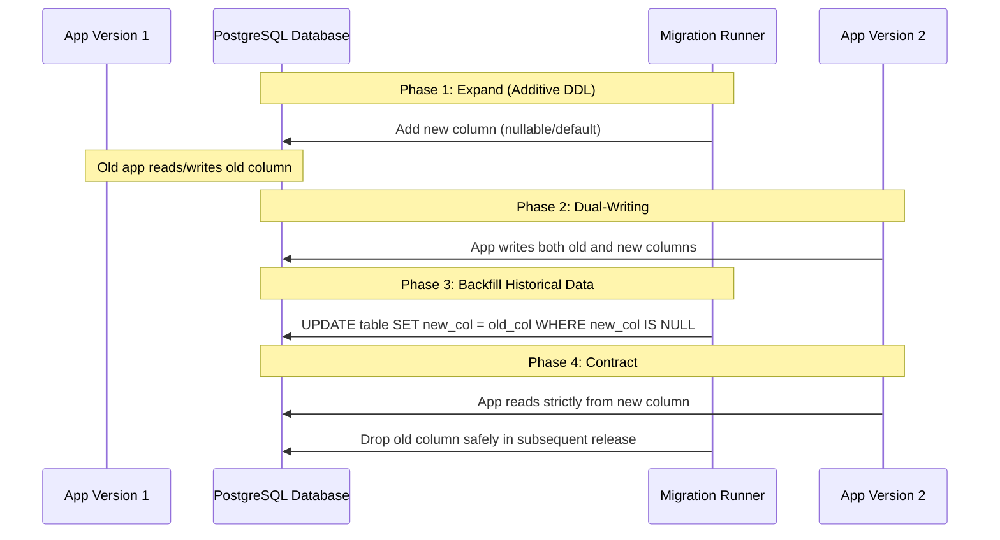

# Database Migration Safety & Zero-Downtime Governance

## 1. Purpose & Non-Negotiable Invariants
The **Database Migration Safety** skill protects persistent production data against accidental loss, schema lockups, and breaking API transitions during deployments.

### Non-Negotiable Migration Invariants:
1. **Never drop, truncate, or recreate a table as a shortcut**: All schema evolutions must be additive or staged safely across deployments.
2. **Never execute destructive DDL directly in production without a verified rollback plan**: Renaming columns, dropping columns, or changing column types abruptly will crash running application replicas.
3. **Always use transactions for DDL where supported**: Ensure migrations fail atomically without leaving half-applied schema state.

---

## 2. Zero-Downtime Migration Patterns (Expand / Contract)

When modifying existing columns or breaking structural changes:



---

## 3. Migration Safety Checklist (Preflight & Postflight)

### Preflight DDL Checklist:
- [ ] **Table Lock Assessment**: Does this migration lock a large table? (e.g. `ADD COLUMN ... NOT NULL` without default locks the entire table).
- [ ] **Concurrent Indexing**: Use `CREATE INDEX CONCURRENTLY` in PostgreSQL to prevent read/write locks.
- [ ] **Lock Timeout**: Set strict lock timeout to prevent queueing transactions:
  ```sql
  SET lock_timeout = '3s';
  ```
- [ ] **Idempotency**: Use `IF NOT EXISTS` / `IF EXISTS` where appropriate:
  ```sql
  CREATE TABLE IF NOT EXISTS ...
  ALTER TABLE ... ADD COLUMN IF NOT EXISTS ...
  ```

### Rollback & Verification Protocol:
- [ ] Every forward migration must have a paired rollback verification script or documented recovery boundary.
- [ ] Test the forward migration on an isolated staging clone before production.
- [ ] Verify that existing application code operates cleanly when connected to the migrated schema.
- [ ] Never claim a migration is production-ready if it has only been inspected visually.
