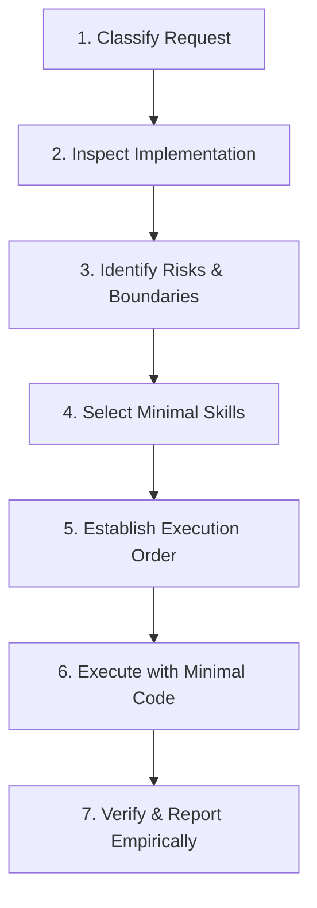

# Engineering Skill Router

## 1. Purpose & Core Identity
The **Engineering Skill Router** is the master decision engine that governs AI coding agent behavior. It prevents agents from acting as naive code generators that blindly create new files, duplicate existing logic, or introduce unnecessary dependencies. Instead, it guides the agent through disciplined, senior-architect workflows: **Inspect $\rightarrow$ Reuse $\rightarrow$ Minimize $\rightarrow$ Verify**.

---

## 2. Seven-Step Engineering Execution Workflow

Every non-trivial engineering task MUST follow this sequential lifecycle:

### Step 1: Classify the Request
Categorize the incoming request into one or more primary categories:
- **Bug Fix**: Unexpected runtime error, logic failure, regression, edge-case defect.
- **New Feature**: Functional capability addition requested by product requirements.
- **Refactoring**: Code restructuring, dead-code removal, abstraction consolidation without changing behavior.
- **Performance Optimization**: Latency reduction, throughput improvement, bundle size shrinkage, query tuning.
- **Database Evolution**: Schema changes, new fields/tables, migration scripts, connection pool tuning.
- **Security & Authorization**: Permission checks, tenant boundary isolation, credential sanitization, OWASP mitigations.
- **Integration**: External webhooks, third-party REST/GraphQL/WebRTC services, message queues, scheduled jobs.
- **Frontend / UI**: UI components, visual branding, accessibility (WCAG), responsive layouts.
- **DevOps & Infrastructure**: Docker, Nginx, CI/CD pipelines, container orchestration, environment configs.
- **Skill Ecosystem**: Skill discovery, auditing, routing updates, test harness validation.

### Step 2: Inspect the Relevant Implementation (Rule 1)
Before proposing or editing a single line of code:
1. Locate existing application entry points and architectural boundaries.
2. Search for existing implementations of the requested functionality (`grep_search`, `view_file`).
3. Identify existing database tables, ORM models, migration history, and API contracts.
4. Review existing unit and integration test fixtures (`vitest`, `playwright`).
5. Review active project instructions (`AGENTS.md`) and design tokens.
*Invariant:* Never assume a feature or utility is absent simply because it was not in the immediate file.

### Step 3: Identify Risks & Execution Boundaries
Evaluate potential failure modes:
- **Data Loss / Schema Drift**: Will DDL lock production tables or drop populated columns?
- **Breaking API Contracts**: Will request/response payload changes break external consumers or frontend pages?
- **Tenant Isolation Regressions**: Could a query or mutation bleed cross-tenant data?
- **Concurrency & Replay**: Are authorization tokens, payment webhooks, or exam submissions vulnerable to replay?
- **Performance Regressions**: Does a new query introduce N+1 database roundtrips or client re-renders?

### Step 4: Select Skills Using Minimal Sufficient Selection
Select only the skills strictly required for the verified scope:
- **Layer A**: Foundational Instructions (Always active via `AGENTS.md`).
- **Layer B**: The Primary Task Skill (e.g., `database-architecture`, `systematic-debugging`).
- **Layer C**: Necessary Supporting Skills (e.g., `testing-and-verification`, `security-and-multitenancy`).
*Anti-Pattern:* Never activate every specialist skill simultaneously. A CSS fix does NOT require a database architect skill.

### Step 5: Establish Strict Execution Order
Respect operational dependencies:
1. Run inspection before designing a schema or refactoring code.
2. Measure baseline metrics before applying performance optimizations.
3. Apply migration safety checks before running migration DDL.
4. Execute unit/integration verification only after implementation changes are staged.

### Step 6: Execute with Minimal Sufficient Code (Rule 2 & 3)
- Prefer using existing functionality unchanged.
- If insufficient, extend existing modules rather than building parallel abstractions.
- Keep changes localized, readable, strictly type-safe, and backward-compatible.

### Step 7: Verify and Report Empirically (Rule 8)
- Execute verifiable automated test runners (`npm test`, `npx vitest run`, `npx tsc --noEmit`).
- Report real pass/fail totals, exact files modified, and what was reused.
- Disclose any unexecuted tests or environment-limited validations openly.

---

## 3. Skill Routing Matrix

| Request Type | Primary Specialist | Supporting / Conditional Skills | Mandatory Verification |
| :--- | :--- | :--- | :--- |
| **Simple Text or Styling Edit** | `repository-investigator` | `frontend-design-system` | Build compilation (`npm run build`), responsive layout review |
| **New PDF / Document Export** | `repository-investigator` `reuse-before-rebuild` | `minimal-implementation-architect` | Generated file integrity, user download flow test |
| **Database Field Addition** | `database-architecture` `database-migration-safety` | `postgresql-and-supabase` | Migration execution, model serialization, backward compatibility |
| **Database Connection Failure** | `systematic-debugging` | `database-connection-reliability` | Connection recovery, pool exhaustion test, zero leak validation |
| **Slow API / Endpoint Latency** | `performance-engineering` | `database-architecture` `systematic-debugging` | Baseline vs. optimized p95 latency benchmark, regression tests |
| **React Rendering / State Issue**| `repository-investigator` | `react-development` `systematic-debugging` | Render count check, component unit test, user interaction test |
| **New SaaS / Multi-Tenant Module**| `minimal-implementation-architect`| `saas-multi-tenant-architecture` `security-and-multitenancy` | Cross-tenant data isolation test, RLS assertion, full E2E flow |
| **Tenant-Specific Feature** | `repository-investigator` | `security-and-multitenancy` | Multi-tenant boundary tests, tenant-scoped unique constraints |
| **External API / Webhook** | `api-design-and-security` | `background-jobs-and-queues` | Idempotency replay test, signature verification, timeout handling |
| **Code Refactoring** | `no-duplicator` `reuse-before-rebuild` | `clean-architecture` `dead-code-and-static-analysis` | 100% regression test pass (`vitest`), zero behavior change |
| **Security / Auth Review** | `security-audit` `security-and-multitenancy` | `api-design-and-security` | OWASP ASVS verification, secret exposure scan, negative auth tests |
| **Production Incident Triage** | `systematic-debugging` | `database-connection-reliability` | Root cause reproduction, minimal safe patch, regression test |
| **Database Query Optimization**| `performance-engineering` | `database-architecture` | `EXPLAIN ANALYZE` query plan check, index selectivity verify |
| **Deployment & Release Gate** | `zealosh-production-readiness` | `devops-and-docker-deploy` | Clean build, zero TypeScript errors, healthcheck probe pass |
| **Skill Ecosystem Governance** | `engineering-skill-router` | `skill-execution-auditor` | Skill discovery audit, routing test suite pass |

---

## 4. Conflict Resolution Hierarchy

When instructions between multiple skills or tools appear to conflict, resolve them using this strict priority order:

1. **Platform Requirements & Safety Policies**: Sandboxing rules, tool constraints, file system preservation policies.
2. **Explicit Operator / User Instructions**: Direct parameters and constraints stated by the operator.
3. **Security, Tenant Isolation & Data Integrity**: Never sacrifice row-level security or connection safety for convenience.
4. **Correctness & Architectural Contracts**: Public API schemas, existing database constraints, interface contracts.
5. **Backward Compatibility & Reliability**: Existing client support, migration non-destructiveness.
6. **Evidence-Based Performance**: Measurable latency or memory improvements backed by profiling.
7. **Minimal Implementation & Code Quality**: Clean, concise, minimal code without unnecessary layers.
8. **Stylistic Preference**: Syntactic sugar, formatting conventions, minor naming choices.

---

## 5. Router Anti-Patterns & Prohibitions

- **DO NOT** activate all 50+ skills for every prompt.
- **DO NOT** claim a skill was invoked if its runbook instructions were not followed.
- **DO NOT** invent non-existent file paths or command line flags.
- **DO NOT** run concurrent conflicting code rewrites in parallel.
- **DO NOT** generate redundant documentation for trivial one-line fixes.
- **DO NOT** bypass automated testing before claiming task completion.
