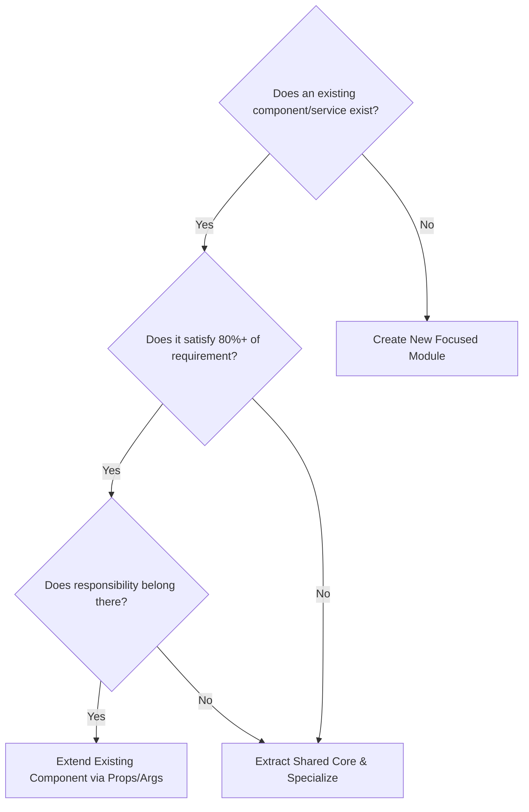

# Reuse Before Rebuild

## 1. Purpose
The **Reuse Before Rebuild** skill guides the engineer to leverage existing architectural assets rather than building parallel or competing solutions. It enforces consistency across the codebase and prevents fragmentation of business logic.

---

## 2. The 6-Tier Reuse Inventory

Before writing new code, actively inspect each of these tiers:

| Asset Tier | Inspection Target | Questions to Answer |
| :--- | :--- | :--- |
| **1. UI & Visual Components** | `src/components/`, `src/app/globals.css` | Does a modal, button, card, table, or form field already exist that can be reused with props? |
| **2. Domain Business Services**| `src/lib/services/`, `src/lib/store/` | Does an existing service handle this domain logic (e.g. enrollment, grading, invoicing)? |
| **3. Shared Utilities** | `src/lib/utils/`, `src/lib/auth/` | Does a helper for formatting currency, hashing secrets, parsing dates, or validating tokens exist? |
| **4. Database Entities** | `src/lib/store/db.ts`, migrations | Does an existing database table already hold this entity or have an extensible schema? |
| **5. Integration Adapters** | `src/lib/adapters/` | Is there an existing adapter client for external APIs (e.g. Moodle, BigBlueButton, Razorpay)? |
| **6. Test Helpers & Fixtures** | `tests/`, test utilities | Are there seeded users, mock requests, or test fixtures that can be reused directly? |

---

## 3. Decision Matrix: Reuse vs. New Implementation

### When to Extend Existing:
- The new requirement is an enhancement or edge case of the same domain concept.
- Adding an optional prop or parameter does not violate Single Responsibility.
- The change benefits other call sites without regressions.

### When to Create a New Module:
- The responsibility is genuinely separate (e.g., Live Video Streaming vs. Static Document Storage).
- Extending the existing component would require deeply nested conditionals or bloated prop interfaces.
- The operational blast radius or security privileges differ significantly.

---

## 4. Anti-Patterns to Prevent
- **Parallel Client Implementations**: Creating `customFetch()` when an authenticated API client is already standardized.
- **Duplicate Database Clients**: Creating a new `createClient()` pool when the singleton `supabase-adapter` is already established.
- **Redundant Utility Sprawl**: Writing a new date formatter in a page file when `formatDate()` is already available in shared utilities.
