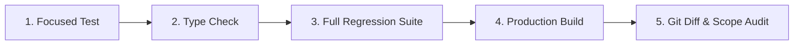

# Testing and Independent Verification

## 1. Core Principle: Verification Before Completion
The **Testing and Verification** skill establishes that code is never considered complete based on visual inspection or hopeful assumptions. Every meaningful code modification must be verified using verifiable automated test runners and empirical evidence.

---

## 2. The 5-Stage Verification Pipeline

Before claiming task completion, execute the following 5 stages:



### Stage 1: Focused Unit / Integration Testing
- Run test files directly covering the modified behavior:
  ```bash
  npx vitest run tests/[target-feature].test.ts
  ```
- Verify both positive (happy path) and negative (error handling, boundary limits) assertions.

### Stage 2: Strict Typechecking
- Run static type analysis with zero allowed errors:
  ```bash
  npx tsc --noEmit
  ```
- Reject unprincipled type casts (`any`, `@ts-ignore`) added merely to silence the compiler.

### Stage 3: Full Regression Suite Execution
- Run the full workspace test suite:
  ```bash
  npm test
  ```
- Verify that no existing functionality, fixtures, or side effects were broken.
- Ensure persistent test files (e.g. `data/zealosh-store.json`) remain unmutated by test suites.

### Stage 4: Production Bundle Compilation
- Verify that Next.js or the application framework compiles without Webpack/Babel/RSC errors:
  ```bash
  npm run build
  ```
- Confirm that route generation (static and dynamic) completes cleanly.

### Stage 5: Final Git Diff & Scope Audit
- Inspect the working copy diff (`git diff --stat`, `git diff --check`).
- Confirm that every touched file was within the authorized task scope.
- Confirm that no temporary debug logs, test passwords, or secrets were committed.

---

## 3. Independent Claim Auditing Rules

- **Zero Fake Claims**: Never claim a test passed without running it and capturing actual runner output.
- **Disclose Limitations**: If an environment cannot run browser tests (e.g. missing headless browser dependencies) or cannot connect to a remote database, state clearly that the check remains **UNVERIFIED**.
- **No Test Suppressions**: Never delete or comment out a failing test to achieve a green result. Fix the underlying root cause.
