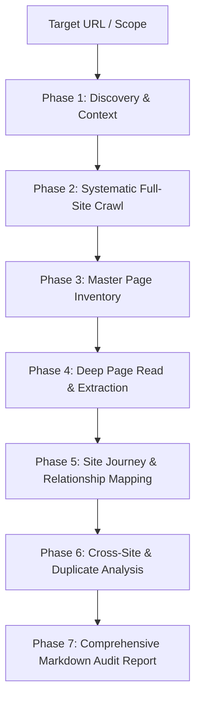

# Website Page Reader, Summarizer & Full Site Audit Engine

A comprehensive, production-grade website analysis engine combining deep page reading, structural extraction, plain-language summarization, UX evaluation, conversion analysis, technical QA, and actionable recommendations across every page of a web product.

---

## Operational Mandates

1. **Read-Only by Default**:
   - The default mode is **READ, ANALYZE, SUMMARIZE, AUDIT, REPORT**.
   - Do NOT modify website source code or database records unless explicitly instructed by the user (e.g. "fix this issue", "implement these recommendations").
2. **Read the Entire Page (No Skimming)**:
   - Inspect all visible copy, headings, subheadings, body paragraphs, navigation links, buttons, form fields, modal triggers, accordions, tabs, carousels, image alt texts, headers, footers, and structured data.
3. **Prove, Don't Assert**:
   - Provide concrete evidence for every finding (exact URL, element selector/text snippet, observed behavior, measured metric).
   - If an item cannot be verified directly, write: `NOT VERIFIED`. Never invent scores or metrics.
4. **Summary First**:
   - Provide a 2–5 sentence plain-language summary for every discovered page explaining what the page does and why it exists before detailing technical parameters.

---

## End-to-End Audit Workflow



---

## Phase 1: Discovery & Context Gathering

Before initiating crawling, confirm or elicit essential context:
1. **Target URL / Scope**: Primary domain, starting route, or local dev port (`http://localhost:3000`).
2. **Product / Business Identity**: What the website offers, sells, or solves.
3. **Target Audience**: Primary user personas (first-time visitors, returning shoppers, B2B buyers, internal staff).
4. **Primary Conversion Goals**: Desired user outcomes (checkout purchase, lead form submission, account creation, contact inquiry).
5. **Brand Tone & Language**: Expected positioning (luxury, playful, technical, direct) and dialect (US vs UK English, PT-BR vs PT-PT).

*Note: If context is already provided in the prompt, proceed immediately without redundant questioning.*

---

## Phase 2: Systematic Full-Site Crawl

Systematically crawl internal routes using available tooling (`browser_subagent`, `read_url_content`, or local Next.js/SSR route exploration):

### Crawl Order
1. **Homepage / Root (`/`)**
2. **Primary Navigation Pages**: Main header categories, collections, services, features, about.
3. **Footer Pages**: Policies, terms of service, privacy, shipping, refund, FAQs, contact.
4. **Catalog & Product Pages**: Category catalog views, top-selling product detail pages, variant selectors.
5. **Conversion Funnel Pages**: Cart, mini-cart drawer, checkout steps, order confirmation / receipt.
6. **User Account Pages**: Login, registration, profile, order history, address book (where accessible).
7. **Marketing & Landing Pages**: Campaign landing pages, seasonal promos, blog posts.
8. **Discovered Routes & Utility Endpoints**: Search results, 404 error page, sitemap.xml, robots.txt.

### Crawl Boundaries
- Crawl **internal domains only**. Do not crawl external third-party links unless explicitly requested.
- Respect authentication boundaries; audit authenticated dashboards only with legitimate credentials.

---

## Phase 3: Master Page Inventory

Compile an initial structured table of all discovered routes:

| # | URL | Page Type | Purpose | HTTP Status | Priority |
|---|-----|-----------|---------|-------------|----------|
| 1 | `/` | Homepage | Brand introduction & product discovery | 200 | 🔴 Critical |
| 2 | `/cakes` | Category | Category product catalog & filtering | 200 | 🟡 High |
| 3 | `/products/truffle` | Product Detail | Variant selection & Add-to-Cart | 200 | 🔴 Critical |
| 4 | `/cart` | Cart | Order review & checkout initiation | 200 | 🔴 Critical |
| 5 | `/checkout` | Checkout | Address, delivery slot & payment | 200 | 🔴 Critical |
| 6 | `/about-us` | Content | Brand credibility & company story | 200 | 🔵 Medium |
| 7 | `/terms` | Legal | Legal terms & conditions | 200 | 🟢 Low |

---

## Phase 4: Deep Page-by-Page Extraction & Analysis

For **EVERY** discovered page, extract and document the following structured sections:

```markdown
### Page [Number] — [Page Title / URL]

**PAGE:** [Page Name]
**URL:** [Full URL or Relative Path]
**HTTP STATUS:** [200 / 301 / 404 / 500]

#### PAGE SUMMARY
[2–5 sentence plain-language explanation of what this page does, why it exists, and what value it provides to the user and business.]

#### PAGE PURPOSE
[Primary business goal and user objective for this page.]

#### TARGET USER
[Who this page is intended for — first-time visitors, returning customers, wholesale buyers, admins, etc.]

#### PAGE TYPE
[Homepage | Landing Page | Category / Catalog | Product Detail | Cart | Checkout | Account / Profile | Dashboard | Content / Blog | Legal / Terms | Support / Help]

#### CONTENT STRUCTURE
1. **[Section 1 Name]** — [Brief description of content & intent]
2. **[Section 2 Name]** — [Brief description of content & intent]
3. **[Section 3 Name]** — [Brief description of content & intent]

#### VISIBLE CONTENT
- **Headings:**
  - H1: "[Exact H1 text]"
  - H2: "[Exact H2 text]"
- **Body & Value Prop:** [Summary of main body copy, key claims, features]
- **Key Messages & Banners:** [Promotional banners, trust badges, alert notices]
- **Labels & Microcopy:** [Input placeholders, helper text, badges]

#### CALLS TO ACTION (CTAs)
- **Primary CTA:** "[Button text]" -> `[Destination URL]` ([Visual emphasis / placement])
- **Secondary CTA:** "[Button text]" -> `[Destination URL]`

#### USER JOURNEY & FLOW
- **Entry Points:** [How users land on this page]
- **What the Page Asks the User to Do:** [Next logical action]
- **Exit Paths:** [Where users navigate next upon completion or drop-off]

#### NAVIGATION & LINKS
- **Internal Links (In):** [Pages linking to this URL]
- **Internal Links (Out):** [Pages this URL links out to]
- **External Links:** [Outbound external links, social links]

#### INTERACTIVE ELEMENTS
- **Forms & Inputs:** [Form fields, required validations, submit triggers]
- **Buttons & Toggles:** [Filter pills, weight/variant selectors, quantity steppers]
- **Dynamic Widgets:** [Accordions, Carousels, Tabs, Modals, Search autocomplete]

#### IMAGES & MEDIA
- **Hero / Banner Media:** [Image / Video URL, visual description]
- **Alt Text Assessment:** [Present / Missing / Generic / Descriptive]

#### SEO & TECHNICAL STRUCTURE
- **Title Tag:** `[Exact <title> tag]`
- **Meta Description:** `[Exact meta description]`
- **Heading Hierarchy:** [Valid single H1 / Nested correctly / Skipped levels]
- **Canonical Tag:** `[Canonical URL]`
- **Robots / Indexability:** `[index, follow / noindex]`
- **Structured Data (JSON-LD):** [Product / Organization / BreadcrumbList / None]

#### UX ASSESSMENT
- **Strengths:** [What works well, intuitive layouts, crisp hierarchy]
- **Friction & Usability Gaps:** [Confusing layouts, cognitive overload, cluttered sections]
- **Missing Information:** [Unanswered user questions, missing specifications]

#### CONVERSION & PERSUASION
- **Conversion Drivers:** [Strong social proof, clear pricing, clear guarantee]
- **Conversion Blockers:** [Hidden pricing, ambiguous CTAs, missing trust badges]

#### TECHNICAL & ACCESSIBILITY QA
- **Broken Links / 404s:** [None / List of broken links]
- **Staging / Localhost References:** [None / Found occurrences]
- **Accessibility (a11y):** [Contrast, ARIA labels, keyboard focus, screen-reader readiness]

#### PRIORITY & RECOMMENDATIONS
- **Priority Level:** `[🔴 CRITICAL | 🟡 HIGH | 🔵 MEDIUM | 🟢 LOW]`
- **Actionable Recommendations:**
  1. `[Actionable fix 1 with specific before -> after text or layout suggestion]`
  2. `[Actionable fix 2]`
```

---

## Phase 5: Site Journey & Relationship Mapping

Map out user journeys, identifying conversion loops, orphan pages, and dead ends:

```
Homepage (/)
  ├── Primary Navigation
  │     ├── Category Page (/cakes)
  │     │     └── Product Detail Page (/products/chocolate-cake)
  │     │           └── Mini-Cart / Cart (/cart)
  │     │                 └── Checkout (/checkout)
  │     │                       └── Order Confirmation (/order-confirmed)
  │     └── Search Autocomplete (/search?q=...)
  ├── Trust & Company
  │     ├── About Us (/about)
  │     ├── Reviews (/reviews)
  │     └── Contact Us (/contact)
  └── Footer Links
        ├── Privacy Policy (/privacy)
        ├── Terms & Conditions (/terms)
        └── Refund & Cancellation Policy (/refund-policy)
```

### Flow Audit Checks:
- **Orphan Pages**: Pages not reachable through any header navigation, footer, or in-content internal links.
- **Dead Ends**: Pages that provide no forward CTA, back button, or navigation out.
- **Click Depth**: Any critical conversion page requiring $> 3$ clicks from the homepage.

---

## Phase 6: Cross-Site & Duplicate Analysis

### 1. Duplicate Page & URL Detection
- Identify duplicate titles, meta descriptions, or identical content blocks served across different URLs (e.g. `/category` vs `/category/index` vs `/category?sort=default`).
- Identify missing canonical tags causing split search engine authority.

### 2. Content Completeness & Polish
- Flag any `Lorem ipsum`, placeholder copy (`"Title Here"`, `"Coming Soon"` without context), or zeroed test stats (`0%`, `+0`).
- Flag tone contradictions or dialect inconsistencies (e.g. US vs UK spelling).

### 3. E-commerce Specific Checks
- Product page completeness: variant options, delivery estimate, pincode checker, real reviews, ingredients/allergens, return policy, sticky Add-to-Cart.
- Checkout friction: guest checkout availability, payment gateway trust badges, express checkout (UPI/GPay/Apple Pay), inline validation errors.

### 4. Broken Link & Technical QA Sweep
- Scan all internal anchors for HTTP 404 / 500 errors or infinite redirect loops.
- Check for hardcoded `localhost:XXXX`, staging, or development URLs in production hyperlinks.

---

## Phase 7: Final Markdown Audit Report Format

The final deliverable must be structured as follows:

```markdown
# [Site Name] — Comprehensive Website Audit

**Audit Date:** [Date]
**Audited URL:** [Base URL]
**Pages Reviewed:** [Total Count]

---

## 1. Executive Summary
[3–5 sentence executive overview of the website's purpose, operational strengths, conversion hurdles, and immediate technical risks.]

## 2. Website Overview & Core Business Architecture
- **Business Model & Value Proposition:** ...
- **Target Audience & Buyer Personas:** ...
- **Core Conversion Goals:** ...
- **Overall UX & Technical State:** ...

## 3. Top 10 High-Impact Issues (Ordered by Severity)
1. `[🔴 CRITICAL]` **[Issue Title]** — [Impact & recommended immediate fix]
2. `[🔴 CRITICAL]` ...

## 4. Master Page Inventory
| # | URL | Page Type | Purpose | Status | Priority |
|---|-----|-----------|---------|--------|----------|
| 1 | ... | ...       | ...     | ...    | ...      |

## 5. User Journey & Relationship Map
[Mermaid or ASCII flow diagram of site navigation, purchase loops, and drop-off risks]

## 6. Page-by-Page Detailed Analysis
[Complete Page-by-Page breakdowns adhering strictly to Phase 4 format]

## 7. Cross-Site Content & Brand Findings
- **Placeholder / Test Data Detected:** ...
- **Copywriting & Voice Consistency:** ...
- **Duplicate Pages / Split URLs:** ...

## 8. Technical, SEO & Broken Link Audit
- **Broken Links & 404 Log:** ...
- **SEO & Structured Data Gaps:** ...
- **Performance & Asset Observations:** ...
- **Accessibility (a11y) Findings:** ...

## 9. Prioritized Action Plan
| Priority | Page / Area | Finding / Gap | Concrete Action | Business Impact |
|----------|-------------|---------------|-----------------|-----------------|
| 🔴 Critical | Checkout | ... | ... | Revenue Protection |
| 🟡 High | Product Detail | ... | ... | Conversion Lift |
| 🔵 Medium | Category | ... | ... | Search Visibility |
| 🟢 Low | Footer | ... | ... | Brand Trust |

## 10. Final Assessment & Next Steps
[Concluding guidance for the engineering and marketing teams.]
```

---

## Supporting References
- [Checklist Reference](references/checklist.md) — Comprehensive itemized checklist for copy, UX, conversion, technical QA, and dialect rules.
- [Page Extraction Template](references/page-template.md) — Standard schema for recording per-page findings.
