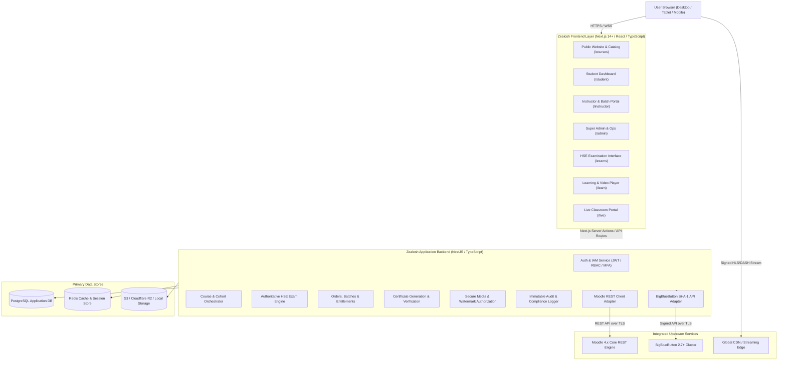

# Zealosh LMS — Master Architecture Specification

**Document Version:** 1.0.0  
**Status:** Architectural Blueprint Baseline  
**Target Brand:** Zealosh Training & Consultants

---

## 1. Architectural Philosophy & Principles

1. **Unified Brand Experience:** The user interacts exclusively with **Zealosh Training & Consultants**. The presence of third-party engines (Moodle, BigBlueButton) is entirely invisible and abstract.
2. **Domain & Route Consolidation:** All traffic operates under one canonical domain (e.g., `lms.zealosh.com` or `zealosh.com`), routing through Next.js for SSR/SSG/SPA experiences and NestJS for business orchestration.
3. **Decoupled Engine Authority:** 
   - Application-owned records (Users, Organizations, Batches, Entitlements, Exams, Orders, Certificates, Audit Logs) reside in PostgreSQL.
   - Learning engine records (Moodle Course Modules, SCORM packages) are governed by Moodle via API.
   - Live conferences (Rooms, Audio/Video, WebRTC streams) are governed by BigBlueButton via API.
4. **Resilience & Fault Isolation:** If Moodle or BigBlueButton experiences downtime or latency, the Zealosh portal, course catalog, mock examination engine, student dashboard, and recorded video delivery remain fully functional.

---

## 2. System Architecture Diagram

---

## 3. Unified Routing Structure

All paths map to distinct, role-secured surfaces:

| Route Path | Access Level | Description |
| :--- | :--- | :--- |
| `/` | Public | Zealosh homepage, value proposition, HSE certification pathways. |
| `/courses` | Public | Course catalog with filters (ASP, CSP, CRSP, CIT, NEBOSH, Delivery Mode). |
| `/courses/[slug]` | Public | Course syllabus, instructor profiles, upcoming batch schedules, enrollment CTA. |
| `/login`, `/register` | Public / Guest | Branded authentication, SSO account linking, password reset. |
| `/student` | Student | Primary student hub: enrolled courses, continue learning, upcoming live sessions, recent exam scores. |
| `/learn/[courseId]` | Enrolled Student | Lesson player: video streaming with dynamic student watermarking, notes, downloadable quick cards. |
| `/exams` | Enrolled Student | HSE Certification Examination Engine: topic practice, timed mock exams, weak area revision. |
| `/exams/[examId]` | Enrolled Student | Secure exam attempt screen: server-enforced countdown timer, question navigator, auto-save. |
| `/exams/[examId]/review` | Enrolled Student | Exam results breakdown, domain blueprint scoring, detailed explanations. |
| `/live/[sessionId]` | Authorized Attendee | Single-click entry to BigBlueButton live classroom via server-generated signed credentials. |
| `/certificates` | Student / Public | Certificate gallery and public verification route (`/certificates/verify/[uuid]`). |
| `/instructor` | Instructor / Tutor | Batch management, student rosters, session scheduling, assignment grading. |
| `/admin` | Super Admin / Org Admin | Platform management, batch creation, course pricing, question bank editor, audit logs. |

---

## 4. Multi-Instructor & Cohort Delivery Architecture

Zealosh provides four distinct delivery models without duplicating course logic:
1. **Recorded (Self-Paced):** Pre-recorded video modules, segmented chapters, interactive quizzes, progress tracking.
2. **Live-Only:** Scheduled interactive Zoom/BigBlueButton sessions, batch attendance tracking, tutor interaction.
3. **Hybrid:** Integrated blend of on-demand recorded theory, scheduled live coaching/problem-solving sessions, and homework.
4. **Materials-Only (Quick Cards & Notes):** Specialized study aids, downloadable PDFs, formula sheets, high-yield summary cards.

Each course cohort belongs to a **Batch** with assigned Lead Instructor, Co-Instructors, start/end dates, enrollment capacity, and dedicated communication stream.
