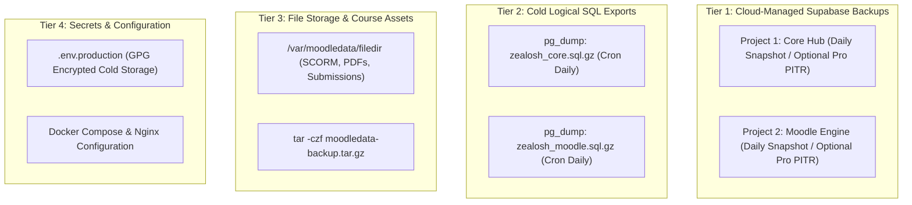

# Zealosh LMS — Authoritative Backup, Disaster Recovery & Restore Runbook

**Document Version:** 1.0.0 (Production Disaster Recovery Specification)  
**Date:** October 25, 2026  
**Status:** **AUTHORITATIVE RECOVERY SPECIFICATION (PREPARED / DRILL PENDING STAGING)**  
**Target Systems:** Supabase Project 1 (Core Hub), Supabase Project 2 (Moodle), `moodledata` Volume, Platform Secrets  

---

## 1. Architectural Backup Tiers & Decoupled Scopes

To avoid catastrophic cascading failures, the Zealosh platform isolates backup lifecycles into four distinct operational tiers:



### Critical Separation of Capabilities:
1. **Supabase-Managed Backups vs. Local Physical Control:**
   - Supabase handles physical disk replication and daily automated snapshots at the cloud infrastructure layer.
   - **Point-in-Time Recovery (PITR):** PITR is a paid add-on on Supabase Pro/Team plans. It is **NOT** assumed to be active on Free/Micro tiers unless verified in the active billing dashboard.
   - Operators must not claim access to physical WAL-G recovery tools inside Supabase managed containers; recovery is initiated through the Supabase Dashboard or API.
2. **Logical Database Backups (`pg_dump`):**
   - Independent of Supabase cloud state. Produces portable, non-destructive SQL dumps that can be restored into any standard PostgreSQL 17 instance.
3. **Moodle Persistent Files (`moodledata`):**
   - Moodle stores database pointers in `mdl_files`, but actual file blobs reside on disk at `/var/moodledata/filedir/`.
   - **A database restore without a corresponding `moodledata` snapshot causes orphaned file errors.** Both must be backed up concurrently.

---

## 2. Executable Backup Automation Procedures

### Procedure A: Logical Export of Supabase Project 1 (Core Hub)
```bash
#!/usr/bin/env bash
# Run on backup host or automated cron server
set -euo pipefail
BACKUP_DIR="/opt/zealosh/backups/$(date +%Y%m%d_%H%M%S)"
mkdir -p "$BACKUP_DIR"

echo "=== [1/3] Exporting Core Hub Supabase Database ==="
# Export public schema and authoritative domain tables
PGPASSWORD="${SUPABASE_PROJECT_1_DB_PASSWORD}" pg_dump \
    -h "aws-0-ap-south-1.pooler.supabase.com" \
    -p 5432 \
    -U "postgres.${SUPABASE_PROJECT_1_REF}" \
    -d postgres \
    --schema=public \
    --no-owner \
    --no-privileges \
    --format=custom \
    --file="$BACKUP_DIR/zealosh_core_hub.dump"

echo "Core Hub logical dump completed: $BACKUP_DIR/zealosh_core_hub.dump"
```

### Procedure B: Logical Export of Supabase Project 2 (Moodle Learning Engine)
```bash
echo "=== [2/3] Exporting Moodle Engine Supabase Database ==="
# Export Moodle mdl_* tables via Supavisor Session Pooler (Port 5432)
PGPASSWORD="${MOODLE_DATABASE_PASSWORD}" pg_dump \
    -h "${MOODLE_DATABASE_HOST}" \
    -p "${MOODLE_DATABASE_PORT:-5432}" \
    -U "${MOODLE_DATABASE_USER}" \
    -d "${MOODLE_DATABASE_NAME:-postgres}" \
    --no-owner \
    --no-privileges \
    --format=custom \
    --file="$BACKUP_DIR/zealosh_moodle_engine.dump"

echo "Moodle Engine logical dump completed: $BACKUP_DIR/zealosh_moodle_engine.dump"
```

### Procedure C: Moodle Persistent File Storage (`moodledata`)
```bash
echo "=== [3/3] Archiving Moodle Persistent File Assets ==="
# Archive moodledata excluding transient cache directories
docker run --rm \
    -v moodledata_data:/var/moodledata:ro \
    -v "$BACKUP_DIR":/backup \
    alpine tar -czf /backup/moodledata_assets.tar.gz \
    --exclude="cache" \
    --exclude="localcache" \
    --exclude="temp" \
    --exclude="trashdir" \
    -C /var/moodledata .

echo "Moodledata archive created: $BACKUP_DIR/moodledata_assets.tar.gz"
```

---

## 3. Non-Destructive Restore Drill Procedure (Staging Verification)

> [!CAUTION]
> **Safety Invariant:** Never execute a restore drill directly into a production database. Always restore into a disposable target database (`zealosh_drill_target`) to verify data consistency before touching production.

### Step-by-Step Restore Verification Protocol:

1. **Provision Disposable Drill Target:**
   ```bash
   # On testing PostgreSQL 17 server:
   psql -U postgres -c "DROP DATABASE IF EXISTS zealosh_moodle_drill;"
   psql -U postgres -c "CREATE DATABASE zealosh_moodle_drill;"
   ```

2. **Restore Logical Dump into Drill Target:**
   ```bash
   pg_restore \
       -h localhost \
       -p 5432 \
       -U postgres \
       -d zealosh_moodle_drill \
       --clean \
       --if-exists \
       "$BACKUP_DIR/zealosh_moodle_engine.dump"
   ```

3. **Validate Database Integrity & Row Count Invariants:**
   ```sql
   -- Verify core Moodle tables exist and contain records
   SELECT count(*) FROM mdl_course;
   SELECT count(*) FROM mdl_user;
   SELECT count(*) FROM mdl_modules;
   SELECT name, value FROM mdl_config WHERE name IN ('version', 'release');
   ```

4. **Verify File Asset Integrity (`moodledata` Check):**
   ```bash
   # Extract backup into a temporary verification directory
   mkdir -p /tmp/moodledata_drill
   tar -xzf "$BACKUP_DIR/moodledata_assets.tar.gz" -C /tmp/moodledata_drill
   
   # Confirm filedir contains contenthash-addressed blobs matching mdl_files
   ls -la /tmp/moodledata_drill/filedir/
   ```

5. **Disaster Recovery Sign-Off Criteria:**
   - [ ] All `mdl_*` tables restored without unhandled constraint violations.
   - [ ] Moodle version in `mdl_config` matches code base version (`5.3.0 LTS`).
   - [ ] Test student accounts and course modules retrieve accurately.
   - [ ] Zero records or schemas leaked into Core Hub database.

---

## 4. Safe Schema Recovery & Preflight Gate Protocol

> [!CAUTION]
> **Anti-Destruction Standard:** Routine execution of `DROP SCHEMA public CASCADE; CREATE SCHEMA public;` is strictly prohibited across all environments. Blanket cascading schema drops destroy database extensions (e.g. `pgcrypto`, `uuid-ossp`), alter default schema permissions, and risk irreversible destruction if executed against the wrong project.

### Authoritative 6-Step Safe Recovery Procedure:
When Moodle container preflight halts in `PARTIAL_OR_UNEXPECTED` state:
1. **Stop Affected Service:** Immediately halt the Moodle service to prevent partial writes:
   ```bash
   docker compose stop zealosh-moodle
   ```
2. **Confirm Target Database & Prefix:**
   Verify `MOODLE_DATABASE_HOST` is Supabase Project 2 (Moodle), not Project 1 (Core Hub). Confirm `MOODLE_DATABASE_PREFIX` matches the expected value (`mdl_`).
3. **Capture Snapshot / Cold Backup:**
   Execute a logical export of existing state before making any modifications:
   ```bash
   PGPASSWORD="$MOODLE_DATABASE_PASSWORD" pg_dump -h "$MOODLE_DATABASE_HOST" -p 5432 -U "$MOODLE_DATABASE_USER" -d postgres --format=custom --file="/opt/zealosh/backups/pre_recovery_$(date +%Y%m%d_%H%M%S).dump"
   ```
4. **Identify Affected Objects Non-Destructively:**
   Inspect objects using non-modifying catalog queries:
   ```sql
   SELECT table_name FROM information_schema.tables WHERE table_schema = 'public' ORDER BY table_name;
   ```
5. **Prefer Disposable Restores or Test Projects:**
   If a fresh database state is needed, restore into a disposable target or provision a dedicated test project in Supabase rather than executing manual schema drops.
6. **Explicit Operator Authorization for Cleanup:**
   If destructive table drops (`DROP TABLE mdl_...`) are necessary to recover from an interrupted installation, they must be executed individually only after operator sign-off, a verified backup, and explicit documentation of the affected objects. Unknown public schema objects must never be deleted.

---

## 5. Current Operational Status & Gate Classification

- **Backup Scripts & Runbook:** **PASS (PREPARED & SYNTAX-CHECKED)**.
- **Physical WAL-G Cloud Snapshot Access:** **NOT TESTED / CLOUD-MANAGED** (Handled natively by Supabase dashboard).
- **Point-in-Time Recovery (PITR):** **NOT TESTED** (Requires confirmation of active billing plan on target project).
- **Staging Restore Drill:** **BLOCKED (INFRASTRUCTURE)** (Pending provisioning of target Linux staging host and disposable test database).
