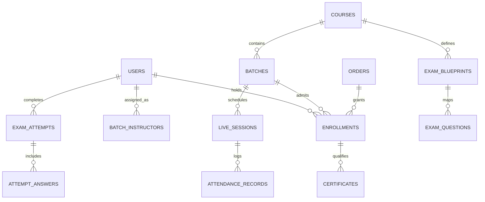

# Zealosh LMS — Data Ownership & Schema Boundary Specification

**Document Version:** 1.0.0  
**Status:** Architectural Authority Baseline  
**Scope:** Application PostgreSQL vs Moodle vs BigBlueButton vs Object Storage.

---

## 1. Data Ownership Matrix

| Business Entity | Authoritative System | Primary Database / Store | Stable Identifier | Access API | Synchronization Flow | Deletion / Archival Policy |
| :--- | :--- | :--- | :--- | :--- | :--- | :--- |
| **User Identity & Roles** | Zealosh Core | PostgreSQL (`users`, `user_roles`) | `UUIDv4` (`user_id`) | NestJS Auth API | Push to Moodle on create; account linking via verified email. | Soft delete (`deleted_at`), cascade to active sessions. |
| **Courses & Offerings** | Zealosh Core | PostgreSQL (`courses`, `course_metadata`) | `UUIDv4` (`course_id`, `slug`) | NestJS Course API | Links to Moodle `course_id` where Moodle module is attached. | Soft archive (`archived_at`); existing enrolled cohorts retain access. |
| **Batches & Cohorts** | Zealosh Core | PostgreSQL (`batches`, `batch_instructors`) | `UUIDv4` (`batch_id`) | NestJS Batch API | Direct relationship in Zealosh; mapped to Moodle course group. | Immutable audit trail. Never physically deleted once active. |
| **Enrollments & Entitlements** | Zealosh Core | PostgreSQL (`enrollments`) | `UUIDv4` (`enrollment_id`) | NestJS Commerce API | Master source of truth. Triggers Moodle user enrolment webhook. | Expiration set by duration; revoked on refund. |
| **HSE Question Bank & Blueprints** | Zealosh Core | PostgreSQL (`exam_questions`, `blueprints`) | `UUIDv4` (`question_id`) | NestJS Exam Service | Native to Zealosh; questions classified by BCSP/BCRSP domains. | Versioned (`version_number`); never update in-place if used in completed exams. |
| **Exam Attempts & Results** | Zealosh Core | PostgreSQL (`exam_attempts`, `attempt_answers`) | `UUIDv4` (`attempt_id`) | NestJS Exam Service | Sealed upon submission. Immutable record of scores & timing. | Retained indefinitely for accreditation and dispute audits. |
| **Live Meeting Rooms** | BigBlueButton | BBB Internal State & Redis | `VARCHAR` (`meeting_id`) | BBB REST API | Zealosh stores metadata (`sessions`); BBB manages real-time state. | Ephemeral meeting state purged post-session; recordings persisted. |
| **Session Attendance** | Zealosh Core | PostgreSQL (`attendance_records`) | `UUIDv4` (`attendance_id`) | NestJS Batch API | Pulled from BBB post-session webhook or polling query. | Permanent record for certificate eligibility validation. |
| **Detailed Moodle Lessons & SCORM** | Moodle Core | Moodle Database (PostgreSQL/MySQL) | `BIGINT` (`moodle_module_id`) | Moodle REST API | Pulled on-demand via REST API; cached in Redis with 15m TTL. | Governed by Moodle course maintenance policy. |
| **Certificates & Verification** | Zealosh Core | PostgreSQL (`certificates`) | `UUIDv4` (`certificate_id`, `verify_code`) | NestJS Cert API | Validated against batch attendance and exam thresholds. | Permanent public verification record; revocation flag supported. |
| **Orders & Payments** | Zealosh Core | PostgreSQL (`orders`, `transactions`) | `UUIDv4` (`order_id`, `payment_ref`) | NestJS Payment API | Webhook ingestion from Razorpay/Stripe with HMAC validation. | Immutable financial records; retained for tax/statutory requirements. |
| **Audit Events** | Zealosh Core | PostgreSQL (`audit_logs`) | `BIGSERIAL` / `UUIDv4` | NestJS Audit Logger | Direct synchronous insert in critical transactions. | Append-only. Write once, read many (WORM). |

---

## 2. Key Foreign-Key Relationships & Integrity Rules

---

## 3. Account-Linking & Identity Resolution Strategy

1. **Email Authority:** Email addresses are the primary global identifier across Zealosh and Moodle.
2. **Account Linking Policy:**
   - When a student registers on Zealosh, their email is normalized (`lowercase`, `trimmed`).
   - If an existing Moodle account exists with that email, the external Moodle ID is linked and stored in `users.external_learning_id`.
   - Accounts are **never** automatically merged across different email addresses without explicit email verification challenge.
   - Instructors have a single unified user record with granular role assignments in `user_roles`.
