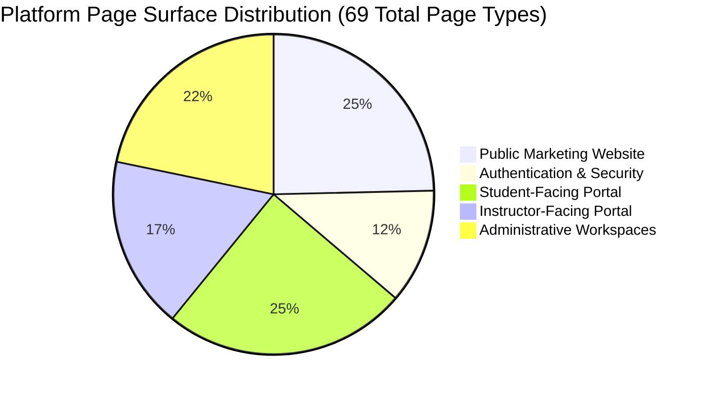
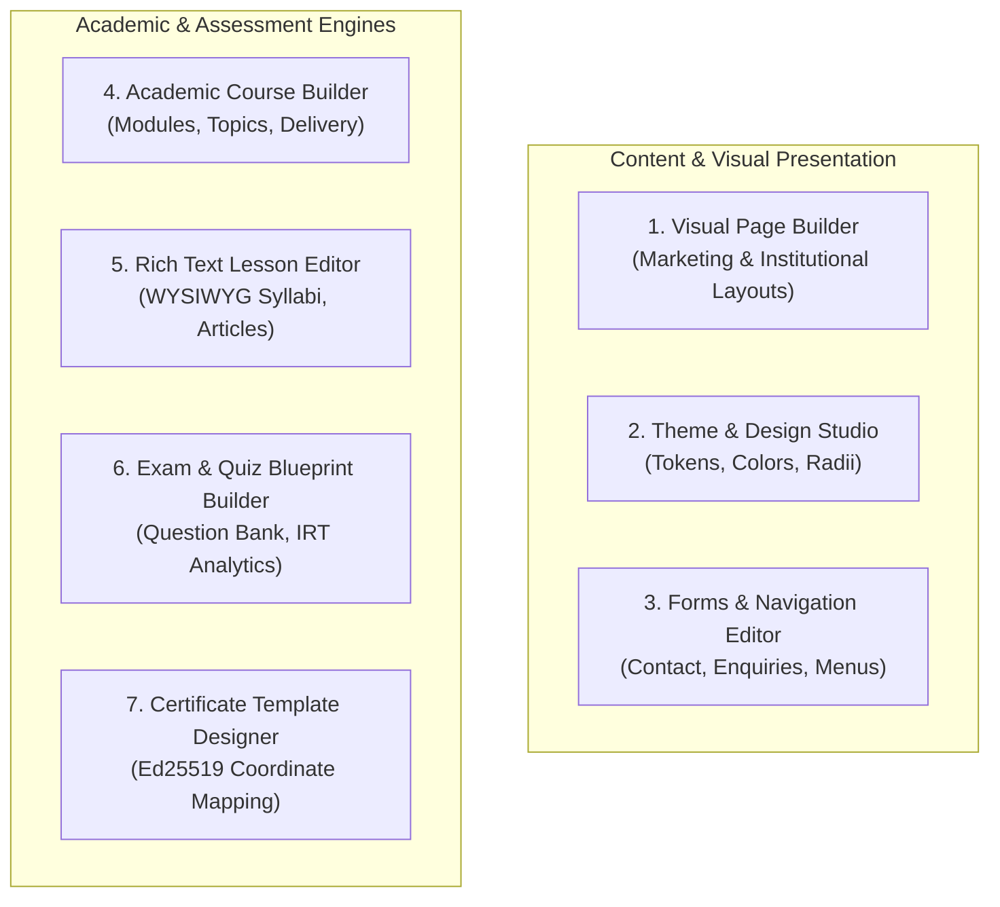

# Zealosh LMS — Comprehensive Editor & Page Type Inventory

**Project:** Zealosh Training & Consultants — Zealosh LMS  
**Institution:** Zealosh Training & Consultants, Kollam, Kerala, India  
**Scope:** Complete Architectural Specification of All 69 Page Types and 7 Specialized Editors  
**Date:** November 10, 2026  
**Status:** APPROVED ARCHITECTURAL INVENTORY  

---

## 1. Master Page Type Inventory (69 Distinct Platform Pages)

The Zealosh platform encompasses 69 distinct page types across five primary functional surfaces:

---

### 1.1 Public Marketing Website Pages (17 Page Types)

| # | Page Type Key | Title / Purpose | Canonical URL | Target Persona | Authoritative Data Sources | Dynamic Bindings | Editor Owning Workspace |
| :---: | :--- | :--- | :--- | :--- | :--- | :--- | :--- |
| **01** | `HOMEPAGE` | Main institutional landing page | `/` | All / Public | `cms_pages`, `branding_theme` | Featured courses, stats, reviews | Visual Page Builder (`WS-02`, `WS-04`) |
| **02** | `ABOUT` | Institutional profile & mission | `/p/about` | Public Visitor | `cms_pages`, `platform_settings`| Accreditation badges, campus photos | Visual Page Builder (`WS-02`, `WS-04`) |
| **03** | `FEATURES` | Platform technological capabilities | `/p/features` | Public Visitor | `cms_pages` | WebRTC demo, PWA features | Visual Page Builder (`WS-02`, `WS-04`) |
| **04** | `SOLUTIONS` | Corporate & enterprise training | `/p/solutions` | Corporate HR | `cms_pages`, `institutional_partners`| Client logos, corporate packages | Visual Page Builder (`WS-02`, `WS-04`) |
| **05** | `PRICING` | Pricing, plans & installment options| `/p/pricing` | Prospective Student| `products`, `product_offerings` | Live course fees, GST rates | Visual Page Builder (`WS-02`, `WS-04`) |
| **06** | `COURSES` | Searchable course directory | `/courses` | Prospective Student| `courses`, `products`, `batches` | Course catalogue, delivery mode filters | Course Explorer / PageBuilder |
| **07** | `COURSE_DETAILS` | Course syllabus, fees & dates | `/courses/[slug]` | Prospective Student| `courses`, `modules`, `batches` | Live syllabus, faculty bio, batch schedule | Dynamic Course Template (`WS-05`) |
| **08** | `INSTRUCTORS` | Institutional faculty directory | `/p/instructors` | Prospective Student| `instructor_profiles`, `users` | Faculty bios, safety certifications | Visual Page Builder (`WS-04`) |
| **09** | `INSTRUCTOR_PROFILE`| Detailed faculty background | `/p/instructors/[id]`| Prospective Student| `instructor_profiles`, `courses` | Faculty reviews, assigned courses | Dynamic Faculty Template (`WS-04`) |
| **10** | `CONTACT` | Campus location, map & enquiry | `/p/contact` | Prospective Student| `cms_pages`, `leads` | Interactive enquiry form | Forms & PageBuilder (`WS-07`) |
| **11** | `FAQ` | Knowledge base & FAQs | `/p/faq` | Prospective Student| `cms_pages` | Accordion questions, Schema.org | Visual Page Builder (`WS-04`) |
| **12** | `BLOG` | Safety industry articles & news | `/p/blog` | Safety Professional| `cms_pages` (type `BLOG`) | Article cards, category filters | Rich Text & PageBuilder (`WS-04`) |
| **13** | `BLOG_DETAILS` | Full article reading view | `/p/blog/[slug]` | Safety Professional| `cms_pages` (type `BLOG_DETAILS`) | Sanitized article HTML, author bio | Rich Text Editor (`WS-04`) |
| **14** | `TESTIMONIALS` | Student reviews & video showcases | `/p/testimonials`| Prospective Student| `student_reviews`, `testimonial_consents`| Verified review cards, poster images | Visual Page Builder (`WS-04`) |
| **15** | `CAREERS` | Faculty & staff recruitment | `/p/careers` | HSE Trainers | `cms_pages` | Job openings, application form | Forms & PageBuilder (`WS-07`) |
| **16** | `PRIVACY_POLICY`| Institutional data governance | `/p/privacy-policy` | All Visitors | `cms_pages` | Static legal text, cookie policy | Rich Text Editor (`WS-04`) |
| **17** | `TERMS` | Terms of service & refund rules | `/p/terms` | All Visitors | `cms_pages` | Statutory exam and fee regulations | Rich Text Editor (`WS-04`) |

---

### 1.2 Authentication & Security Pages (8 Page Types)

| # | Page Type Key | Title / Purpose | Canonical URL | Target Persona | Authoritative Data Sources | Security Features |
| :---: | :--- | :--- | :--- | :--- | :--- | :--- |
| **18** | `AUTH_LOGIN` | Secure portal login | `/login` | All Registered Users | Supabase Auth, `users`, `login_attempts` | 5-attempt lockout, password visibility toggle |
| **19** | `AUTH_REGISTER` | Candidate student registration | `/register` | Prospective Student | Supabase Auth, `profiles` | Password strength meter, email verification dispatch |
| **20** | `AUTH_FORGOT_PW` | Password recovery request | `/auth/forgot-password` | All Users | `email_outbox`, `users` | Rate-limited transactional outbox reset dispatch |
| **21** | `AUTH_RESET_PW` | Password configuration | `/auth/reset-password` | All Users | Supabase GoTrue Auth | Time-bounded secure token verification |
| **22** | `AUTH_VERIFY_EMAIL`| Email confirmation landing | `/auth/verify-email` | New Registrants | `users.email_confirmed_at` | Instant token verification and auto-login |
| **23** | `AUTH_OTP_VERIFY` | One-time passcode challenge | `/auth/verify-otp` | High-Security Action | `user_sessions` | 6-digit OTP verification with countdown timer |
| **24** | `AUTH_INVITE_ACCEPT`| Faculty/Corporate invitation | `/auth/accept-invite` | Invited Staff/Cohort | `users`, `user_roles` | Role pre-assignment and onboarding completion |
| **25** | `AUTH_MFA` | Two-factor authentication prompt | `/auth/mfa-challenge` | Staff / Admin | `user_sessions`, TOTP challenge | QR code verification, fallback emergency codes |

---

### 1.3 Student-Facing Portal Pages (17 Page Types)

| # | Page Type Key | Title / Purpose | Canonical URL | Target Persona | Authoritative Data Sources | Key User Interactions |
| :---: | :--- | :--- | :--- | :--- | :--- | :--- |
| **26** | `STUDENT_DASHBOARD` | Main learning dashboard | `/student` | Enrolled Student | `enrollments`, `courses`, `batches` | Course cards, upcoming live class banners, alerts |
| **27** | `STUDENT_COURSES` | My enrolled courses list | `/student/courses` | Enrolled Student | `enrollments`, `learning_progress` | Progression percentages, batch start/end dates |
| **28** | `STUDENT_COURSE_VIEW`| Course syllabus & classwork hub | `/courses/[slug]` | Enrolled Student | `modules`, `topics`, `announcements` | Topic list, teaching materials download, timetable |
| **29** | `STUDENT_PLAYER` | Video lecture & lesson viewer | `/learn/[courseId]` | Enrolled Student | `learning_materials`, `learning_progress`| Beacon resume, scrub lock, doubt submission |
| **30** | `STUDENT_CLASSROOM` | Live BigBlueButton WebRTC class | `/live/[sessionId]` | Enrolled Student | `live_sessions`, `attendance_records` | Audio/video, screen sharing, chat, whiteboard |
| **31** | `STUDENT_RECORDINGS` | Class recording & replay archive | `/recordings/[recordingId]` | Enrolled Student | `class_recordings`, `recording_doubts` | Video bookmarks, doubts with instructor answers |
| **32** | `STUDENT_ASSIGNMENTS`| Homework assignments list | `/student/assignments`| Enrolled Student | `assignments`, `assignment_submissions` | Deadlines, submission status, grade badges |
| **33** | `STUDENT_SUBMIT` | Assignment file submission | `/assignments/[id]` | Enrolled Student | `assignment_submissions`, storage | PDF/DOCX file upload, submission notes |
| **34** | `STUDENT_QUIZZES` | Formative topic knowledge checks | `/student/quizzes` | Enrolled Student | `quizzes`, `quiz_questions` | Timed multiple-choice quiz, immediate score |
| **35** | `STUDENT_EXAMS` | High-stakes HSE examination portal | `/exams/[examId]` | Candidate Student | `exam_blueprints`, `exam_attempts` | Proctored exam interface, server deadline timer |
| **36** | `STUDENT_GRADES` | Academic gradebook & feedback | `/student/grades` | Enrolled Student | Evaluations, `item_analytics` | Rubric breakdown, AI suggestions, instructor notes |
| **37** | `STUDENT_CERTS` | Certificates & credentials hub | `/verify/[code]` | Certified Graduate | `issued_certificates_v2`, Ed25519 | Cryptographic verification QR, PDF certificate download |
| **38** | `STUDENT_CAREER` | HSE career roadmap & milestones | `/student/career` | Enrolled Student | `career_pathways`, `student_career_plans`| Milestone roadmap, external certification evidence |
| **39** | `STUDENT_MENTOR` | 1-on-1 faculty office hours | `/student/mentorship` | Enrolled Student | `instructor_office_hours`, appointments | Calendar slot booking with assigned lead instructor |
| **40** | `STUDENT_MESSAGES` | Peer & cohort group chat | `/messages` | Enrolled Student | `conversations`, `channel_messages` | Cohort channel discussion, direct peer messaging |
| **41** | `STUDENT_SECURITY` | Active sessions & security | `/student/security` | Enrolled Student | `user_sessions`, TOTP challenge | Multi-device session audit, one-click revocation |
| **42** | `STUDENT_SUPPORT` | Student helpdesk & ticketing | `/support` | Enrolled Student | `support_tickets`, ticket messages | Ticket creation, priority tag, threaded replies |

---

### 1.4 Instructor-Facing Portal Pages (12 Page Types)

| # | Page Type Key | Title / Purpose | Canonical URL | Target Persona | Authoritative Data Sources | Key User Interactions |
| :---: | :--- | :--- | :--- | :--- | :--- | :--- |
| **43** | `INSTRUCTOR_DASH` | Teaching overview & alerts | `/instructor` | Faculty / Trainer | `batches`, `enrollments` | Active cohort roster, upcoming sessions, grading badge |
| **44** | `INSTRUCTOR_COURSES`| Course & delivery management | `/instructor/courses` | Faculty / Trainer | `courses`, `delivery_configurations` | Syllabus version review, delivery mode configuration |
| **45** | `INSTRUCTOR_TREE` | Academic Curriculum Tree editor | `/admin/curriculum` | Lead Instructor | `modules`, `topics`, `subtopics` | Visual tree reordering, module status toggles |
| **46** | `INSTRUCTOR_LIVE` | Live classroom host studio | `/live/[sessionId]/host`| Faculty / Trainer | `live_sessions`, BBB moderator | Moderator launch, presentation preloading, polling |
| **47** | `INSTRUCTOR_ATTEND`| Cohort attendance register | `/instructor/attendance`| Faculty / Trainer | `attendance_records` | Participant join/leave durations, percentage scoring |
| **48** | `INSTRUCTOR_GRADE` | Assignment evaluation desk | `/instructor/grading` | Faculty / Trainer | `assignment_submissions`, rubrics | Rubric scoring, qualitative feedback, AI reviews |
| **49** | `INSTRUCTOR_EXAMS` | Assessment authoring workspace | `/admin/questions` | Faculty / Trainer | `question_bank_items`, `item_analytics` | Question authoring, IRT stats, question tagging |
| **50** | `INSTRUCTOR_COHORT`| Cohort progression & oversight | `/instructor/cohorts` | Faculty / Trainer | `learning_progress`, `enrollments` | Student completion tracking, at-risk alerts |
| **51** | `INSTRUCTOR_HOURS` | Office hours & booking slots | `/instructor/office-hours`| Faculty / Trainer | `instructor_office_hours` | Weekly recurring availability, student appointment list |
| **52** | `INSTRUCTOR_NOTICES`| Course broadcast announcements | `/instructor/announcements`| Faculty / Trainer| `classroom_announcements`, outbox | Broadcast notices with instant email outbox push |
| **53** | `INSTRUCTOR_STATS` | Topic failure rates & analytics | `/instructor/analytics` | Faculty / Trainer | `item_analytics`, `quiz_attempts` | Quiz failure graphs, item discrimination curves |
| **54** | `INSTRUCTOR_BIO` | Faculty biography & settings | `/instructor/profile` | Faculty / Trainer | `instructor_profiles` | Public bio, safety certifications, office hours toggle |

---

### 1.5 Administrator Workspace Pages (15 Page Types)

| # | Page Type Key | Title / Purpose | Canonical URL | Target Persona | Authoritative Data Sources | Key User Interactions |
| :---: | :--- | :--- | :--- | :--- | :--- | :--- |
| **55** | `ADMIN_DASHBOARD` | Executive institutional cockpit | `/admin` | Admin / Superadmin | Multi-domain analytics API | Real-time student counts, gross revenue, SRE health |
| **56** | `ADMIN_ADMISSIONS` | Admissions pipeline Kanban | `/admin/admissions` | Admissions Staff | `admission_applications`, `leads` | Drag-and-drop 6-stage review, document approve/reject |
| **57** | `ADMIN_USERS` | User provisioning & RBAC | `/admin/users` | Admin / Superadmin | `users`, `profiles`, `user_roles` | Account generation, role assignment, CSV bulk import |
| **58** | `ADMIN_ACADEMIC` | Academic hierarchy governance | `/admin/curriculum` | Academic Dean | `academic_years`, `programmes`, `dept` | Department creation, module migration, syllabus snapshot |
| **59** | `ADMIN_BATCHES` | Cohort allocation & scheduling | `/admin/batches` | Academic Admin | `batches`, capacity limits | Batch creation, instructor assignment, start/end dates |
| **60** | `ADMIN_CLASSROOM` | WebRTC operations & recordings | `/classroom` | SRE / Admin | `live_sessions`, `class_recordings` | Active room monitoring, recording reconciliation |
| **61** | `ADMIN_EXAMS` | HSE Examination blueprint admin | `/admin/exams` | Exam Controller | `exam_blueprints`, evaluations | Passing thresholds, blueprint editing, manual scoring |
| **62** | `ADMIN_CERTS` | Certificate issuance & audit | `/admin/certificates` | Registrar | `issued_certificates_v2`, logs | Certificate issuance, revocation, signing key audit |
| **63** | `ADMIN_STUDIO` | Website Studio & CMS Page List | `/admin/workspace` | Content Admin | `cms_pages`, `cms_page_versions` | Page creation, visual builder launch, publishing queue |
| **64** | `ADMIN_EMAIL` | Transactional email outbox desk | `/admin/email` | Operations Staff | `email_outbox`, `email_templates` | Outbox queue monitor, retry failed dispatches |
| **65** | `ADMIN_FINANCE` | Commerce, invoices & refunds | `/invoices` | Finance Officer | `invoices`, `payment_orders`, refunds | Tax invoice audit, credit note issuance, reconciliation |
| **66** | `ADMIN_SUPPORT` | Support ticketing desk | `/admin/support` | Helpdesk Staff | `support_tickets`, `support_teams` | Ticket assignment, SLA tracking, priority escalation |
| **67** | `ADMIN_REPORTS` | Executive & statutory reports | `/admin/reports` | Management / Dean | Reporting engine | Compliance export, attendance audit, CSV downloads |
| **68** | `ADMIN_DIAG` | SRE health & telemetry | `/admin/diagnostics` | DevOps / SRE | `diagnostic_issues`, telemetry | Liveness/readiness, synthetic monitoring, metrics |
| **69** | `ADMIN_CONFIG` | Global settings & maintenance | `/admin/operations` | Superadmin | `platform_settings`, maintenance | Maintenance mode toggle, brand tokens, audit archives |

---

## 2. Specialized Editor Ecosystem (Detailed Specifications)

### 2.1 Editor 1: Visual Website Page Builder (`CmsEditorWorkspace.tsx`)
- **Primary Users:** Administrative Content Managers, Marketing Staff.
- **Underlying Tables:** `cms_pages`, `cms_page_versions`, `cms_page_nodes`, `cms_templates`, `cms_reusable_blocks`.
- **Supported Page Types:** 17 Public Marketing Pages, Landing Pages, Promotional Banners.
- **Functional Capabilities:**
  - Structural node tree builder (Section -> Container -> Row -> Column -> Component).
  - Component palette: Headings, Body Text, Buttons, Images, Cards, Grids, Accordions, Testimonial Sliders, Course Cards.
  - Multi-device viewport simulation: Desktop (1280px), Tablet (768px), Mobile (375px).
  - Responsive property overrides (margins, padding, font sizes, alignment per viewport).
  - Command pattern undo/redo stack (`Ctrl+Z`, `Ctrl+Y`).
  - Fail-closed HTML/URL sanitization preventing script injection.

### 2.2 Editor 2: Academic Course Builder (`VisualCurriculumTree.tsx`)
- **Primary Users:** Lead Instructors, Academic Deans.
- **Underlying Tables:** `courses`, `modules`, `topics`, `subtopics`, `syllabus_versions`, `delivery_configurations`.
- **Supported Page Types:** Course Curriculum Workspace (`/admin/curriculum`), Course Details.
- **Functional Capabilities:**
  - Hierarchical tree authoring with depth constraints (Year -> Dept -> Programme -> Course -> Module -> Topic -> Subtopic).
  - Delivery mode configuration (`LIVE`, `BLENDED`, `E-LEARNING`).
  - Immutable syllabus version snapshot freezing and publishing.
  - Completion policy and prerequisite configuration.
  - Preloaded teaching materials scheduling with timed unlock triggers.

### 2.3 Editor 3: Rich Text Editor (Sanitized WYSIWYG Editor)
- **Primary Users:** Instructors, Blog Authors, Policy Administrators.
- **Underlying Tables:** `lessons`, `cms_pages` (types `BLOG`, `FAQ`, `TERMS`).
- **Supported Page Types:** Lesson Authoring Drawer, Blog Editor, FAQ Editor, Legal Pages.
- **Functional Capabilities:**
  - Semantic block styling: H2-H4, Paragraphs, Unordered/Ordered Lists, Blockquotes, Callout Warning Boxes.
  - Media asset embedding: Responsive image URLs, video streaming embeds (YouTube, Vimeo, Cloudflare Stream).
  - Zero raw `<script>` execution; automatic XSS sanitization via `sanitizeHtml()`.
  - Word count, reading time calculator, and clean Markdown export.

### 2.4 Editor 4: Examination & Quiz Builder (`QuestionBankWorkspace.tsx` & `/admin/exams`)
- **Primary Users:** Examination Controllers, Certified HSE Instructors.
- **Underlying Tables:** `question_bank_items`, `question_versions`, `item_analytics`, `exam_blueprints`, `quizzes`.
- **Supported Page Types:** Question Bank Workspace (`/admin/questions`), HSE Exam Blueprints (`/admin/exams`).
- **Functional Capabilities:**
  - Item taxonomy tagging: HSE Domain, Bloom's Cognitive Level, Difficulty Rating.
  - Psychometric Item Response Theory (IRT) tracking: Difficulty ($b$), Discrimination ($a$).
  - Blueprint builder: Section time limits, mandatory questions, randomized question drawing.
  - Rubric matrix configuration for descriptive, essay, and situational case-study questions.
  - Webcam proctoring and browser lock down security rules.

### 2.5 Editor 5: Certificate Template Designer
- **Primary Users:** Institutional Registrars, Superadmins.
- **Underlying Tables:** `certificates`, `issued_certificates_v2`, `certificate_signing_keys`.
- **Supported Page Types:** Certificate Management Workspace (`/admin/certificates`).
- **Functional Capabilities:**
  - Visual coordinate mapper for standard A4 landscape certificate backgrounds.
  - Drag-and-drop placement of dynamic text tokens: `{{candidate_name}}`, `{{course_title}}`, `{{issue_date}}`, `{{serial_no}}`.
  - Anchor point configuration for the Ed25519 verification QR code and official institutional seals.
  - Instant SVG/PDF preview generation with sample candidate data.
  - Security boundary: Visual designer cannot touch private cryptographic keys; key signing remains isolated in backend.

### 2.6 Editor 6: Theme & Design Studio (`ThemeDesignStudio.tsx`)
- **Primary Users:** Brand Managers, Superadmins.
- **Underlying Tables:** `branding_theme`, `config_audits`.
- **Supported Page Types:** Website Studio Theme Workspace (`/admin/workspace/theme`).
- **Functional Capabilities:**
  - Brand color palette management: Primary Green (`#4f8c4c`), Header Dark (`#252c41`), Accent Green (`#2ea033`).
  - Typography scale configuration: Heading font family, Body font family, base scaling factors.
  - Component style tokens: Button border radii, surface container shadows, card border colors.
  - Live preview canvas showing responsive navigation, buttons, and cards.
  - One-click "Reset to Zealosh Official Identity" safety feature.

### 2.7 Editor 7: Forms, Navigation & Template Editors
- **Primary Users:** Website Administrators, Operational Staff.
- **Underlying Tables:** `navigation_items`, `email_templates`, `cms_pages`.
- **Supported Page Types:** Navigation Manager, Form Builder, Email Outbox Console (`/admin/email`).
- **Functional Capabilities:**
  - Navigation tree editor: Reorder header and footer links with drag-and-drop; configure nested dropdowns.
  - Contact/Enquiry form builder: Add text, email, phone, dropdown, and file upload fields with validation rules.
  - Transactional email template editor: Edit HTML/text outbox templates with variable merge tag insertion (`{{student_name}}`, `{{verification_link}}`).
