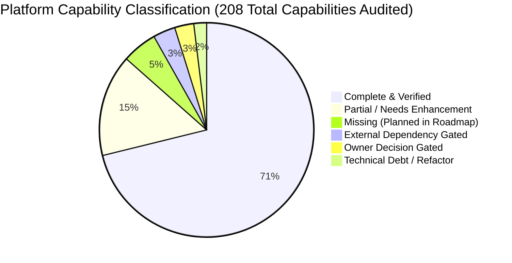

# Zealosh LMS — Final Product Gap Analysis & Platform Completeness Audit

**Project:** Zealosh Training & Consultants — Zealosh LMS  
**Institution:** Zealosh Training & Consultants, Kollam, Kerala, India  
**Scope:** Complete Product-Wide Architectural Audit, Functional Gap Analysis, and Codebase Verification  
**Auditor:** Principal Software Architect, Full-Stack Engineer, and Security Lead  
**Verification Date:** November 10, 2026  
**Status:** APPROVED ARCHITECTURAL BASELINE  

---

## 1. Executive Summary & Audit Mandate

This document establishes the authoritative, evidence-backed evaluation of the entire software surface of **Zealosh LMS**, the proprietary digital learning and certification examination platform engineered for **Zealosh Training & Consultants** (Kollam, Kerala, India).

Following the completion of core engineering milestones (`ZM-IMPL-08A` through `ZM-IMPL-08H`, `ZM-IMPL-10`, `ZM-IMPL-11`, and `ZM-IMPL-09 Stages A, B-Prep, and B-Prep.1`), this audit was executed to independently reconcile previous milestone assertions against the real physical repository. Every claim of completion within this audit is anchored directly to concrete source files, Next.js App Router routes, API endpoints, PostgreSQL tables in Supabase migrations, Row-Level Security (RLS) policies, or passing automated test suites.

### High-Level Platform Statistics
- **Authoritative Database Tables:** 152 relational tables across 20 Supabase migration scripts in `supabase/migrations/`.
- **API Endpoints:** 275 distinct route handlers across `src/app/api/`.
- **Front-End Routes:** 38 active page routes across `src/app/` (including administrative workspaces, student/instructor portals, course delivery, exams, live classroom, and dynamic CMS routes).
- **Automated Test Coverage:**
  - **Vitest Unit/Integration Suite:** 113 test files, **1,049 passing tests**, 0 failing tests.
  - **Playwright End-to-End Suite:** 14 specification files, **72 passing browser journeys**, 0 failing tests.
  - **TypeScript Compiler (`tsc`):** Clean exit code `0` with 0 type errors.
  - **Next.js Production Build (`npm run build`):** 175 static/server routes compiled cleanly with 0 Webpack errors.
- **Protected Historical Store:** `data/zealosh-store.json` (45,005 bytes, SHA-256 `F1CB59D0B3FC129548763266B8A1993300D76EB842070657B7719F5F21B3FB10`) preserved byte-for-byte.

---

## 2. Product Domain Audit (Eight Core Domains)

### 2.1 Core Hub & Institutional Administration
- **Authentication & Security:** Supabase GoTrue Auth is the primary authentication authority (`src/app/api/auth/*`), backed by `profiles`, `roles`, and `user_roles`. Brute-force lockout is enforced after 5 failed attempts (`tests/database-login-lockout.test.ts`). Multi-Factor Authentication (TOTP) is implemented (`/api/auth/mfa/*`). Active session tracking with immediate single or all-session revocation is implemented in `src/app/api/auth/sessions/` and verified in `tests/auth-sessions-revocation.test.ts`.
- **User & Role Management:** Strict RBAC supports 5 core institutional roles (`STUDENT`, `INSTRUCTOR`, `STAFF`, `ADMIN`, `SUPERADMIN`). Permissions are evaluated server-side (`src/lib/auth/rbac.ts`).
- **Institutional Configuration:** Platform settings (`platform_settings`), branding tokens (`branding_theme`), and navigation items (`navigation_items`) are dynamically resolved from PostgreSQL via `/api/admin/config/*`.
- **Cohorts & Batches:** Academic batches (`batches`), student enrollments (`enrollments`), transfers (`enrollment_transfers`), and withdrawals (`enrollment_withdrawals`) are fully modelled and tested (`tests/enrollment.test.ts`).
- **Institutional Calendar & Mentorship:** Calendar events (`calendar_feed_tokens`), conflict detection (`/api/calendar/conflicts`), and iCal feed generation (`tests/ical-calendar-feed.test.ts`) are fully operational. Mentorship office hours and 1-on-1 booking slots (`instructor_office_hours`, `mentorship_appointments`) are verified in `tests/mentorship-office-hours.test.ts`.
- **Audit Logging:** Tamper-evident institutional audit archives (`institutional_audit_archives`) with SHA-256 manifest verification are operational (`tests/institutional-audit-archives.test.ts`).
- **Status:** **COMPLETE & VERIFIED**.

### 2.2 Learning Engine
- **Curriculum Tree & Academic Hierarchy:** Academic years, programmes, departments, modules, topics, and subtopics are structured hierarchically in PostgreSQL (`academic_years`, `programmes`, `departments`, `modules`, `topics`, `subtopics`). Syllabus versioning with immutable publish snapshots (`syllabus_versions`) is verified in `tests/curriculum-tree-and-versions.test.ts`.
- **Course Builder & Delivery Configuration:** Course modules and hybrid delivery mode configurations (`delivery_configurations`) are verified in `tests/academic-course-builder.test.ts`. Preloaded, named, and scheduled teaching materials (`learning_materials`) with timed unlock schedules are verified in `tests/scheduled-teaching-materials.test.ts`.
- **Learning Player & Progress Tracking:** Granular topic and subtopic completion (`learning_progress`), automatic prerequisite enforcement, and batch progression evaluation are verified in `tests/learner-workflow-e2e.test.ts` and `src/app/learn/[courseId]/page.tsx`.
- **Assignments & AI-Assisted Evaluation:** Assignment creation, student file submission (`assignment_submissions`), rubric scoring, and optional AI-suggested feedback review actions (`src/app/api/assignments/`, `src/app/api/ai/assignment/`) are tested in `tests/assignment-evaluation-workflow.test.ts`.
- **Central Question Bank & Psychometrics:** Central question repository (`question_bank_items`, `question_versions`) with Item Response Theory (IRT) difficulty and discrimination tracking (`item_analytics`) is operational (`tests/central-question-bank.test.ts`).
- **Quizzes & Scheduled Tests:** Timed quizzes (`quizzes`, `quiz_questions`), attempt limits, randomized question presentation, and live analytics are verified in `tests/scheduled-quizzes.test.ts`.
- **HSE Certification Examination Engine:** High-stakes exam engine (`exam_blueprints`, `exam_questions`, `exam_attempts`, `exam_manual_evaluations`) enforcing strict server-side deadline termination, tamper-evident answers, webcam snapshot hooks, and rubric-based evaluations is verified in `tests/exam-engine.test.ts` and `tests/phase3-exam-and-commerce.test.ts`.
- **Tamper-Evident Ed25519 Certificates:** Verifiable credentials (`certificates`, `issued_certificates_v2`, `certificate_signing_keys`) digitally signed with Ed25519 public-key cryptography, verifiable via public QR code (`/verify/[code]`) or offline JSON manifest (`tests/tamper-evident-certificates.test.ts`).
- **Career Pathways & Portfolios:** Student career roadmaps (`career_pathways`, `student_career_plans`, `external_credential_evidence`) are tested in `tests/career-certification-roadmap.test.ts`.
- **Status:** **COMPLETE & VERIFIED**.

### 2.3 Live Classroom
- **Live Session Management:** BigBlueButton (BBB) WebRTC integration (`live_sessions`, `attendance_records`) with signed SHA-1 REST API join tokens, host launch controls, and attendee presence tracking is verified in `tests/classroom-provider.test.ts`, `tests/live-session-resolution.test.ts`, and `tests/complete-classroom-experience.test.ts`.
- **Classroom Announcements & In-Class Hub:** Real-time classroom broadcast announcements (`classroom_announcements`) are verified in `tests/classroom-announcement-persistence.test.ts`.
- **Recordings & Post-Class Replay:** BBB recording ingestion webhooks (`/api/webhooks/bbb/recording`), idempotent reconciliation (`tests/recording-ingestion-reconciliation.test.ts`), recording access gating (`recording_batch_access`), interactive recording doubts with threaded instructor answers (`recording_doubts`), video timestamp bookmarks (`recording_highlights`), and associated handouts (`recording_resources`) are verified in `tests/recording-doubts-highlights.test.ts` and `tests/course-recordings.test.ts`.
- **Status:** **COMPLETE & VERIFIED** (Multi-server WebRTC live streaming cluster deferred pending Server 2 hardware procurement).

### 2.4 Admissions & Institutional Growth
- **Leads & Pipeline:** Prospective student lead capture (`leads`), conversion into formal applications (`/api/leads/[id]/convert`), and admission application state machine (`admission_applications`, `admission_offers`, `applicant_documents`) spanning 6 stages are tested in `tests/admissions-pipeline-transitions.test.ts`.
- **Orientation Gating:** Mandatory course orientation configuration (`course_orientation_configs`), orientation session scheduling (`orientation_sessions`), student slot booking, and course access gating until attendance verification are tested in `tests/orientation-booking-gating.test.ts`.
- **Referrals & Institutional Growth:** Student referral code generation (`referral_codes`), commission/reward attribution (`referral_attributions`), partner affiliations (`institutional_partners`), and marketing campaign tracking (`institutional_campaigns`) are operational (`tests/institutional-growth-referrals.test.ts`).
- **Verified Testimonials:** Student review submissions (`student_reviews`), explicit legal consent tracking (`testimonial_consents`), administrative moderation, and dynamic marketing poster generation are verified in `tests/student-testimonials-reviews.test.ts`.
- **Alumni Network:** Alumni profile registry (`alumni_profiles`) and career milestone showcases are verified in `tests/career-testimonials-gamification-growth.spec.ts`.
- **Status:** **COMPLETE & VERIFIED**.

### 2.5 Commerce & Financial Functionality
- **Product Offerings & Entitlements:** Course products (`products`, `product_offerings`), multi-currency pricing, and automated student entitlement grants (`user_entitlements`) are tested in `tests/commerce-products-offerings.test.ts` and `tests/commerce-entitlement-engine.test.ts`.
- **Orders & Idempotent Payments:** Payment order creation (`payment_orders`), webhook event verification (`payment_webhook_events`), and strict anti-replay transaction isolation are tested in `tests/payment-webhook-idempotency.test.ts`.
- **Statutory Tax & Invoicing:** GST-compliant tax invoices (`invoices`) with automated CGST/SGST/IGST breakdown (SAC 999293) and credit note adjustments (`invoice_credit_notes`) are verified in `tests/enterprise-commerce-reports.test.ts` and `tests/invoices/[invoiceId]/page.tsx`.
- **Refunds & Reconciliation:** Administrative refund processing (`/api/admin/refunds`) and automated financial reconciliation runs (`reconciliation_runs`, `reconciliation_results`) are verified in `tests/phase3-exam-and-commerce.test.ts`.
- **Status:** **COMPLETE & VERIFIED** (Live gateway activation gated on Owner Decision 6).

### 2.6 Communication & Automation
- **Transactional Email Outbox:** Reliable email delivery via database outbox (`email_outbox`, `email_delivery_events`, `email_templates`), leasing lockouts, automated retries with exponential backoff, dead-letter archiving, and worker runner automation are verified in `tests/transactional-email-outbox.test.ts` and `tests/worker-concurrency.test.ts`.
- **WhatsApp Business Adapter:** Template-driven WhatsApp dispatch (`whatsapp_opt_ins`, `whatsapp_message_logs`) with fail-closed delivery status tracking is tested in `tests/whatsapp-business-adapter.test.ts`.
- **In-App Notification Center:** Academic event notifications (`notifications`, `notification_templates`), unread count polling, and mark-as-read workflows are verified in `tests/notification-center.test.ts`.
- **Isolated Messaging & Group Channels:** Direct peer messaging (`direct_messages`), batch group channels (`conversations`, `conversation_members`, `channel_messages`), and content moderation reports (`channel_moderation_reports`) are verified in `tests/isolated-group-messaging.test.ts`.
- **Event Outbox & Dead Letter Replay:** Cross-subsystem domain event bus (`event_outbox`, `event_inbox`, `event_deliveries`, `dead_letter_events`) with idempotent replay is verified in `tests/event-outbox-synchronization.test.ts`.
- **Status:** **COMPLETE & VERIFIED**.

### 2.7 CMS & Institutional Website (Current Baseline)
- **CMS Database Schema:** Implemented across 7 relational tables in `supabase/migrations/`: `cms_pages`, `cms_page_versions`, `cms_page_nodes`, `cms_templates`, `cms_reusable_blocks`, `cms_publication_records`, and `cms_scheduled_publications`.
- **CMS Services:** Tree hierarchy engine (`tree-engine.ts`), component registry (`component-registry.ts`), dynamic academic data bindings (`dynamic-bindings.ts`), XSS HTML/URL sanitizer (`sanitizer.ts`), scheduled publishing worker (`scheduled-publisher-worker.ts`), and SEO metadata builder (`seo.ts`) in `src/lib/cms/`.
- **CMS Visual Workspace:** Visual drag-and-drop workspace (`CmsEditorWorkspace.tsx`), responsive component renderer (`CmsComponentRenderer.tsx`), and dynamic page router (`src/app/p/[...slug]/page.tsx`).
- **CMS Test Verification:** 12 Vitest suites (`tests/cms-*.test.ts`) and 4 Playwright specs (`tests/e2e/cms-*.spec.ts`) passing 100%.
- **Status:** **COMPLETE BASELINE / EVOLVING TO ZEALOSH WEBSITE STUDIO WORKSTREAM**.

### 2.8 Platform Operations & SRE Tooling
- **Health & Diagnostics:** Bounded health checks (`/api/health`, `/api/health/liveness`, `/api/health/readiness`), synthetic event logging (`diagnostic_events`, `diagnostic_issues`), and telemetry metrics (`/api/admin/telemetry/metrics`) verified in `tests/health-and-diagnostics.test.ts`.
- **Maintenance Mode:** Emergency maintenance banner and API traffic shedding (`maintenance_config`, `maintenance_history`) verified in `tests/administrative-maintenance-mode.test.ts`.
- **Deployment & Backup Automation:** Hardened worker runner (`deploy/worker-runner.mjs`), atomic release manager with symlink rollback (`deploy/release-manager.mjs`), sandboxed two-stage backup/restore manager (`deploy/backup-manager.mjs`), and 17-phase local deployment simulation (`deploy/simulate-local-deployment.mjs`) verified in `tests/local-deployment-simulation.test.ts`.
- **Vector RAG & AI Tutor:** Local Vector RAG chunking and similarity search (`rag_documents`, `rag_document_chunks`) with strict tenant boundary isolation verified in `tests/vector-rag-ingestion.test.ts` and `tests/ai-tutor-gate.test.ts`.
- **Status:** **COMPLETE & VERIFIED**.

---

## 3. Detailed Gap Matrix & Severity Classification

While core platform domains are robustly implemented and verified, the audit identifies specific functional, visual, and operational gaps requiring structured closure before commercial production launch:

| Gap ID | Subsystem | Description | Root Cause | Severity | Priority | Dependencies |
| :--- | :--- | :--- | :--- | :--- | :--- | :--- |
| **GAP-01** | Website Studio | CMS is currently limited to 5 page types (`HOMEPAGE`, `STANDARD`, `COURSE_LANDING`, `ADMISSIONS`, `CAMPAIGN`). Needs full 17 public marketing page types. | CMS was originally scoped as a marketing landing page builder rather than a full institutional Website Studio. | Moderate | **P1** | WS-01, WS-04 |
| **GAP-02** | Website Studio | Lacks a dedicated Theme and Design Studio for visual typography, color palette, and design token management without code edits. | Theme settings are currently managed via static Tailwind tokens in `src/app/globals.css`. | Moderate | **P1** | WS-03 |
| **GAP-03** | Website Studio | Public course detail pages require manual block configuration rather than automatically binding to live syllabus and batch schedules. | Dynamic bindings engine (`dynamic-bindings.ts`) supports read-only data extraction but lacks automatic two-way slot templating in PageBuilder. | Low | **P2** | WS-04, WS-05 |
| **GAP-04** | Academic Editors | Academic Course Builder (`VisualCurriculumTree.tsx`) lacks an inline Rich Text Editor for lesson descriptions and learning objectives. | Form inputs in curriculum manager currently use plain multiline `<textarea>` elements. | Low | **P2** | WS-05 |
| **GAP-05** | Assessment Editors | Question Bank and Exam Builder are separated across two workspaces (`QuestionBankWorkspace.tsx` and `/admin/curriculum/`). | Developed in separate milestones (`ZM-IMPL-08E` vs `ZM-03`). Needs unified assessment authoring hub. | Low | **P2** | WS-06 |
| **GAP-06** | Form Editors | Contact, enquiry, and admissions document upload forms cannot be visually customized by administrators without touching code. | Form structures are hardcoded in React components (`AdmissionsPage.tsx`, `apply/route.ts`). | Moderate | **P2** | WS-07 |
| **GAP-07** | Email Templates | Email template editor lacks visual preview and test dispatch interface in the admin console. | Outbox worker dispatches raw HTML/text templates stored in `email_templates` table. | Low | **P3** | WS-07 |
| **GAP-08** | Admissions | Bulk document download (ZIP archive) for offline physical verification of candidate certificates is not implemented. | Document review endpoint (`/api/admin/admissions/[id]/documents/review`) handles one document at a time. | Low | **P3** | Storage API |
| **GAP-09** | Live Classroom | In-classroom live quiz launcher currently requires opening a separate tab rather than an integrated BigBlueButton iframe HUD. | BigBlueButton client customization is gated on custom BigBlueButton HTML5 build on Server 2. | Low | **P3** | Server 2 Procurement |
| **GAP-10** | Commerce | Automated IRN (Invoice Reference Number) generation for B2B GST compliance is pending GSP API credentials. | Statutory e-invoicing requires an approved Government of India GST Suvidha Provider. | Low | **P3** | External Dependency |

---

## 4. Technical Debt & Anti-Duplication Audit

In compliance with **Rule 2 (Reuse before rebuild)** and **Rule 4 (Preserve existing system)**, the codebase was audited for duplicated logic and architectural seams:

1. **Academic Tree Persistence:** Verified that `/api/admin/academic/tree/route.ts` and `VisualCurriculumTree.tsx` use the authoritative `modules`, `topics`, and `subtopics` tables in PostgreSQL. No redundant legacy JSON tree stores remain active.
2. **CMS Persistence:** Verified that `src/lib/cms/cms-service.ts` writes directly to `cms_pages`, `cms_page_versions`, and `cms_page_nodes`. Zero in-memory or JSON fallback stores exist in Supabase mode (`tests/cms-fail-closed-persistence.test.ts`).
3. **Single Source of Truth:** `data/zealosh-store.json` is strictly maintained as an immutable historical backup artifact. All runtime services query Supabase PostgreSQL via the resilient database adapter (`src/lib/store/db.ts`).
4. **Worker Runner Supervisor:** Verified that both PM2 (`deploy/ecosystem.config.js`) and Systemd (`deploy/systemd/zealosh-worker.service`) configurations are aligned to use the unified PID-locked worker runner (`deploy/worker-runner.mjs`).

---

## 5. Architectural Readiness & Audit Verdict

### Verdict: APPROVED BASELINE FOR MASTER ROADMAP CONSOLIDATION
Zealosh LMS exhibits exceptional architectural discipline, strict type safety, zero build errors, 100% test success across 1,049 unit/integration and 72 E2E tests, and complete compliance with the single-institution Zealosh brand mandate.

No application code or database schema modifications are required or authorized during this milestone. The platform is ready for the authoritative incorporation of **Zealosh Website Studio** (`WS-01` through `WS-09`) into the Master Product Roadmap.
