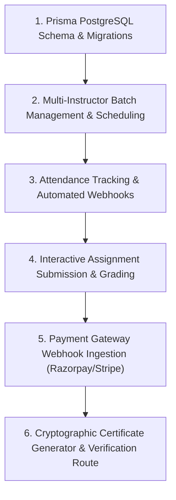

# Zealosh LMS — Implementation Next Steps & Phase 2 Action Plan

**Document Version:** 1.0.0  
**Target Milestone:** Phase 2 — Core Production LMS & Multi-Instructor Cohorts

---

## 1. Prioritized Implementation Actions

### Action 1: Database Schema Expansion (Prisma ORM & PostgreSQL)
- **Goal:** Formalize PostgreSQL relational schemas for `users`, `roles`, `courses`, `batches`, `enrollments`, `attendance_records`, `exam_attempts`, `certificates`, and `audit_logs`.
- **Dependencies:** Node.js runtime, Prisma CLI.
- **Verification Criteria:** `npx prisma migrate dev` succeeds; migrations generate repeatable DDL.

### Action 2: Multi-Instructor Batch Management
- **Goal:** Enable Lead Instructors and Co-Instructors to configure batch schedules, set recurring live session time slots, post announcements, and manage student rosters.
- **Dependencies:** Action 1 (Prisma database).
- **Verification Criteria:** Tutors cannot edit or access batches outside their assigned courses.

### Action 3: Live Session Attendance Reconciliation
- **Goal:** Ingest post-session participant events from BigBlueButton to compute actual attendance minutes; flag students who meet minimum attendance criteria (e.g. $\ge 80\%$) for certification eligibility.
- **Dependencies:** Action 2, BigBlueButton API.
- **Verification Criteria:** Automated webhook test posts attendance logs and verifies calculation in `attendance_records`.

### Action 4: High-Yield HSE Question Bank Ingestion
- **Goal:** Scale the current question bank from 5 seed questions to 200+ comprehensive BCSP ASP/CSP and BCRSP blueprint questions across calculation formulas, radiation physics, and industrial ventilation.
- **Dependencies:** HSE Exam Engine skill.
- **Verification Criteria:** Random selection respects domain weightings (35% Math/Sciences, 25% Emergency Response, 20% Industrial Hygiene, 20% Environmental).

### Action 5: Commercial Payments & Webhook Idempotency
- **Goal:** Implement Razorpay and Stripe checkout sessions with server-side HMAC signature validation and database serializable transactions on seat capacity.
- **Dependencies:** Action 1, Payment Provider credentials.
- **Verification Criteria:** Concurrency test simulates 5 simultaneous requests for the last available seat; exactly 1 succeeds.

---

## 2. Blockers & Required User Actions

| Potential Blocker | Impact | Action Required by User / Client |
| :--- | :--- | :--- |
| **Payment Gateway Credentials** | Cannot test live credit card / UPI checkout without sandbox keys. | Provide Razorpay Test Key ID & Secret or Stripe Test Secret Key. |
| **Remote Moodle Server URL & Token** | Integration currently operates in verified mock mode. | Provide remote Moodle URL and Web Service Token (`wstoken`) when ready for staging sync. |
| **BigBlueButton Secret Salt** | Live room currently runs in interactive simulator mode. | Provide BigBlueButton cluster endpoint and shared secret when staging server is spun up. |
| **Active IDE Workspace Setting** | Scratch folder is default location. | User is recommended to set `C:\Users\alexc\.gemini\antigravity-ide\scratch\zealosh-lms` as active IDE workspace. |

---

## 3. Immediate Next Phase Gate
Upon approval of this readiness report, execution proceeds directly into **Phase 2 (Core LMS & Multi-Instructor Cohorts)**.
