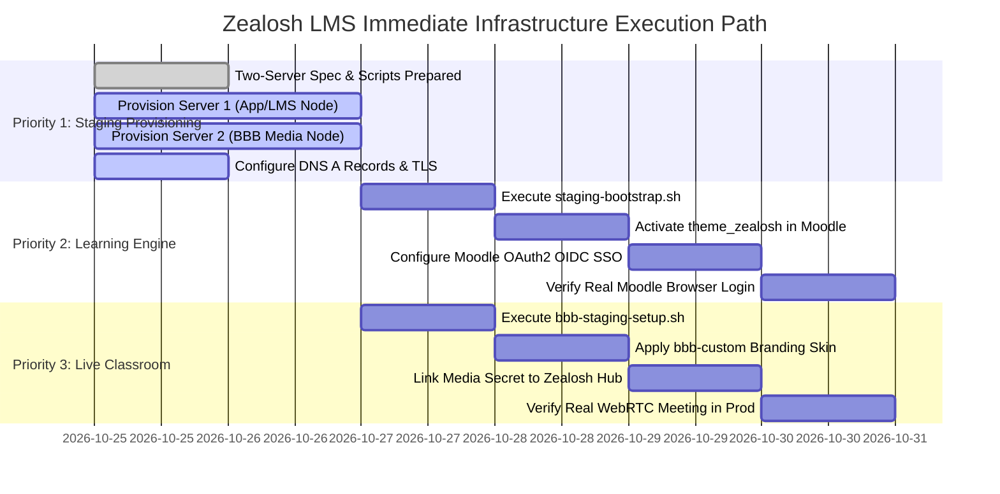

# Zealosh LMS — Master Implementation Roadmap: Staging & Production Infrastructure

**Document Version:** 4.6.0 (Milestone 8: Optional AI Tutor Feature Gate, Seam Scaffolding & Persistence Hardening Complete, 206 Vitest Tests Passing, 48 Routes Cleanly Built)  
**Date:** October 27, 2026  
**Status:** **ACTIVE EXECUTION ROADMAP**  
**Target:** Staging Environment Provisioning, Self-Hosted Moodle Engine Activation, and BigBlueButton Media Deployment.

---

## 1. Focused Execution Priorities (In Sequence)

---

## 2. Authoritative 7-Milestone Staging & Release Gate Matrix

### Milestone 1: Core Hub Persistence & Core LMS Workflows
- **Scope:** Full-stack Next.js Core Hub data access layer across dual storage modes (`in_memory` and `supabase`), plus complete Core LMS workflows (coursework assignments, multi-criteria rubrics, student submissions, instructor grading queue, recurring live cohorts, and user/enrollment lifecycle governance).
- **Invariants Verified:**
  - 12-point Supabase persistence criteria (CRUD, concurrency serialization via `enroll_student_atomic`, audit logging).
  - RBAC permission guards, system role protection, and point-in-time configuration rollback.
  - Exam state preservation, timer enforcement, and objective multi-domain scoring.
  - Core LMS workflows: course lifecycle, prerequisite enforcement, persistent lesson progression, assignment submissions, rubric grading, and live session attendance.
  - Live Supabase Coursework Persistence: Migration `20261026000004_zealosh_assignments_and_submissions.sql` synchronized with Project 1 (`yeegsljnjwxdhgzfdnyg`); no redundant `course_id`/`batch_id` on submissions; course-scoped instructor permissions via `public.is_course_instructor()`; strict active enrollment check for student submissions; rubric stored as JSONB; table grants revoked from `anon`; clean fixture teardown with 0 leftover records.
- **Verification Evidence:**
  - `npx vitest run`: **PASS** (149/149 tests passed across 16 files in ~15s).
  - `tests/supabase-coursework-live.test.ts`: **PASS** (11/11 tests green against live PostgreSQL).
  - `npx tsc --noEmit`: **PASS** (0 compilation errors).
  - `npm run build`: **PASS** (40/40 production routes generated and optimized cleanly).
- **Status:** **PASS (VERIFIED IN CODE & REMOTE SUPABASE PROJECT 1)**.

---

### Milestone 2: Moodle Database Connectivity, Installation & Data Persistence
- **Scope:** Connect Moodle 5.3 LTS to dedicated Supabase Project 2 PostgreSQL 17 database with hardened preflight gates.
- **Connection Strategy:**
  - Shared Supavisor Pooler in Session Mode (Port 5432, `aws-0-[region].pooler.supabase.com`, `postgres.[project-ref]`).
  - Supports standard IPv4 cloud hosts, prepared statements, session GUCs, and advisory locks.
  - Connection ceiling capped at 30 Apache workers (`MaxRequestWorkers 30`) + cron/admin clients (~33-36 total); classified as **PREPARED / NOT TESTED** pending live database benchmark.
  - Zero `mdl_*` tables in Core Hub project.
- **Canonical URL & Health Check Strategy:**
  - Configurable canonical external URL: `https://${ZEALOSH_DOMAIN:-lms.staging.zealosh.com}/learn-engine`.
  - Staging DNS isolated to `lms.staging.zealosh.com`; production explicitly configured as `lms.zealosh.com`.
  - Targeted container health check ([`deploy/moodle/moodle-healthcheck.sh`](file:///C:/Users/alexc/.gemini/antigravity-ide/scratch/zealosh-lms/deploy/moodle/moodle-healthcheck.sh)) queries `http://127.0.0.1:80/` without following external redirects (`-L` prohibited), passes explicit Host header (`-H "Host: ${DOMAIN}"`), and strictly accepts HTTP 200, 302, or 303.
- **Container & Routing Strategy:**
  - Production `deploy/moodle/Dockerfile` pinned to Moodle `v5.3.0` LTS release.
  - Apache `DocumentRoot` pointed strictly to `/var/www/html/public`.
  - Moodle 5.1+ front-controller routing via `DirectoryIndex index.php` and `FallbackResource /r.php`.
  - Sensitive files (`config.php`, core libraries, `/var/moodledata`) kept outside web root.
  - **Installer Secret Protection:** Eliminates `--adminpass=...` in `/proc/<pid>/cmdline` and kernel process argument vectors by using [`deploy/moodle/moodle-installer-wrapper.php`](file:///C:/Users/alexc/.gemini/antigravity-ide/scratch/zealosh-lms/deploy/moodle/moodle-installer-wrapper.php), reading secrets from `/run/secrets/moodle_admin_pass` (mode 0600 on tmpfs, unlinked immediately), and populating in-memory `$_SERVER['argv']` before requiring core `admin/cli/install_database.php`.
  - **3-State Schema Classification:** Evaluates configured prefix (`MOODLE_DATABASE_PREFIX`, default `mdl_`) into `CLEAN`, `INSTALLED`, or `PARTIAL_OR_UNEXPECTED`. Only `CLEAN` installs; `INSTALLED` skips install (and skips auto-upgrade on ordinary container boots); `PARTIAL_OR_UNEXPECTED` halts immediately (`exit 1`) with secret-free diagnostics.
  - Production upgrades decoupled and stripped of `--allow-unstable`. Requires explicit operator flag `MOODLE_TRIGGER_UPGRADE=1`.
- **Dependencies:** Provisioning of dedicated Supabase Project 2, Server 1 Linux host with Docker.
- **Status:** **PREPARED (CODE AUDITED) / BLOCKED (INFRASTRUCTURE)**.

---

### Milestone 3: Authentic Theme Rendering & Real OIDC Browser-Based SSO
- **Scope:** Complete single-click authentication from Zealosh Core Hub into Moodle 5.3 LTS without password prompts.
- **Authentic Branding:**
  - Deleted fabricated SVGs (`logo.svg`, `favicon.svg`).
  - Deployed verified original assets: `public/logo.png` (12.9KB) and `public/logo-round.png` (3.9KB).
  - Updated `theme_zealosh/templates/navbar.mustache` to render authentic logo.
- **OIDC SSO Implementation:**
  - Core Hub Identity Provider (`/.well-known/openid-configuration`, `/api/oauth/authorize`, `/api/oauth/token`, `/api/oauth/userinfo`).
  - Tested: PKCE S256 verification, single-use code replay rejection, `application/x-www-form-urlencoded` token exchange.
- **Verification Evidence:**
  - Automated OIDC protocol suite (`tests/oidc-sso.test.ts`): **PASS (SIMULATED)** (12/12 tests).
  - End-to-end journey script (`scripts/verify-oidc-sso-journey.ts`): **PASS (SIMULATED)** (10/10 invariants).
  - Real Moodle GUI click-through in browser: **BLOCKED (INFRASTRUCTURE)** (Awaiting running Moodle container).
- **Status:** **PROTOCOL: PASS (SIMULATED) / BROWSER UI: BLOCKED (INFRASTRUCTURE)**.

---

### Milestone 4: BigBlueButton Deployment & Live Classroom Media
- **Scope:** Dedicated WebRTC audio/video conferencing server with custom Zealosh branding skin.
- **Infrastructure Requirement:** Dedicated Server 2 (Ubuntu 22.04 LTS, 8 vCPU, 16GB RAM, public IP, ports 80/443/UDP open).
- **Automation:** [`deploy/bbb-staging-setup.sh`](file:///C:/Users/alexc/.gemini/antigravity-ide/scratch/zealosh-lms/deploy/bbb-staging-setup.sh) and [`bbb-custom/apply-branding.sh`](file:///C:/Users/alexc/.gemini/antigravity-ide/scratch/zealosh-lms/bbb-custom/apply-branding.sh).
- **Status:** **PREPARED / SCRIPTS VALIDATED (Blocked pending dedicated media host)**.

---

### Milestone 5: End-to-End Learner & Administrator Workflows
- **Scope:** Cross-tier user journeys from course discovery to certification:
  - Discovery (`/courses/[slug]`) -> Atomic Enrollment (`/api/batches/[id]/enroll`) -> Student Hub (`/student`).
  - Dynamic course lesson & coursework navigation (`/learn/[courseId]`).
  - Server-enforced prerequisite examination gating (`/api/exams`, `/api/exams/[id]/start`): Active enrollment and >=80% lesson progression strictly required to unlock examination; unauthorized access rejected with structured 403 errors (`EXAM_UNENROLLED`, `EXAM_PROGRESS_INSUFFICIENT`); Super Admin bypass supported.
  - Interactive exam catalog with visual progression meters, lock badges, and direct CTAs to lessons or enrollment.
  - Timed examination submission -> Multi-domain objective scoring -> Immediate accreditation card with QR verification link (`/verify/[code]`).
  - Public credential verification engine (`/api/certificates/verify/[code]`) with cryptographic metadata validation.
  - Administrative certificate governance & revocation (`/api/admin/certificates/revoke`) with reason tracking and immutable audit logging.
  - Superadmin configuration updates, feature flags, role management, and audit rollback.
- **Verification Evidence:**
  - Dedicated E2E suite `tests/learner-workflow-e2e.test.ts`: **PASS (11/11 tests green)** covering the entire 11-step lifecycle.
  - Full Vitest suite: **160/160 tests passing across 17 files**.
  - Production build: **Exit code 0 (40/40 routes)**.
- **Status:**
  - Core Hub Workflows: **PASS (VERIFIED)**.
  - Federated Cross-Platform Journey (Moodle & BBB live handoff): **BLOCKED (INFRASTRUCTURE)**.

---

### Milestone 6: Security Hardening, Backup/Restore & Production Review
- **Scope:** OWASP-aligned application security, reverse proxy hardening, 4-tier decoupled backup architecture, and non-destructive disaster recovery runbook.
- **Invariants Verified:**
  - Automated security & crypto suite: constant-time bcrypt comparisons, signed JWT verification, RLS enforcement, single-use auth code replay rejection: **PASS (13/13 tests)**.
  - Reverse proxy security headers: `X-Frame-Options: SAMEORIGIN`, `X-Content-Type-Options: nosniff`, `Referrer-Policy: strict-origin-when-cross-origin`: **PASS**.
  - Strict TLS requirement preserved across all database and external gateway connections.
  - Four decoupled backup tiers defined in [docs/BACKUP_AND_RESTORE_RUNBOOK.md](file:///C:/Users/alexc/.gemini/antigravity-ide/scratch/zealosh-lms/docs/BACKUP_AND_RESTORE_RUNBOOK.md):
    1. Cloud-Managed Supabase Snapshots (managed independently in cloud dashboard; PITR requires active paid plan add-on).
    2. Logical SQL exports via `pg_dump` over Session Mode port 5432.
    3. Persistent file assets archive (`moodledata/filedir` via Docker tar).
    4. Production environment secrets (`.env.production` encrypted cold storage).
- **Physical Restore Verification Requirement:**
  - Non-destructive restore drill into disposable target database (`zealosh_moodle_drill`) verifying table row counts (`mdl_course`, `mdl_user`) and retrieval of an uploaded learning file asset.
- **Status:** **PREPARED (CODE AUDITED & TESTED; PHYSICAL RESTORE DRILL BLOCKED ON STAGING)**.

---

### Milestone 7: Enterprise Commerce, Invoicing & Multi-Dataset Reporting Engine
- **Scope:** Complete end-to-end commercial transactional pipeline, tax invoicing, student invoice portal, authoritative Supabase PostgreSQL persistence reconciliation, financial RPC security hardening, and multi-dataset regulatory compliance reporting engine.
- **Delivered Items:**
  - **Financial RPC Security Hardening & Accounting Integrity (CP-7.8):**
    - Revoked `EXECUTE` privileges from `PUBLIC`, `anon`, and `authenticated` on `complete_payment_order_atomic` and `process_refund_atomic`. Granted execution exclusively to trusted backend `service_role`.
    - Hardened database search paths with `SET search_path = public, pg_temp` and schema-qualified references across both functions to prevent object shadowing.
    - Concurrency-safe monotonic invoice numbering: deployed `public.invoice_number_seq` for reliable `INV-2026-XXXX` generation, completely eliminating random 4-digit unique constraint collision risks.
    - Payment completion lifecycle secured (`/api/payments/webhook`): validates persisted pending order, verifies expected amount (with subunit handling), currency, and gateway order reference; rejects failed or uncaptured events without mutating order state.
    - Secured administrative refund engine (`/api/admin/refunds`): enforces `SUPER_ADMIN`/`ORG_ADMIN` authorization, derives real actor identity from session JWT (no caller-supplied identity spoofing), requires non-empty refund reasons, and logs unforgeable audit records.
    - Payment-state model unified across PostgreSQL, TypeScript, and adapters: canonical status constraints on `payment_orders` (`PENDING`, `PAID`, `FAILED`, `REFUNDED`, `CANCELLED`) and `invoices` (`ISSUED`, `PAID`, `REFUNDED`, `VOID`), with partial unique index `uq_payment_orders_gateway_payment_paid` enforcing gateway idempotency on `PAID`.
  - **Authoritative Database Schema Reconciliation (CP-7.7):** Schema migration `20261026000005_zealosh_payment_orders_and_invoices.sql` deployed and verified on Core Hub Project 1 (`yeegsljnjwxdhgzfdnyg`).
    - `payment_orders` and `invoices` tables created with immutable accounting snapshot columns (`subtotal`, `tax_amount`, `cgst_amount`, `sgst_amount`, `course_title_snapshot`, `batch_name_snapshot`).
    - Concurrency-safe unique partial index `uq_payment_orders_gateway_payment_paid`.
    - Row-Level Security (RLS) active: `anon` table access denied (verified live); authenticated user read isolation; administrator audit read access.
    - Atomic PostgreSQL transaction functions: `complete_payment_order_atomic` and `process_refund_atomic` for concurrency-safe state transitions, seat reservations, and access revocations.
  - **Payment Order API (`/api/payments/order`):** Dynamic INR/USD course pricing, prerequisite certification checks (ASP required for CSP), batch seat limits, and audit logging.
  - **Cryptographic Webhook Handler (`/api/payments/webhook`):** Constant-time HMAC-SHA256 signature verification (`crypto.timingSafeEqual`), replay idempotency defense, and atomic seat reservation + enrollment completion.
  - **Statutory Indian GST Invoicing Engine:** Automated calculation of 18% inclusive tax breakdown (CGST 9% + SGST 9%), SAC code `999293` (Vocational & Professional Training Services), corporate/student billing address management, staging registration flag (`providerGstinVerified`), and sequential invoice generation (`INV-2026-XXXX`).
  - **Printable Tax Invoice Page (`/invoices/[invoiceId]`):** Full-fidelity responsive and `@media print` printable invoice with Zealosh corporate branding, provider GSTIN (`32AABCZ1234F1Z5`), student/sponsor tax identifiers, and official digital verification seal.
  - **Student Portal Invoicing Integration (`/student`):** Integrated "Tax Invoices & Receipts" section enabling enrolled students to review past transactions and launch official tax invoices.
  - **Multi-Dataset Regulatory Compliance Reporting Engine (`/api/admin/reports`):** Streaming export engine supporting standard RFC 4180 CSV and structured JSON across 4 critical institutional datasets:
    1. `enrollments`: Candidate details, course, batch, progress percentage, completion status, and enrollment dates.
    2. `exams`: Completed attempt scores, passing status, duration, and blueprint identifiers.
    3. `certificates`: Issued accreditation records, certificate codes, candidate names, scores, and QR verification URLs.
    4. `revenue`: Financial ledger with invoice numbers, customer details, taxable values, GST breakdown, and transaction references.
  - **Superadmin Reporting Hub (`/admin` Tab 14):** 4 KPI summary cards (Total Revenue, Active Enrollments, Completed Exam Attempts, Issued Certificates), dataset selector pills, live table preview, and instant CSV/JSON download actions.
  - **PWA Capabilities:** Web App Manifest (`public/manifest.json`), service worker (`public/sw.js`), and offline fallback shell (`public/offline.html`).
  - **Class Recordings, Topic Highlights, References & Interactive Doubts (CP-7.9):**
    - Authoritative database migration `20261026000006_zealosh_recordings_and_doubts.sql` deployed and verified on Core Hub Project 1 (`yeegsljnjwxdhgzfdnyg`).
    - 6 relational tables deployed: `class_recordings`, `recording_batch_access`, `recording_highlights`, `recording_resources`, `recording_doubts`, and `recording_doubt_answers`.
    - Durable storage provider service (`RecordingStorageService`) with constant-time HMAC-SHA256 playback token signing, TTL validation, and streaming endpoint `/api/recordings/[recordingId]/stream` with `Accept-Ranges` and strict download gating.
    - Superadmin cross-batch access governance (`/api/admin/recordings/access`) with audit trails (`RECORDING_ACCESS_GRANTED`, `RECORDING_ACCESS_REVOKED`).
    - Chronologically ordered chapter highlights (`/api/recordings/[recordingId]/highlights`) with duration and timestamp validation.
    - Attached study resources (`/api/recordings/[recordingId]/resources`) with protocol safety validation.
    - Interactive doubts & answers (`/api/recordings/[recordingId]/doubts`) with timestamp anchoring, learner privacy isolation, and instructor resolution workflows.
    - 4 integrated portals: dedicated video player (`/recordings/[recordingId]`), student revision hub (`/student`), instructor doubt queue (`/instructor`), and recordings governance console (`/admin`).
- **Verification Evidence:**
  - Dedicated E2E suite `tests/recording-doubts-highlights.test.ts`: **PASS (17/17 tests green)** including live Supabase roundtrip across all 6 tables.
  - Dedicated E2E suite `tests/enterprise-commerce-reports.test.ts`: **PASS (17/17 tests green)** including live Supabase RPC authorization & lifecycle roundtrip.
  - Full Vitest regression suite: **PASS (194/194 tests passing across all 19 test files)**.
  - TypeScript compilation: **PASS (`npx tsc --noEmit` exits with 0 errors)**.
  - Production build: **PASS (`npm run build` exits with code 0 across 47 routes)**.
  - Live PostgreSQL verification: **PASS (Zero residual test records on Core Hub Project 1)**.
- **Status:** **PASS (VERIFIED IN CODE, INTEGRATION SUITE, LIVE POSTGRESQL & PRODUCTION BUILD)**.

---

### Milestone 8: Optional AI Tutor Feature Gate, Seam Scaffolding & Persistence Hardening (ADR-003)
- **Scope:** Complete architectural seam preparation for a future, optional, self-hosted AI Tutor; strict capability gating; zero outbound inference; zero unapproved costs; elimination of in-memory Map fallbacks in API routes.
- **Delivered Items:**
  - **Decision Status:** OPTIONAL, PROPOSED, AND NOT APPROVED FOR FULL IMPLEMENTATION (ADR-003). No Ollama servers or GPU nodes provisioned.
  - **Authoritative Database Schema:** Migration `supabase/migrations/20261027000007_zealosh_ai_tutor_gate.sql` adding `ai_tutor_enabled BOOLEAN NOT NULL DEFAULT FALSE` to `public.feature_flags`.
  - **Central Capability Check:** `src/lib/ai-tutor/gate.ts` (`isAiTutorEnabled()`, `assertAiTutorEnabled()`) defaulting strictly to `false`.
  - **Server-Side Service Boundary:** `src/lib/ai-tutor/service.ts` enforcing `AiTutorDisabledError` before any network or compute operations; verified zero outbound requests when disabled; course enrollment check and active exam session suspension guard.
  - **Direct API Seam:** `src/app/api/ai-tutor/query/route.ts` protected by JWT session authentication, returning HTTP 403 `AI_TUTOR_DISABLED` with structured refusal.
  - **Superadmin Authorization Guard:** `src/app/api/admin/config/features/route.ts` rejects non-superadmins attempting to alter `aiTutorEnabled` with HTTP 403.
  - **Candidate Config Schema Validator:** `validateAiTutorConfig()` enforces protocol safety, URL structure, and bounded parameters (timeout, tokens, temperature).
  - **Persistence Hardening:**
    - Replaced direct in-memory Map fallback in `/api/exams/[examId]/submit` with async question bank retrieval and full-bank fallback.
    - Replaced synchronous `db.users.size` in `/api/health/readiness` with awaited `db.getUsers()`.
- **Verification Evidence:**
  - Dedicated test suite `tests/ai-tutor-gate.test.ts`: **PASS (12/12 tests green)**.
  - Full Vitest regression suite: **PASS (206/206 tests passing across 20 test files)**.
  - TypeScript compilation: **PASS (`npx tsc --noEmit` exits with 0 errors)**.
  - Production build: **PASS (`npm run build` exits with code 0 across 48 routes)**.
- **Status:** **PASS (VERIFIED IN CODE, UNIT TESTS, INTEGRATION SUITE & PRODUCTION BUILD)**.
- **Recovery Point:** CP-8.0 (`C:\Users\alexc\.gemini\antigravity-ide\scratch\zealosh-lms`).

