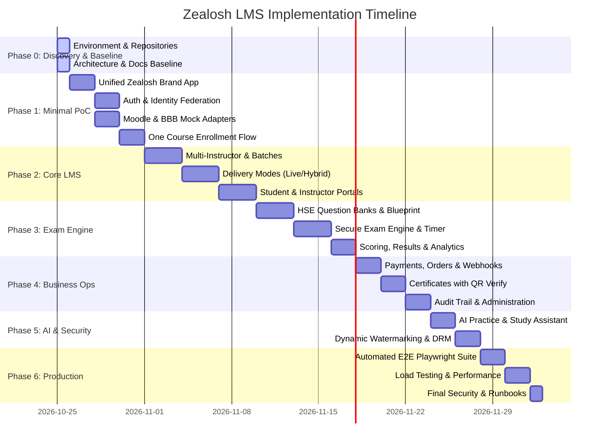

# Zealosh LMS — Master Implementation Roadmap

**Document Version:** 1.0.0  
**Status:** Approved Roadmap Baseline  
**Execution Model:** Phased, Test-Driven, Incremental Implementation

---

## 1. Phased Delivery Overview

---

## 2. Phase Breakdown & Acceptance Criteria

### Phase 0: Discovery, Environment Verification & Acquisition (Current)
- **Goal:** Audit host environment, verify dependencies, evaluate upstream repositories, establish directory workspace, and generate the 10 mandatory architecture/compliance documents.
- **Deliverables:** Completed `docs/` suite, repository inventory, brand asset extraction (`logo.png`, `styles.css`), clean git repository.
- **Gate to Proceed:** Phase 0 documentation verified; environment compatibility matrix validated.

### Phase 1: Minimal Integrated Proof of Concept (PoC)
- **Goal:** Build the unified Zealosh web application shell, unified authentication system, course catalog, and the first integrated end-to-end workflow: Student Registration → Course Discovery → Batch Enrollment → Authorized Lesson Access → Live Classroom Launch → Student Progress.
- **Key Milestones:**
  1. Next.js 14+ frontend with official Zealosh design tokens (`#4f8c4c` primary green, `#252c41` navy, `#eaedf5` borders).
  2. NestJS backend with JWT auth, user entity, and external learning adapters.
  3. Moodle REST client adapter and BigBlueButton SHA1 signature adapter.
  4. End-to-end verification of registration to course view.
- **Gate to Proceed:** PoC workflow functions smoothly without errors; zero exposed secrets in browser.

### Phase 2: Core LMS & Multi-Instructor Cohorts
- **Goal:** Deliver full course lifecycle management, multi-instructor batch assignment, delivery mode flexibility (Recorded, Live, Hybrid, Materials-Only), and dedicated portals for students and instructors.
- **Key Milestones:**
  1. Batch capacity control and enrollment locking.
  2. Attendance logging for live sessions.
  3. Interactive curriculum viewer with notes, PDFs, and video chapters.
  4. Instructor grading dashboard and student progress tracking.
- **Gate to Proceed:** Multiple tutors successfully manage separate cohorts without cross-course privilege escalation.

### Phase 3: HSE Certification Examination Engine
- **Goal:** Implement the specialized HSE mock examination engine for ASP, CSP, CRSP, and CIT certifications.
- **Key Milestones:**
  1. Question banks mapped to official examination blueprints (Domains, Weights, Difficulty).
  2. Practice modes (Topic Practice, Timed Practice, Weak Area Review).
  3. Server-enforced countdown timer, periodic auto-save, auto-submission on expiration.
  4. Scoring engine with topic-level diagnostic feedback.
- **Gate to Proceed:** Concurrency test on exam submissions succeeds; client timer manipulation rejected by server.

### Phase 4: Business Operations, Payments & Certificates
- **Goal:** Complete commercial transactions, batch enrollment webhooks, verified certificate generation, and administrative audit logging.
- **Key Milestones:**
  1. Razorpay/Stripe webhook handlers with HMAC verification and idempotency keys.
  2. PDF certificate generation with unique cryptographic verification codes and public verification route (`/certificates/verify/[uuid]`).
  3. Super Admin dashboard with system-wide reporting and immutable audit trail.
- **Gate to Proceed:** Duplicate webhook test succeeds with zero duplicate enrollments; certificate verification returns valid status.

### Phase 5: AI Capabilities & Enhanced Media Protection
- **Goal:** Add AI-powered study assistance, personalized revision plans, question explanations, and dynamic streaming watermarks.
- **Key Milestones:**
  1. AI study assistant orchestrator with strict prompt safety guidelines and safety-critical disclaimers.
  2. Shaka Player integration with dynamic student watermark overlay.
- **Gate to Proceed:** AI assistant fails gracefully when offline; watermarks render dynamically across devices.

### Phase 6: Production Readiness & Quality Assurance
- **Goal:** Full automated test coverage, browser Playwright validation with recorded evidence, performance profiling, and disaster recovery drill.
- **Key Milestones:**
  1. 100% pass rate on unit and integration test suites.
  2. Complete Playwright E2E browser tests for Student, Instructor, and Admin journeys.
  3. Verified backup and recovery runbooks.
- **Gate to Proceed:** All acceptance criteria satisfied with real execution evidence.
