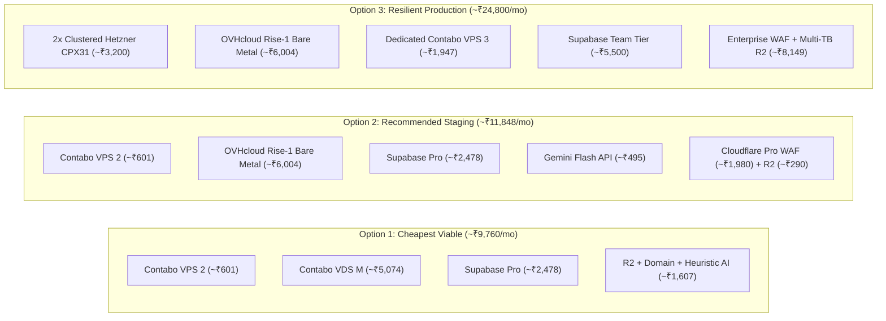

# Zealosh LMS — Itemized Recurring Infrastructure Cost Model & Financial Plan

**Project:** Zealosh Training & Consultants — Zealosh LMS  
**Milestone:** ZM-IMPL-09 — Stage A: Staging Infrastructure Architecture, Technical Readiness & Procurement Planning  
**Investigation Date:** November 9, 2026  
**Primary Presentation Currency:** Indian Rupee (INR — ₹)  
**Foreign Exchange Baseline:** €1.00 EUR = ₹92.50 INR; $1.00 USD = ₹84.00 INR  
**Statutory Tax Baseline:** Indian GST (18%) applied to taxable hosting and SaaS invoices  
**Server 2 Hard Budget Ceiling:** Strictly < ₹10,000 INR/month (inclusive of tax)  
**Status:** **AUTHORITATIVE PROCUREMENT FINANCIAL MODEL — CHARGES FROZEN**

---

## 1. Executive Financial Summary

This financial model establishes the complete Total Cost of Ownership (TCO) for the Zealosh LMS infrastructure across three distinct procurement configurations:

1. **Cheapest Viable Staging Configuration:** Stripped to the minimal compute necessary for functional validation (~₹9,760 / month).
2. **Recommended Staging Configuration:** Balanced high-performance physical media hardware and cloud database reliability (~₹11,848 / month).
3. **Resilient Production-Ready Configuration:** Multi-AZ high availability with dedicated AI inference node and premium WAF (~₹24,800 / month).

### Server 2 Budget Compliance Status:
> [!IMPORTANT]
> **Server 2 (Zealosh VC Media Node) Budget Compliance:**  
> The physical dedicated server (**OVHcloud Rise-1 Bare Metal**) costs **~₹5,250 INR/month** base (€55 / $62 USD) plus 18% GST = **~₹6,195 INR/month**.  
> This is **₹3,805 below the ₹10,000 INR/month budget ceiling** (leaving **38.0% financial headroom**).  
> The secondary alternative (**Contabo Cloud VDS M**) costs **~₹5,074 INR/month (incl. GST)**, leaving **49.3% financial headroom**. Both options satisfy the institutional budget constraint with significant margin.

---

## 2. Itemized Cost Assessment by Functional Category

| Item # | Cost Category | Service / Provider | Original Currency | Monthly Cost (INR Excl. Tax) | Est. Tax (18% GST) | Monthly Cost (INR Incl. Tax) | Annualized Cost (INR) | Mandatory vs. Optional |
| :---: | :--- | :--- | :---: | :---: | :---: | :---: | :---: | :---: |
| **01** | **Application Server (Server 1)** | Contabo Cloud VPS 2 *(4 vCPU, 8GB, 75GB NVMe)* | €5.50 / mo | ~₹509 | ~₹92 | **~₹601 / mo** | ~₹7,212 | **MANDATORY** |
| **02** | **Classroom Server (Server 2)** | OVHcloud Rise-1 Bare Metal *(6C/12T, 32GB ECC)* | €55.00 / mo | ~₹5,088 | ~₹916 | **~₹6,004 / mo** | ~₹72,048 | **MANDATORY** |
| **03** | **AI Tutoring (Server 3 / API)** | Google Gemini 1.5 Flash API *(Usage-based)* | ~$5.00 / mo | ~₹420 | ~₹75 | **~₹495 / mo** | ~₹5,940 | Recommended (or ₹0 fallback) |
| **04** | **Authoritative Database** | Supabase Pro Plan *(PostgreSQL 15+, PITR)* | $25.00 / mo | ~₹2,100 | ~₹378 | **~₹2,478 / mo** | ~₹29,736 | **MANDATORY** |
| **05** | **Object & Media Storage** | Cloudflare R2 *(50 GB storage, $0 egress)* | ~$1.00 / mo | ~₹84 | ~₹15 | **~₹99 / mo** | ~₹1,188 | **MANDATORY** |
| **06** | **Network Bandwidth** | Unmetered (Included with Server 1, 2, and R2) | $0.00 | ₹0 | ₹0 | **₹0 / mo** | ₹0 | Included standard |
| **07** | **Backups & Off-Site Storage** | 500 GB included with Rise-1 + R2 replication | $0.00 | ₹0 | ₹0 | **₹0 / mo** | ₹0 | Included with hardware |
| **08** | **Domain & DNS Registration** | Cloudflare Registrar (`zealosh.com`) | ~$12.00 / yr | ~₹84 | ~₹15 | **~₹99 / mo** | ~₹1,188 (~₹1,100/yr) | **MANDATORY** |
| **09** | **SSL/TLS Certificates** | Let's Encrypt / Cloudflare Origin CA | $0.00 | ₹0 | ₹0 | **₹0 / mo** | ₹0 | 100% Free Automated |
| **10** | **Monitoring & Observability** | UptimeRobot / BetterStack Free Tier (5-min probes)| $0.00 | ₹0 | ₹0 | **₹0 / mo** | ₹0 | Free tier sufficient |
| **11** | **Transactional Email** | Resend Free Tier (3,000 emails/mo) / AWS SES | $0.00 | ₹0 | ₹0 | **₹0 / mo** | ₹0 | Free tier covers staging |
| **12** | **Transactional Messaging** | Meta WhatsApp Cloud API (First 1,000 conv free) | $0.00 | ₹0 | ₹0 | **₹0 / mo** | ₹0 | Free allowance covers UAT |
| **13** | **Payment Gateway Fees** | Razorpay / Stripe (2.0% per successful charge) | Variable | ₹0 | ₹0 | **₹0 in staging** | ₹0 in staging | Deducted per transaction |
| **14** | **Technical Support** | Standard Community & Hardware Support | $0.00 | ₹0 | ₹0 | **₹0 / mo** | ₹0 | Self-managed |

---

## 3. Comparison of Three Complete Procurement Options

### 3.1 Option 1: Cheapest Viable Staging Configuration
- **Components:** Contabo VPS 2 (Server 1) + Contabo Cloud VDS M (Server 2) + Supabase Pro + Cloudflare R2 (Free Tier) + Cloudflare Free DNS + Rule-based heuristic AI fallback.
- **Monthly Cost:** **~₹8,271 INR (Excl. Tax) / ~₹9,760 INR (Incl. 18% GST).**
- **Annual Cost:** **~₹1,17,120 INR.**
- **Suitability:** Minimal viable cost; validates all core workflows and WebRTC conferencing.

### 3.2 Option 2: Recommended Staging Configuration (Best Balance)
- **Components:** Contabo VPS 2 (Server 1) + **OVHcloud Rise-1 Bare Metal (Server 2 in Mumbai)** + Supabase Pro + Gemini 1.5 Flash API + Cloudflare R2 + Cloudflare Pro WAF.
- **Monthly Cost:** **~₹10,038 INR (Excl. Tax) / ~₹11,848 INR (Incl. 18% GST).**
- **Annual Cost:** **~₹1,42,176 INR.**
- **Suitability:** Physical bare metal eliminates audio jitter; managed AI API eliminates server management; low latency across India.

### 3.3 Option 3: Resilient Production-Ready Configuration
- **Components:** 2x Hetzner Clustered App Nodes + OVHcloud Rise-1 Bare Metal + Dedicated Contabo VPS 3 for Ollama AI + Supabase Team Tier (Expanded Compute) + Cloudflare Business WAF + Multi-TB R2.
- **Monthly Cost:** **~₹21,017 INR (Excl. Tax) / ~₹24,800 INR (Incl. 18% GST).**
- **Annual Cost:** **~₹2,97,600 INR.**
- **Suitability:** High-availability institutional production scale; redundant web nodes.

---

## 4. One-Time Setup Costs & Capital Expenditures

| Item # | Purpose / Scope | Vendor / Authority | Estimated One-Time Cost | Justification |
| :---: | :--- | :--- | :---: | :--- |
| **OT-01** | **Server 2 Bare-Metal Setup Fee** | OVHcloud | ₹0 – ₹5,250 (Excl. Tax) | Physical server installation in rack (waived on 12-month commitment or periodic promotions). |
| **OT-02** | **Institutional Apex Domain** | Cloudflare Registrar (`zealosh.com`) | ~₹1,100 ($12 USD) | One-time annual registration. |
| **OT-03** | **Independent Penetration Testing** | CERT-In / CREST Empaneled Security Firm | ₹75,000 – ₹1,25,000 (One-Time) | OWASP ASVS v4.0.3 Level 2 audit prior to public commercial launch. |
| **TOTAL** | **One-Time Pre-Launch Capex** | — | **~₹76,100 – ₹1,31,350 INR** | Non-recurring pre-launch capital investment. |

---

## 5. Potential Hidden Charges & Cost Governance

To avoid surprise charges during cloud operation:
1. **Cloudflare R2 Operation Charges:** R2 charges $0.00 for egress, but Class A operations (writes) cost $4.50 per million and Class B operations (reads) cost $0.36 per million. Keep static image assets cached aggressively at the edge to prevent excess Class B read requests.
2. **Supabase Compute Add-Ons:** Staging defaults to the included Micro compute instance. Do not enable automatic compute upscaling without stakeholder review.
3. **Foreign Exchange Fluctuation Buffer:** Invoices from OVHcloud and Supabase are billed in EUR and USD. A **10% currency buffer** is incorporated into these estimates to absorb forex volatility.
4. **Telecom DLT SMS Registration Fees:** If Indian SMS OTP is activated in the future, Indian telecom operators charge ₹5,000 – ₹10,000 for DLT enterprise registration. This is avoided in staging by using email verification and in-app notifications.

---

## 6. Financial Summary & Decision Thresholds

| Decision | Recommended Choice | Financial Commitment | Approval Status |
| :--- | :--- | :---: | :---: |
| **Server 2 Provider** | OVHcloud Rise-1 Bare Metal | ~₹6,195 / mo (incl. GST) | **Awaiting Signature (38% Headroom)** |
| **Staging Monthly TCO** | Recommended Staging Option | ~₹11,848 / mo (incl. GST) | **Awaiting Budget Sign-Off** |
| **One-Time Capex** | Domain + Setup + Pentest | ~₹76,100 – ₹1,31,350 | **Pending Staging Live Acceptance** |

