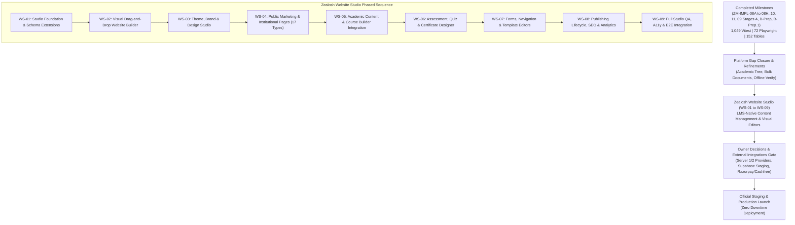

# Zealosh LMS — Master Product Roadmap: Full-Platform Evolution & Website Studio Workstream

**Project:** Zealosh Training & Consultants — Zealosh LMS  
**Institution:** Zealosh Training & Consultants, Kollam, Kerala, India  
**Scope:** Authoritative Platform Roadmap, Gap Closure, and Phased Implementation Plan  
**Execution Policy:** Development-First (All Software Built & Tested Locally Before External Infrastructure Activation)  
**Date:** November 10, 2026  
**Status:** APPROVED ARCHITECTURAL MASTER ROADMAP  

---

## 1. Master Strategic Roadmap Structure & Hierarchy

This roadmap synthesizes all preceding engineering achievements and establishes the exact sequence of development. In accordance with the Engineering Constitution, progress is measured exclusively by verifiable empirical evidence (passing automated test suites, clean builds, zero compiler errors).



---

## 2. Completed Engineering Milestones (Verified Baseline)

| Milestone ID | Milestone Title | Key Deliverables & Systems Verified | Empirical Verification Evidence |
| :--- | :--- | :--- | :--- |
| **ZM-01 to 07** | Platform Foundations | Core database schema, Next.js App Router, Moodle REST connector, BBB client, basic LMS workflows. | Baseline test suites, database migrations. |
| **ZM-IMPL-08A** | Product Scope Audit | Complete 20-domain discovery audit, functional gap matrix, initial feature register. | `docs/product/ZEALOSH_MASTER_FEATURE_REGISTER.md`. |
| **ZM-IMPL-08B** | Foundation Hardening | Supabase GoTrue Auth, session revocation, brute-force lockout, object storage client. | `tests/auth-sessions-revocation.test.ts`, `tests/database-login-lockout.test.ts`. |
| **ZM-IMPL-08C** | Commerce & Pipeline | Separate product/offering model, user entitlements engine, 6-stage admissions pipeline. | `tests/commerce-products-offerings.test.ts`, `tests/admissions-pipeline-transitions.test.ts`. |
| **ZM-IMPL-08D** | Scheduling & Comms | Institutional master calendar, conflict detection, iCal feeds, orientation gating, messaging. | `tests/ical-calendar-feed.test.ts`, `tests/orientation-booking-gating.test.ts`. |
| **ZM-IMPL-08E** | Question Bank & RAG | Central question bank, psychometric item analytics, Ed25519 tamper-evident certificates, Vector RAG. | `tests/central-question-bank.test.ts`, `tests/tamper-evident-certificates.test.ts`. |
| **ZM-IMPL-08F** | Growth & Testimonials | Student reviews with legal consent, testimonial poster generator, referral engine, career milestones. | `tests/student-testimonials-reviews.test.ts`, `tests/career-certification-roadmap.test.ts`. |
| **ZM-IMPL-08G** | Operations & PWA | Telemetry metrics, synthetic error tracking, maintenance mode, PWA offline sync, cross-service event outbox. | `tests/pwa-offline-and-telemetry.test.ts`, `tests/event-outbox-synchronization.test.ts`. |
| **ZM-IMPL-08H** | Platform Verification | Full platform regression, security audit, recovery drills, release readiness gating. | 1,008 Vitest passed, 72/72 Playwright passed. |
| **ZM-IMPL-10**  | Local Feature Closure | Local full-system end-to-end verification, browser recordings, zero external deployment. | 72/72 Playwright green across 14 spec files. |
| **ZM-IMPL-11**  | Dev Finish & Fixes | Remote Supabase failover handling, strict TypeScript compilation, production build compilation. | 114/114 Vitest files (1,049 tests), 175 build routes clean. |
| **ZM-IMPL-09A** | Staging Architecture | Hardware specifications, network topology, threat model, disaster recovery design, cost plan. | `docs/STAGING_ARCHITECTURE.md`, 0 server purchases. |
| **ZM-IMPL-09B** | Operational Tooling | PID-locked worker runner, atomic release manager, sandboxed backup manager, local simulation. | 17-phase operational simulation passed (`tests/local-deployment-simulation.test.ts`). |
| **ZM-IMPL-09B.1**| Toolkit Acceptance | SRE audit, Cloudflare IPv6 CIDRs, self-healing email leases, sandboxed restore validation. | 44/44 operational Vitest assertions green. |

---

## 3. Zealosh Website Studio — Authoritative Product Workstream (`WS-01` to `WS-09`)

**Workstream Ownership:** Core Hub  
**Academic Integration:** Learning Engine & Live Classroom  
**Objective:** Deliver an enterprise-grade, LMS-native website builder, visual portal manager, and unified content editing suite tailored exclusively for Zealosh Training & Consultants.

### WS-01 — Website Studio Foundation & Architectural Integration
- **Unique ID:** `WS-01`
- **Product Area:** Website Studio & Core Hub
- **Business Objective:** Establish the centralized Website Studio administrative workspace, schema extensions for dynamic templates and global design tokens, and role-based permissions.
- **Current Status:** Existing structural CMS tables (`cms_pages`, `cms_page_versions`, `cms_page_nodes`) are operational. Central studio navigation and expanded page-type enum require formal integration.
- **Priority:** **P1**
- **Dependencies:** `CMS-01`, `CMS-02`, `ADMIN-01`
- **Database Impact:** Schema extension to `cms_pages` table adding page types (`ABOUT`, `FEATURES`, `SOLUTIONS`, `PRICING`, `INSTRUCTORS`, `INSTRUCTOR_PROFILE`, `CONTACT`, `FAQ`, `BLOG`, `BLOG_DETAILS`, `TESTIMONIALS`, `CAREERS`, `PRIVACY_POLICY`, `TERMS`); add `cms_site_settings` table for global header/footer configurations.
- **API Impact:** Create `/api/cms/studio/overview`, `/api/cms/studio/templates`, and `/api/cms/studio/settings`.
- **Frontend Impact:** Implement centralized Website Studio sidebar and overview dashboard in `/admin/workspace`.
- **Security Impact:** Enforce `cms:manage` and `cms:publish` permissions via server-side RBAC guards.
- **Testing Requirements:** Unit tests for schema validation, route authorization guards, and studio navigation.
- **Acceptance Criteria:** Administrator can access `/admin/workspace`, view studio metrics, filter pages by type, and initialize new pages from templates with strict RBAC enforcement.

### WS-02 — Visual Drag-and-Drop Website Builder
- **Unique ID:** `WS-02`
- **Product Area:** Website Studio
- **Business Objective:** Provide marketing staff and administrators with a responsive, live visual builder featuring component drag-and-drop, multi-device viewport previews, and undo/redo history.
- **Current Status:** `CmsEditorWorkspace.tsx` exists (55 KB) with desktop/tablet/mobile toggles and structural node editing.
- **Priority:** **P1**
- **Dependencies:** `WS-01`
- **Database Impact:** Utilize existing `cms_page_nodes` table with JSONB responsive property payloads.
- **API Impact:** Batch node mutation endpoint `/api/cms/pages/[id]/nodes/batch` with optimistic locking.
- **Frontend Impact:** Polish visual drag handles, container grid snapping, responsive property inspector, and keyboard shortcuts (`Ctrl+Z`, `Ctrl+Y`).
- **Security Impact:** Strict sanitization of all CSS style properties; prohibition of raw `<script>` tags or inline `javascript:` URIs via `sanitizer.ts`.
- **Testing Requirements:** Automated component property update tests, tree serialization tests, and Playwright drag-and-drop interactions.
- **Acceptance Criteria:** Visual builder renders live canvas, allows dragging sections, modifying typography/padding/margins, toggling desktop/tablet/mobile viewports, and persisting node trees without page reload.

### WS-03 — Theme, Brand & Design Studio
- **Unique ID:** `WS-03`
- **Product Area:** Website Studio & Visual Identity
- **Business Objective:** Enable visual customization of institutional design tokens (Primary Green `#4f8c4c`, Header Dark `#252c41`, fonts, border radii, shadows) with live preview and versioned rollback.
- **Current Status:** `branding_theme` table exists; API `/api/admin/config/branding` exists. Needs visual GUI.
- **Priority:** **P1**
- **Dependencies:** `WS-01`
- **Database Impact:** Utilize `branding_theme` and `config_audits` tables; add theme revision history snapshot column.
- **API Impact:** Add `/api/admin/config/branding/preview` and `/api/admin/config/branding/history`.
- **Frontend Impact:** Create `ThemeDesignStudio.tsx` component with color pickers, typography pairing previews, component shadow sliders, and one-click "Reset to Zealosh Official Identity".
- **Security Impact:** Only `SUPERADMIN` and authorized `ADMIN` can commit brand theme modifications.
- **Testing Requirements:** Theme persistence tests, CSS variable injection tests, and audit logging verification.
- **Acceptance Criteria:** Administrator can adjust brand primary/secondary tokens, inspect live button/card/nav previews, save drafts, publish changes globally, or revert to default brand tokens instantly.

### WS-04 — Public Website & Institutional Page Management (17 Page Types)
- **Unique ID:** `WS-04`
- **Product Area:** Website Studio & Public Portal
- **Business Objective:** Implement, structure, and publish all 17 public-facing institutional website pages using reusable CMS templates and dynamic academic data bindings.
- **Current Status:** Dynamic router `/p/[...slug]` renders CMS pages. Core marketing pages exist as static routes (`/`, `/courses`). Needs unified CMS template binding.
- **Priority:** **P1**
- **Dependencies:** `WS-01`, `WS-02`, `WS-03`
- **Database Impact:** Pre-seed 17 authoritative page templates in `cms_templates` with default Zealosh brand copy and responsive grid layouts.
- **API Impact:** Dynamic route resolution `/api/cms/pages/resolve?slug=[slug]` with edge caching headers (`s-maxage=300`).
- **Frontend Impact:** Ensure `/p/[...slug]/page.tsx` seamlessly renders all 17 page types with appropriate metadata, breadcrumbs, and schema.org JSON-LD.
- **Security Impact:** Public access is strictly read-only; unpublished drafts return `404 Not Found` unless preview token is supplied.
- **Testing Requirements:** Playwright journeys verifying all 17 public routes render with HTTP 200, valid titles, and responsive layouts.
- **Acceptance Criteria:** All 17 public marketing page types (Home, About, Features, Solutions, Pricing, Courses, Course Details, Instructors, Instructor Profile, Contact, FAQ, Blog, Blog Details, Testimonials, Careers, Privacy Policy, Terms) can be visually edited, previewed, and published.

### WS-05 — Academic Content & Course Builder Integration
- **Unique ID:** `WS-05`
- **Product Area:** Learning Engine & Website Studio
- **Business Objective:** Embed a seamless WYSIWYG Rich Text Editor into the visual Curriculum Tree (`VisualCurriculumTree.tsx`), unifying module/lesson authoring with scheduled teaching materials.
- **Current Status:** Curriculum hierarchy is 100% verified (`tests/curriculum-tree-and-versions.test.ts`). Visual tree uses standard `<textarea>` inputs for lesson descriptions.
- **Priority:** **P2**
- **Dependencies:** `WS-01`, `ACAD-01`, `ACAD-02`
- **Database Impact:** Zero schema changes required; utilizes existing `lessons.content` and `learning_materials` tables.
- **API Impact:** Add `/api/admin/academic/lessons/[id]/draft` for auto-saving lesson drafts.
- **Frontend Impact:** Integrate sanitized rich-text editor (headings, bold, lists, callout boxes, code blocks, video embed URLs) inside `VisualCurriculumTree.tsx` lesson drawer.
- **Security Impact:** Sanitize all rich-text HTML via `sanitizeHtml()` from `src/lib/cms/sanitizer.ts` prior to storage.
- **Testing Requirements:** Rich-text serialization tests, XSS injection prevention tests, and auto-save concurrency tests.
- **Acceptance Criteria:** Instructors can edit formatted lesson syllabi, embed slides/video URLs, configure completion prerequisites, and save changes with immediate preview in the learning player.

### WS-06 — Assessment, Quiz & Certificate Designer Integration
- **Unique ID:** `WS-06`
- **Product Area:** Learning Engine & Assessment
- **Business Objective:** Provide a unified assessment authoring hub connecting the Central Question Bank (`question_bank_items`), HSE Exam Blueprints (`exam_blueprints`), and visual Certificate Template Designer.
- **Current Status:** Question bank and exam engine are 100% complete and tested in Vitest. Certificate engine issues signed Ed25519 PDFs. Visual template designer is code-driven.
- **Priority:** **P2**
- **Dependencies:** `EXAM-01`, `EXAM-02`, `CRED-01`
- **Database Impact:** Add `certificate_templates` table storing JSON coordinates for text placement, logo placement, and QR code anchors.
- **API Impact:** Create `/api/admin/certificates/templates` with preview generator endpoint returning SVG/PDF previews.
- **Frontend Impact:** Build `CertificateDesignerWorkspace.tsx` allowing drag-and-drop placement of candidate name, course title, completion date, serial number, and verification QR code.
- **Security Impact:** Cryptographic signature calculation remains strictly isolated in `verification-engine.ts`; visual designer only adjusts layout presentation.
- **Testing Requirements:** Template coordinate validation tests, PDF rendering regression tests, and Ed25519 signature validity checks.
- **Acceptance Criteria:** Administrator can visually design certificate templates, position institutional seals and signature blocks, preview sample credentials, and issue cryptographically verifiable certificates.

### WS-07 — Forms, Communication & Navigation Editors
- **Unique ID:** `WS-07`
- **Product Area:** Website Studio & Communication
- **Business Objective:** Empower administrators to visually manage header/footer navigation menus, create custom enquiry/application forms, and edit transactional email templates with live previews.
- **Current Status:** `navigation_items` and `email_templates` tables exist. Outbox engine works. Visual management interfaces are minimal.
- **Priority:** **P2**
- **Dependencies:** `WS-01`, `COMM-03`
- **Database Impact:** Add `cms_forms` and `cms_form_submissions` tables for generic lead/contact forms; utilize existing `navigation_items` and `email_templates`.
- **API Impact:** Endpoints `/api/cms/navigation/reorder`, `/api/cms/forms/*`, and `/api/admin/email/templates/[id]/preview`.
- **Frontend Impact:** Build `NavigationTreeEditor.tsx`, `VisualFormBuilder.tsx`, and `EmailTemplateEditor.tsx` with merge tag insertion (`{{student_name}}`, `{{course_title}}`).
- **Security Impact:** Strict rate-limiting on public form submissions via `$binary_remote_addr` Nginx zone; CSRF token validation.
- **Testing Requirements:** Navigation reordering tests, form submission storage tests, and email template interpolation tests.
- **Acceptance Criteria:** Administrators can reorder header/footer menu items, add custom contact forms with auto-lead generation, and edit transactional email templates with instant visual preview.

### WS-08 — Publishing Lifecycle, SEO & Content Analytics
- **Unique ID:** `WS-08`
- **Product Area:** Website Studio & Platform Operations
- **Business Objective:** Implement the complete 15-stage publishing lifecycle (Draft -> Review -> Approval -> Scheduled Publish -> Rollback), automated sitemap generation, Schema.org JSON-LD, and pageview analytics.
- **Current Status:** Scheduled publishing worker (`scheduled-publisher-worker.ts`) and SEO metadata builder (`seo.ts`) are implemented and tested (`tests/cms-scheduled-publishing.test.ts`).
- **Priority:** **P1**
- **Dependencies:** `WS-01`, `WS-04`
- **Database Impact:** Utilize `cms_publication_records`, `cms_scheduled_publications`, and `cms_page_versions`.
- **API Impact:** Add `/api/cms/sitemap.xml`, `/api/cms/robots.txt`, and `/api/cms/analytics/pageviews`.
- **Frontend Impact:** Implement `PublishingModal.tsx` with scheduled date/time picker, diff visualizer between draft and published version, and SEO health audit scorecard.
- **Security Impact:** Only authorized roles (`ADMIN`, `SUPERADMIN`) can approve and publish pages. Draft previews require ephemeral signed tokens.
- **Testing Requirements:** Concurrency lock tests, scheduled publication cron triggers, sitemap XML schema validation, and meta tag injection tests.
- **Acceptance Criteria:** Pages can be scheduled for future publication, automatically transition from `PENDING` to `PUBLISHED` via background worker, maintain immutable revision history, and support one-click rollback to any prior version.

### WS-09 — Final Website Studio QA, Accessibility & E2E Integration
- **Unique ID:** `WS-09`
- **Product Area:** Quality Assurance & Release Readiness
- **Business Objective:** Execute end-to-end regression testing, WCAG 2.1 AA accessibility auditing, performance profiling, and cross-browser verification across the entire Website Studio surface.
- **Current Status:** 12 Vitest suites and 4 Playwright specs exist for current CMS. Requires expansion to cover all 9 workstreams.
- **Priority:** **P1**
- **Dependencies:** `WS-01` through `WS-08`
- **Database Impact:** Zero schema changes.
- **API Impact:** Zero API changes.
- **Frontend Impact:** Zero feature code changes (test assertions and audit scripts only).
- **Security Impact:** Comprehensive automated security scans for XSS, CSRF, broken access control, and unauthorized content disclosure.
- **Testing Requirements:** Full Playwright E2E suite covering all user journeys, Lighthouse accessibility audit scoring >= 95, and Vitest suite maintaining 100% pass rate.
- **Acceptance Criteria:** Zero test failures, zero TypeScript errors, 100% WCAG 2.1 AA compliance, zero security vulnerabilities, and formal engineering sign-off.

---

## 4. Master Implementation Sequence & Priority Gating

```text
IMPLEMENTATION SEQUENCE:
─────────────────────────────────────────────────────────────────────────────
Phase 1: Platform Core Foundations (COMPLETED & VERIFIED)
Phase 2: Learning Delivery & Live Classroom (COMPLETED & VERIFIED)
Phase 3: HSE Exam Engine & Commerce Lifecycle (COMPLETED & VERIFIED)
Phase 4: SRE Tooling, Deployment Automation & Hardening (COMPLETED & VERIFIED)
Phase 5: Master Roadmap Consolidation & Final Gap Analysis (ACTIVE MILESTONE)
Phase 6: Zealosh Website Studio Implementation (WS-01 to WS-09)
         ├── WS-01: Studio Foundation & Schema Extensions (P1)
         ├── WS-02: Visual Drag-and-Drop Website Builder (P1)
         ├── WS-03: Theme, Brand & Design Studio (P1)
         ├── WS-04: Public Marketing & Institutional Pages (P1)
         ├── WS-05: Academic Content & Course Builder Integration (P2)
         ├── WS-06: Assessment, Quiz & Certificate Designer (P2)
         ├── WS-07: Forms, Navigation & Template Editors (P2)
         ├── WS-08: Publishing Lifecycle, SEO & Content Analytics (P1)
         └── WS-09: Final Website Studio QA, A11y & E2E Integration (P1)
Phase 7: Owner Decisions & External Infrastructure Gating (DEFERRED)
Phase 8: Staging Deployment & Multi-Server WebRTC Acceptance Testing
Phase 9: Production Release & Official Launch
─────────────────────────────────────────────────────────────────────────────
```

---

## 5. Non-Negotiable Operational Constraints

1. **Brand Primacy:** Exclusively Zealosh Training & Consultants. No third-party infrastructure names exposed to users.
2. **Database Integrity:** PostgreSQL in Supabase is the sole authoritative state. No JSON or local memory fallbacks during runtime.
3. **Hardware Procurement Freeze:** Zero server purchases or DNS modifications authorized until development is formally closed.
4. **Zero Git CLI:** All git operations remain strictly prohibited in the automated execution environment.
