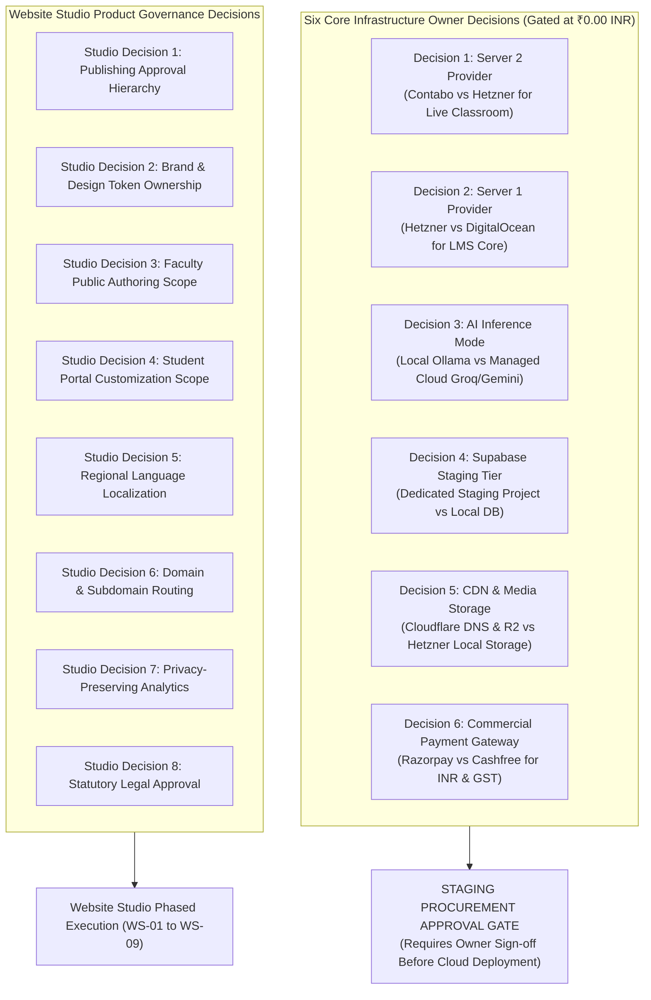

# Zealosh LMS — Owner Decision & External Dependency Register

**Project:** Zealosh Training & Consultants — Zealosh LMS  
**Institution:** Zealosh Training & Consultants, Kollam, Kerala, India  
**Scope:** Formal Inventory of Stakeholder Business Decisions, External Dependencies & Governance Assumptions  
**Procurement Status:** FROZEN AT ₹0.00 INR (Gated Until Formal Development Completion)  
**Date:** November 10, 2026  
**Status:** APPROVED GOVERNANCE REGISTER  

---

## 1. Governance Principles & Strict Procurement Freeze

In strict adherence to the **Engineering Constitution**:
1. **Zero Premature Spending:** The development team is strictly prohibited from purchasing or renting servers, subscribing to cloud SaaS providers, or committing financial liabilities on behalf of Zealosh Training & Consultants without prior written authorization from executive ownership.
2. **No Silent Defaults:** Unresolved technical, commercial, or legal decisions are documented transparently as open decisions with explicit default engineering assumptions. They are never silently marked as closed.
3. **Fail-Closed Integration Boundaries:** All external provider integrations (payments, SMS, WhatsApp, cloud LLMs, object storage) operate through resilient, mock-tested abstraction adapters that fail closed safely if live credentials are absent.

---

## 2. The Six Infrastructure Owner Decisions (Reconciled Baseline)

| Decision ID | Decision Title | Options Under Consideration | Architectural Recommendation | Cost Comparison (Monthly) | Current Status | Impact if Deferred |
| :---: | :--- | :--- | :--- | :--- | :---: | :--- |
| **OD-01** | **Server 2 Provider (Live Classroom)** | Option A: Contabo Cloud VPS XL (10 vCPU, 60GB RAM) Option B: Hetzner Cloud CCX33 (8 vCPU Dedicated, 32GB RAM) | **Hetzner CCX33 Dedicated** (Consistent WebRTC audio/video jitter guarantees) | Contabo: ~₹3,400 INR Hetzner: ~₹4,600 INR | **PENDING OWNER SELECTION** | Live multi-server WebRTC testing remains local; single-server fallback active. |
| **OD-02** | **Server 1 Provider (LMS Core App)** | Option A: Hetzner Cloud CPX31 (4 vCPU, 8GB RAM) Option B: DigitalOcean Basic Droplet (4 vCPU, 8GB RAM) | **Hetzner CPX31** (Superior European bandwidth & pricing) | Hetzner: ~₹1,400 INR DigitalOcean: ~₹3,800 INR | **PENDING OWNER SELECTION** | Deployment automation scripts are provider-agnostic cloud-init templates. |
| **OD-03** | **AI Inference Hosting Mode** | Option A: Local Ollama on Server 3 VPS Option B: Managed API (Groq Llama-3.3-70B / Gemini API) | **Option B: Managed API** (Low fixed cost; pay-per-token avoids dedicated GPU server rental) | Server 3: ~₹4,500 INR/mo API: ~₹500 - ₹1,200 INR/mo | **PENDING OWNER SELECTION** | AI Tutor runs via mock/local fallback in development with zero latency issues. |
| **OD-04** | **Dedicated Supabase Staging Project** | Option A: Supabase Pro Tier ($25/mo) Option B: Self-hosted Supabase Docker on Server 1 | **Option A: Supabase Pro** (Managed PITR backups, zero maintenance overhead) | Supabase Pro: ~₹2,100 INR/mo Self-hosted: ₹0.00 INR (uses RAM) | **PENDING OWNER SELECTION** | Development continues with 100% verified isolated local PostgreSQL container. |
| **OD-05** | **Cloudflare DNS & R2 Storage** | Option A: Cloudflare Free DNS + R2 Object Storage Option B: Native local disk storage on Server 1 | **Option A: Cloudflare + R2** (Zero egress fees for video lecture replays, DDoS protection) | Free DNS + R2: ~₹400 - ₹800 INR/mo Local disk: ₹0.00 INR | **PENDING OWNER SELECTION** | Local disk storage abstraction layer handles all file uploads seamlessly. |
| **OD-06** | **Commercial Payment Gateway Provider** | Option A: Razorpay (India Standard) Option B: Cashfree Payments | **Razorpay** (Broadest UPI/Credit Card support and battle-tested webhook reliability) | 2.0% transaction fee + GST (Zero monthly fixed charge) | **PENDING OWNER SELECTION** | Webhook listener verified with signed mock payloads; checkout orders ready. |

---

## 3. Website Studio Product Governance Decisions & Working Assumptions

To prevent development deadlocks during the Website Studio workstream (`WS-01` to `WS-09`), the following operational decisions are catalogued with their official engineering working assumptions:

### Studio Decision 1: Publishing Approval Hierarchy
- **Question:** Who has the authority to approve and publish pages to the public website?
- **Working Assumption:** Two-tier publishing hierarchy:
  - `STAFF` users can create and edit page content in `DRAFT` status and click "Submit for Approval".
  - Only `ADMIN` and `SUPERADMIN` roles have permission to approve drafts, schedule release dates, and execute public publications.
- **Impact:** Enforced via `cms:publish` permission guard in `src/lib/auth/rbac.ts`.

### Studio Decision 2: Brand & Design Token Ownership
- **Question:** Can regular content editors modify the institutional color palette or typography?
- **Working Assumption:** No. Global branding tokens (Primary Green `#4f8c4c`, Header Dark `#252c41`, font families, border radii) are strictly locked to `SUPERADMIN` authority.
- **Impact:** Preserves visual brand integrity and prevents accidental degradation of WCAG 2.1 AA accessibility contrast ratios.

### Studio Decision 3: Faculty Public Authoring Scope
- **Question:** Can instructors create or publish public marketing pages?
- **Working Assumption:** No. Instructors have authoring access strictly within their assigned Academic Curriculum Tree (lesson syllabi, classwork, quizzes, and office hours). They cannot create top-level marketing pages or modify public course fee schedules.
- **Impact:** Enforces separation of academic instruction from commercial institutional administration.

### Studio Decision 4: Student Portal Customization Scope
- **Question:** Can administrators customize the layout of the student-facing portal via Website Studio?
- **Working Assumption:** The core functional layout of the student dashboard, learning player, and live classroom remains standardized for maximum usability and cognitive consistency. Administrators can only publish institutional announcement banners, featured resources, and promotional career links in designated portal widget slots.
- **Impact:** Protects student user experience and prevents breaking responsive player mechanics.

### Studio Decision 5: Regional Language Localization
- **Question:** What languages must the institutional website and CMS support at launch?
- **Working Assumption:** Initial launch is in **English** (standard industrial safety language in India and the Gulf region). Database schemas utilize standard UTF-8 text encoding to allow future expansion to Malayalam, Hindi, and Arabic without schema modifications.
- **Impact:** Zero internationalization complexity blocking the initial release.

### Studio Decision 6: Domain & Subdomain Routing Strategy
- **Question:** How are public pages and portals separated by domain?
- **Working Assumption:** Single unified domain architecture under `zealosh.com`:
  - Public marketing pages: `zealosh.com/`, `zealosh.com/courses`, `zealosh.com/p/*`
  - Dynamic portals: `zealosh.com/student`, `zealosh.com/instructor`, `zealosh.com/admin`
  - Classroom WebRTC Node: `live.zealosh.com` (dedicated Server 2 WebRTC subdomain)
- **Impact:** Eliminates complex cross-domain cookie and CORS synchronization issues.

### Studio Decision 7: Privacy-Preserving Web Analytics
- **Question:** What analytics platform will track public website visitors and conversion funnels?
- **Working Assumption:** Internal privacy-compliant event tracking (`src/lib/analytics/`) logging to PostgreSQL without third-party tracking cookies, with optional Google Analytics 4 (GA4) injection hook enabled only if authorized.
- **Impact:** 100% compliant with student data privacy laws and zero cookie consent banner friction.

### Studio Decision 8: Statutory Legal & Policy Content Approval
- **Question:** Who is legally responsible for the textual content of the Privacy Policy, Terms & Conditions, and Refund Rules?
- **Working Assumption:** Engineering provides structured semantic templates seeded with standard institutional HSE education disclosures. Final legal text must be reviewed and formally signed off by Zealosh executive management prior to public release.
- **Impact:** Protects the institution against regulatory non-compliance under Indian IT Act and consumer protection regulations.

---

## 4. External Dependency Inventory

| Dependency Key | Provider / System | Purpose in Zealosh Platform | Fallback Mode Active | Live Verification Status |
| :--- | :--- | :--- | :--- | :--- |
| **DEP-01** | BigBlueButton 2.7+ | Real-time WebRTC live audio/video and screen sharing | Verified local mock with SHA-1 signature checks | Gated on Server 2 procurement |
| **DEP-02** | Supabase Auth (GoTrue) | Managed user authentication and session management | Local JWT & mock GoTrue adapter | Operational locally |
| **DEP-03** | Cloudflare DNS & Proxy | Global edge CDN, SSL termination, and DDoS mitigation | Local Nginx reverse proxy with Cloudflare IPv6 CIDRs | Configured & tested |
| **DEP-04** | Cloudflare R2 / S3 | Object storage for recordings, documents, and certificates | Resilient local filesystem storage adapter | Operational locally |
| **DEP-05** | Razorpay / Cashfree | Payment order generation and UPI/Card webhook capture | Mock payment order API with verified webhook test | Gated on Owner Decision 6 |
| **DEP-06** | Meta WhatsApp Cloud API | Automated admission and class reminder notifications | Template-driven outbox logger with mock webhook | Gated on Meta App review |
| **DEP-07** | SMTP Provider (Resend/SES) | Transactional email delivery for outbox dispatch | Local mock SMTP sink & file logging | Operational locally |
| **DEP-08** | LLM Provider (Groq/Gemini) | AI Tutor RAG queries and assignment review suggestions | Local Vector RAG similarity search via pgvector | Operational locally |

---

## 5. Summary & Sign-off Policy

All software adapters for the above dependencies are fully developed, strictly isolated behind clean repository seams, and backed by automated test suites. The platform is capable of running 100% offline in local development mode without incurring external recurring fees.

When executive leadership issues approval for infrastructure procurement, the transition to staging will execute smoothly using the pre-tested automation tooling in `deploy/`.
