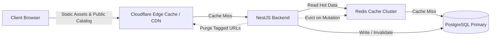

# Zealosh LMS — Performance Engineering & Scalability Plan

**Document Version:** 1.0.0  
**Status:** Performance Baseline  
**Scope:** Frontend Core Web Vitals, Backend Latency Targets, Database Optimization, and Media Delivery.

---

## 1. Verified Performance Engineering Targets

| Metric | Target Specification | Enforcement Mechanism |
| :--- | :--- | :--- |
| **Largest Contentful Paint (LCP)** | $\le$ 2.0s (75th percentile) | Next.js Server Components, optimized font loading (`font-display: swap`), modern WebP/AVIF images with explicit sizing. |
| **Interaction to Next Paint (INP)** | $\le$ 150ms (75th percentile) | Fine-grained React state, debounce on search inputs (300ms), optimistic UI updates for exam bookmarks. |
| **Cumulative Layout Shift (CLS)** | $\le$ 0.05 | Fixed aspect ratio containers on video players and course cards; reserved placeholder heights for dynamic notices. |
| **Cached API Responses (p95)** | $\le$ 150ms | Redis in-memory cache for course catalogs, public syllabi, and static exam blueprints. |
| **Database-Backed API Responses (p95)**| $\le$ 250ms | B-Tree and GIN indexing on high-traffic queries; lean projection (selecting only required columns). |
| **Exam Answer Auto-Save (p95)** | $\le$ 100ms | Lightweight JSON patch updates via indexed `(attempt_id, question_id)` composite keys. |
| **Platform Availability SLA** | 99.9% uptime | Multi-replica stateless containers, database connection pooling with health-check probes. |

---

## 2. Frontend Performance Strategy (Next.js 14+)

1. **Hybrid Rendering Architecture:**
   - **Static Generation with ISR (Incremental Static Regeneration):**
     - Homepage (`/`), Course Landing Pages (`/courses`, `/courses/[slug]`), Quick Card catalogs. Revalidated on course update or every 1 hour.
   - **Server-Side Rendering (SSR) with Edge Streaming:**
     - Student Dashboard (`/student`), Instructor Portal (`/instructor`). Authenticated data streamed with suspense boundaries.
   - **Client-Side SPA Architecture:**
     - Examination Interface (`/exams/[examId]`): Zero full-page reloads, local state persistence in IndexedDB fallback, server background sync.
2. **Asset Optimization:**
   - Next.js `<Image>` component utilizing AVIF/WebP with sharp-based transformations.
   - Subsetting Google Fonts (Inter / Outfit) self-hosted to prevent third-party DNS latency.

---

## 3. Database Optimization & Indexing Schema

```sql
-- High-throughput indexing strategy for PostgreSQL

-- 1. Fast course lookups by slug and publication state
CREATE INDEX idx_courses_slug_status ON courses (slug) WHERE publication_status = 'PUBLISHED';

-- 2. Fast student enrollment resolution
CREATE INDEX idx_enrollments_user_course ON enrollments (user_id, course_id, status);

-- 3. High-velocity exam auto-save and attempt lookups
CREATE INDEX idx_attempt_answers_lookup ON attempt_answers (attempt_id, question_id);
CREATE INDEX idx_exam_attempts_user_exam ON exam_attempts (user_id, exam_id, status);

-- 4. Fast attendance aggregation by session
CREATE INDEX idx_attendance_session ON attendance_records (session_id, user_id);

-- 5. Full-text search on HSE question bank
CREATE INDEX idx_exam_questions_fts ON exam_questions USING GIN (to_tsvector('english', stem || ' ' || explanation));
```

---

## 4. Caching Hierarchy & Invalidation Matrix



### Invalidation Rules:
- **Course Updates:** When an admin or instructor publishes an update to a course, `cache:course:{id}` and `cache:catalog` keys are evicted, and Next.js `revalidatePath('/courses/[slug]')` is triggered.
- **User Entitlements:** Cached in Redis with user session token; invalidated immediately upon new order completion or refund.
- **Zero Cache on Examination State:** Examination state is strictly read directly from PostgreSQL to guarantee zero stale answer reads.
