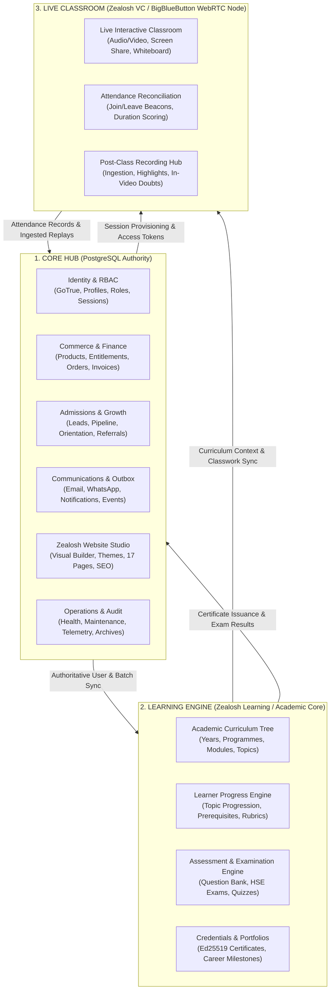
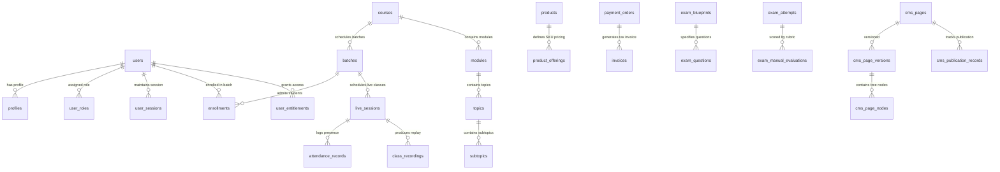

# Zealosh LMS — Product Architecture & Domain Map (Authoritative Specification)

**Project:** Zealosh Training & Consultants — Zealosh LMS  
**Institution:** Zealosh Training & Consultants, Kollam, Kerala, India  
**Scope:** Authoritative Subsystem Boundaries, Entity Model Map & Single-Source-of-Truth Architecture  
**Date:** November 10, 2026  
**Status:** APPROVED ARCHITECTURAL SPECIFICATION  

---

## 1. Architectural Philosophy & The Three Pillars

Zealosh LMS is engineered strictly around three primary functional pillars, governed by the institutional rule of **Data Ownership & Isolation**:

---

## 2. Strict Boundary Defense & Architectural Invariants

### 2.1 Single Source of Truth Invariant
- **PostgreSQL in Supabase** is the sole authoritative system of record for:
  - Users, Profiles, Roles, and Permissions (`users`, `profiles`, `roles`, `user_roles`).
  - Courses, Syllabi, Batches, and Delivery Modes (`courses`, `modules`, `batches`).
  - Admissions, Leads, and Orientation Gating (`admission_applications`, `orientation_bookings`).
  - Orders, Payments, Invoices, and Entitlements (`payment_orders`, `invoices`, `user_entitlements`).
  - Question Banks, Examination Blueprints, and Attempts (`question_bank_items`, `exam_attempts`).
  - Digitally Signed Certificates (`issued_certificates_v2`, `certificate_signing_keys`).
- **Zero Fallback Stores:** No runtime JSON fallbacks or in-memory stores are permitted. `data/zealosh-store.json` is an immutable, byte-preserved historical archive.

### 2.2 Separation of Website Studio from Academic & Financial Truth
The new **Zealosh Website Studio** manages presentation templates, marketing pages, and content layouts. In accordance with the **Engineering Constitution**:
- **Website Studio Must Never Duplicate Academic Entities:** A public course landing page must read its title, syllabus, instructor details, pricing, and batch availability dynamically from PostgreSQL via the Dynamic Bindings Engine (`src/lib/cms/dynamic-bindings.ts`).
- **Website Studio Cannot Mutate Academic Records:** Content editors editing a course page in the Visual PageBuilder modify layout containers, marketing copy, and promotional badges. They cannot alter course graduation requirements, passing thresholds, or fee structures without using authorized academic/commerce APIs.
- **Fail-Closed Security Gating:** Unpublished CMS page drafts, future-scheduled publications, and internal portal previews require authenticated sessions with `cms:view_draft` or `cms:publish` permissions. Public requests for unpublished slugs fail closed with `404 Not Found`.

---

## 3. Database Entity Map Across Subsystems (152 Relational Tables)

### Table Inventory by Domain:
1. **Core Identity & Administration (14 tables):** `users`, `profiles`, `roles`, `user_roles`, `user_sessions`, `login_attempts`, `oauth_codes`, `platform_settings`, `branding_theme`, `navigation_items`, `workspace_layouts`, `maintenance_config`, `maintenance_history`, `audit_logs`.
2. **Learning Engine & Curriculum (26 tables):** `academic_years`, `programmes`, `departments`, `courses`, `modules`, `topics`, `subtopics`, `lessons`, `syllabus_versions`, `delivery_configurations`, `learning_materials`, `learning_progress`, `assignments`, `assignment_submissions`, `quizzes`, `quiz_questions`, `quiz_attempts`, `question_bank_items`, `question_versions`, `item_analytics`, `exam_blueprints`, `exam_questions`, `exam_attempts`, `exam_manual_evaluations`, `course_completion_policies`, `completion_evaluations`.
3. **Credentials & Career (11 tables):** `certificates`, `issued_certificates_v2`, `certificate_signing_keys`, `certificate_audit_logs`, `certifications`, `career_pathways`, `career_pathway_stages`, `student_career_plans`, `student_career_milestones`, `external_credential_evidence`, `achievement_showcases`.
4. **Live Classroom & Replay (10 tables):** `batches`, `live_sessions`, `attendance_records`, `class_recordings`, `recording_batch_access`, `recording_doubts`, `recording_doubt_answers`, `recording_highlights`, `recording_resources`, `classroom_announcements`.
5. **Admissions & Growth (16 tables):** `leads`, `admission_applications`, `admission_offers`, `applicant_documents`, `application_documents`, `course_orientation_configs`, `orientation_sessions`, `orientation_bookings`, `referral_codes`, `referral_attributions`, `institutional_campaigns`, `institutional_partners`, `student_reviews`, `testimonial_consents`, `alumni_profiles`, `instructor_profiles`.
6. **Commerce & Finance (11 tables):** `products`, `product_offerings`, `user_entitlements`, `payment_orders`, `payment_webhook_events`, `invoices`, `invoice_credit_notes`, `reconciliation_runs`, `reconciliation_results`, `points_ledger`, `badge_definitions`.
7. **Communication & Events (16 tables):** `email_outbox`, `email_delivery_events`, `email_templates`, `whatsapp_opt_ins`, `whatsapp_message_logs`, `notifications`, `notification_templates`, `user_notification_preferences`, `conversations`, `conversation_members`, `channel_messages`, `direct_messages`, `channel_moderation_reports`, `event_outbox`, `event_inbox`, `event_deliveries`.
8. **CMS & Website Studio (7 tables):** `cms_pages`, `cms_page_versions`, `cms_page_nodes`, `cms_templates`, `cms_reusable_blocks`, `cms_publication_records`, `cms_scheduled_publications`.
9. **Support & Operations (18 tables):** `support_tickets`, `support_ticket_messages`, `support_ticket_attachments`, `support_ticket_events`, `support_teams`, `support_team_members`, `support_categories`, `support_sla_policies`, `diagnostic_events`, `diagnostic_issues`, `service_health_checks`, `app_error_logs`, `institutional_audit_archives`, `dead_letter_events`, `provisioning_jobs`, `provisioning_steps`, `pwa_offline_events`, `pwa_push_subscriptions`.
10. **Specialized & AI (23 tables):** `ai_tutor_sessions`, `ai_tutor_messages`, `rag_documents`, `rag_document_chunks`, `calendar_feed_tokens`, `institutional_holidays`, `mentorship_appointments`, `instructor_office_hours`, `academic_interventions`, `student_problem_reports`, `enrollment_transfers`, `enrollment_withdrawals`, `workflows`, `feature_flags`, `config_audits`, `domain_registry`, `media_assets`, `student_profiles`, `student_streaks`, `user_badge_awards`, `gamification_rules`, `taxonomy_domains`.

---

## 4. Subsystem Integration & Event Contracts

All cross-pillar communication follows explicit transactional event schemas managed by the **Transactional Event Outbox** (`event_outbox`):

| Event Type | Producer Subsystem | Consumer Subsystem | Payload Description | Idempotency Key Format |
| :--- | :--- | :--- | :--- | :--- |
| `admission.application.offered` | Admissions Pipeline | Provisioning Orchestrator | `applicationId`, `candidateEmail`, `courseId` | `evt-adm-off-{appId}` |
| `commerce.order.completed` | Payment Webhook | Entitlement Engine | `orderId`, `userId`, `productOfferingId` | `evt-ord-cmp-{orderId}` |
| `enrollment.activated` | Provisioning Worker | Learning Engine & Comms | `enrollmentId`, `studentId`, `batchId` | `evt-enr-act-{enrollmentId}` |
| `classroom.session.ended` | Live Classroom Node | Attendance Reconciler | `sessionId`, `attendees[]`, `duration` | `evt-cls-end-{sessionId}` |
| `classroom.recording.ready` | BBB Webhook | Recording Replay Hub | `recordingId`, `bbbInternalId`, `mediaUrl` | `evt-rec-rdy-{recordingId}` |
| `assessment.exam.submitted` | HSE Exam Engine | Evaluation & Cert Engine | `attemptId`, `studentId`, `blueprintId`, `score` | `evt-exm-sub-{attemptId}` |
| `certificate.issued` | Credential Engine | Email Outbox & Student Hub | `certificateId`, `verificationCode`, `pdfUrl` | `evt-crt-iss-{certId}` |
| `cms.page.published` | Website Studio Worker | CDN & Sitemap Service | `pageId`, `slug`, `versionNumber`, `publishedAt` | `evt-cms-pub-{pageId}-{ver}` |

This decoupled outbox pattern guarantees zero distributed transactions, strict atomicity, and self-healing resilience across the entire Zealosh infrastructure.
