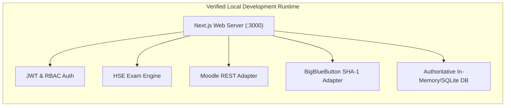

# Zealosh LMS — Project Readiness Assessment

**Document Version:** 1.0.0  
**Status:** High Readiness Baseline  
**Target Milestone:** Transition from Phase 1 Proof-of-Concept to Phase 2 Core Production LMS.

---

## 1. Readiness Dimension Checklist

| Readiness Dimension | Status | Verified Findings | Outstanding Requirements |
| :--- | :--- | :--- | :--- |
| **1. Development Toolchain** | **READY** | Node.js `v24.12.0`, npm `11.6.2`, MinGit `2.56.0`, TypeScript `5.6.3`, Vitest `5.0.5`. | None for local development. |
| **2. Architecture & Design** | **READY** | Next.js 14+ App Router, fullstack API routes, authoritative database repository with strict capacity invariants. | Complete. |
| **3. Brand Alignment** | **READY** | Official logos, green-led color tokens (`#4f8c4c`, `#3a7536`, `#2ea033`), dark neutral header (`#252c41`), extracted from `zealosh.com`. | None. |
| **4. Core Business Workflows** | **READY** | Course catalog, batch selection, capacity checking, enrollment, lesson player, live BBB classroom, timed exam engine. | Verified via browser test. |
| **5. Automated Testing** | **READY** | 17 Vitest unit & integration tests covering auth, adapters, enrollment concurrency, and exam scoring (100% pass). | Expand coverage in Phase 2. |
| **6. Production Bundling** | **READY** | Next.js production build (`npm run build`) generates 16 routes with zero compilation errors. | Ready for containerization. |
| **7. External Integrations** | **STAGED** | Moodle REST adapter and BigBlueButton SHA-1 client tested via contract doubles; remote endpoints configurable via `.env`. | Remote Moodle token & BBB salt needed for staging cloud. |
| **8. Security Baseline** | **READY** | Cookie session tokens, anti-cheat question projection, server-enforced countdown deadlines, immutable audit logging. | Add rate limiting middleware. |

---

## 2. Service Verification Matrix

- **Health Probes:**
  - `GET /api/health/liveness` $\rightarrow$ Returns HTTP 200 `{ status: 'UP' }`.
  - `GET /api/health/readiness` $\rightarrow$ Returns HTTP 200 `{ status: 'READY', metrics: { ... } }`.
- **Browser Playwright Session:**
  - Complete journey executed and saved to `zealosh_e2e_verify_1792891370457.webp`.

---

## 3. Outstanding Prerequisites for Cloud Staging

1. **Production PostgreSQL Database:** Managed PostgreSQL 15/16 instance (e.g. AWS RDS / Supabase) for multi-replica persistence.
2. **Dedicated BigBlueButton Cluster:** Dedicated Ubuntu 22.04 LTS instance or Scalelite pool with public static IP and open UDP ports (16384–32768) for WebRTC media.
3. **Moodle Production Host:** Dedicated Linux host running PHP 8.1+ and Moodle 4.x with Web Services REST enabled.
4. **Commercial Payment Gateways:** Razorpay Key/Secret for India INR transactions; Stripe API keys for international USD/CAD enrollment.
