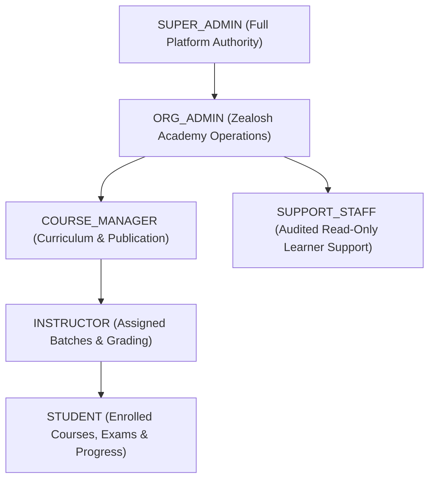

# Zealosh LMS — Security Architecture & Threat Model

**Document Version:** 1.0.0  
**Status:** Security Baseline (OWASP ASVS 4.0 Level 2 Aligned)  
**Target Platform:** Zealosh LMS

---

## 1. Threat Modeling & Attack Surface Analysis

| Threat / Attack Vector | Vulnerable Surface | Countermeasure / Security Control |
| :--- | :--- | :--- |
| **Broken Object Level Authorization (BOLA/IDOR)** | `/api/exams/attempts/:id` `/api/courses/:id/lessons` | Server-side ownership verification: verify `attempt.userId === authenticatedUser.id` and user holds active enrollment for the parent course. |
| **Exam Integrity Tampering** | Client-side timer manipulation; inspecting network payloads for answer keys | Answers & scoring logic stored strictly on server. Exam duration calculated via `server_start_time` + `duration_minutes`. Auto-submit job triggers on server at expiration. Correct answer keys stripped from test delivery payloads. |
| **Session Hijacking & Token Theft** | JWT storage in browser | Access tokens (short-lived, 15m) and Refresh tokens (7 days, rotated on use) stored in `httpOnly`, `Secure`, `SameSite=Strict` cookies. |
| **Privileged Credential Exposure** | BigBlueButton shared secret, Moodle web service token, payment webhook keys | Zero exposure in frontend code or Git repositories. Managed via environment variables and backend config service. |
| **Cross-Site Scripting (XSS)** | Instructor course descriptions, question stems, forum posts | React JSX auto-escaping, HTML sanitization with DOMPurify on any permitted rich-text stems, strict Content Security Policy (CSP). |
| **SQL & NoSQL Injection** | Search inputs, course filters, exam grading queries | Parameterized queries via Prisma ORM and TypeORM; strictly typed DTO validation with `class-validator`. |
| **Media Piracy & Screen Recording** | Recorded lessons, video lectures | Signed, expiring CloudFront/CDN URLs (TTL 120m). Canvas-injected dynamic student watermark overlay (User Name + Email + Dynamic UTC timestamp) rendered during playback. |
| **Payment Spoofing & Replay Attacks** | Webhook listener `/api/payments/webhook` | Webhook signature verification via HMAC-SHA256 with timestamp tolerance window (300s). Enforced idempotency on transaction IDs. |

---

## 2. Server-Side Role-Based Access Control (RBAC)

The system implements strict server-side authorization decorators and middleware. Role hierarchy:

### Authorization Rules:
1. **Instructors:** Can only access and grade students in batches where they are assigned as Lead Instructor, Co-Instructor, or Teaching Assistant in `batch_instructors`.
2. **Students:** Can only access lessons, live sessions, and exams for courses in which they have an active status in `enrollments` (`status = 'ACTIVE'` and `expires_at > NOW()`).
3. **High-Stakes Examination Protection:** Support staff cannot view active examination answer sheets or answers prior to exam submission.

---

## 3. High-Stakes Examination Security Specification

1. **Attempt Initialization:**
   - Validates that the student has not exceeded the maximum permitted attempts (`attempts_used < max_attempts`).
   - Generates an immutable snapshot of question IDs and randomized option order (`attempt_questions`).
   - Server registers `start_time = NOW()` and `scheduled_deadline = NOW() + INTERVAL 'duration_minutes'`.
2. **In-Flight Answer Saving:**
   - Client sends partial answers every 30 seconds or on question navigation via `PUT /api/exams/attempts/:id/answers`.
   - Each answer update is saved with an `updated_at` server timestamp.
3. **Server-Enforced Deadline & Auto-Submission:**
   - Submission is triggered either by student explicit click or by server cron/worker when `NOW() > scheduled_deadline + grace_period (60s)`.
   - Any answer sent after `scheduled_deadline + grace_period` is rejected.
4. **Scoring & Integrity Sealing:**
   - Scoring algorithm runs on server: compares selected option IDs against authoritative `exam_questions.correct_options`.
   - Results record is written to `exam_attempts` with `status = 'COMPLETED'`, `score`, `passed`, and `completed_at`.
   - Post-completion, the attempt record becomes read-only.

---

## 4. Comprehensive Audit Trail

All sensitive operations write an immutable entry to `audit_logs`:
- User authentication events (Login, MFA challenge, Logout, Failed attempts).
- Course publication and pricing adjustments.
- Manual grade adjustments and instructor feedback overrides.
- Certificate generation and revocation.
- Administrative role grants and revocations.
- Payment refunds and enrollment cancellations.
