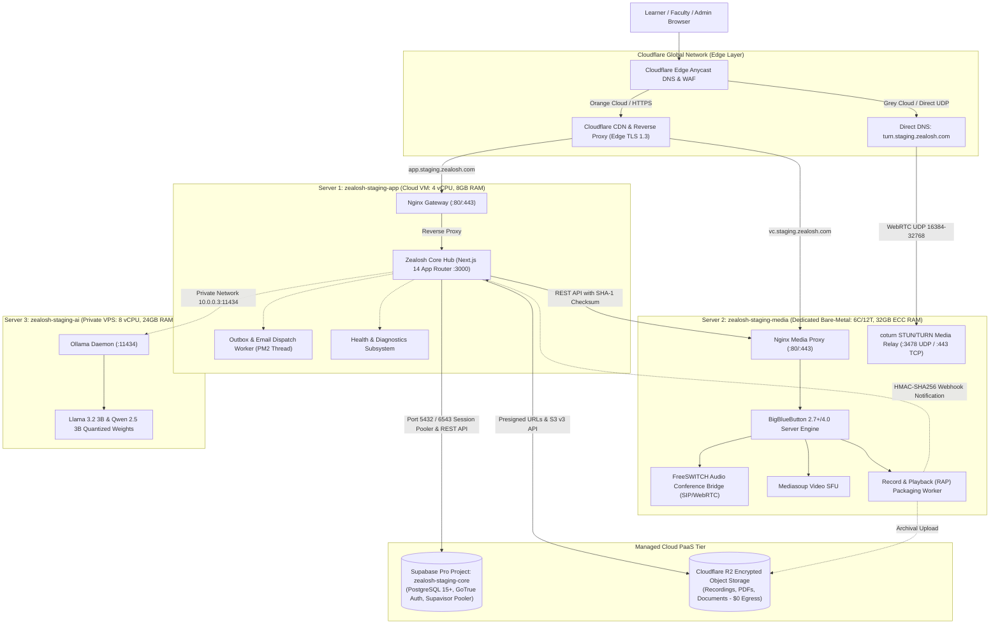
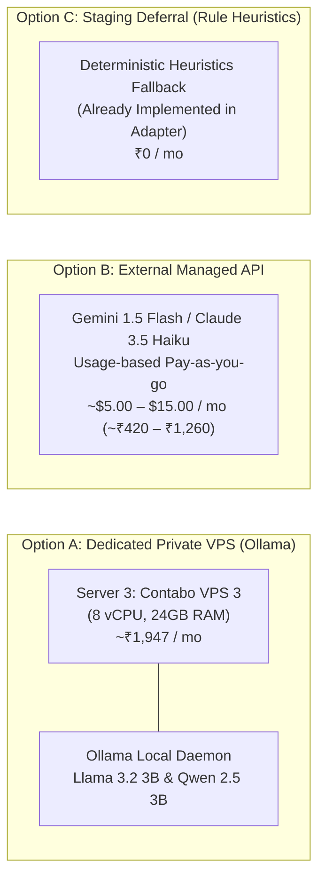

# Zealosh LMS — Staging Infrastructure Architecture & Subsystem Specification

**Project:** Zealosh Training & Consultants — Zealosh LMS  
**Milestone:** ZM-IMPL-09 — Stage A: Staging Infrastructure Architecture, Technical Readiness & Procurement Planning  
**Target Architecture:** Multi-Node Isolated Production Staging Architecture v3.1  
**Authoritative Institution:** Zealosh Training & Consultants, Kollam, Kerala, India  
**Date:** November 2026  
**Status:** **ARCHITECTURE DESIGN COMPLETE — CHARGES STRICTLY FROZEN**

---

## 1. Global Staging Architecture Overview

The Zealosh LMS staging infrastructure is designed as a decoupled, multi-node topology that isolates compute-intensive workloads (real-time WebRTC media and AI inference) from the core web application and delegates stateful persistence to managed cloud platforms.

---

## 2. Server 1: Zealosh LMS Core Application Host

### 2.1 Role & Subsystem Workloads
Server 1 is the primary web application host responsible for:
- Next.js 14.2.15 standalone server running React Server Components (RSC) and Client Components.
- 112 App Router API route handlers (Authentication, Admissions Kanban, Course Delivery, Invoicing, Certificate Verification, Exam Engine, Support Tickets).
- Superadmin Command Center, Student Dashboard, Instructor Workspace, and Public Course Catalog.
- Background asynchronous processing: Transactional outbox event dispatcher (`event_outbox`), scheduled email dispatch worker (`email_outbox`), and admissions stage automation.
- Inbound webhook receivers: Payment provider webhooks (Razorpay/Stripe), BigBlueButton recording completion webhooks, and WhatsApp status webhooks.
- In-memory rate limiting and application diagnostics endpoints (`/api/health`, `/api/admin/diagnostics/*`).

### 2.2 Sizing & Hardware Specifications
| Dimension | Staging Specification | Rationale & Operational Tolerance |
| :--- | :--- | :--- |
| **Compute / CPU** | 4 vCPUs (Dedicated or High-Priority Shared AMD EPYC) | Next.js SSR rendering + PM2 cluster mode (2 worker threads) + background outbox polling. |
| **Memory / RAM** | 8 GB DDR4/DDR5 RAM | Node.js process baseline (~600 MB per worker) + Nginx buffers + OS page cache. Memory ceiling capped at 1.5 GB per worker via PM2 `max_memory_restart`. |
| **Operating System** | Ubuntu 24.04 LTS 64-bit | Enterprise Linux kernel (Linux 6.8+), long-term security maintenance through 2029, modern systemd. |
| **Storage Type** | NVMe SSD in RAID or Data Center Cloud Block Storage | High IOPS for temporary compilation caches, static asset delivery, and local audit logging. |
| **Storage Capacity** | 80 GB to 160 GB NVMe | 20 GB OS/packages + 10 GB application builds/artifacts + 30 GB local rolling logs/temp uploads + 20+ GB safety headroom. |
| **Network Throughput**| 1 Gbps public port; 10 TB to 20 TB monthly traffic | Sufficient for all staging web traffic, API calls, and PDF certificate generation. |
| **Concurrent Users** | 50–100 simultaneous active users | Supports institutional UAT journeys, admin operations, and mock candidate testing sessions. |

### 2.3 Process Architecture & Reverse Proxy
- **Runtime:** Node.js 20 LTS (Active LTS, v20.18+).
- **Process Supervisor:** PM2 runtime in cluster mode (`ecosystem.config.js`):
  - `instances: 2` (binds to 2 vCPUs, leaving 2 vCPUs free for OS tasks, SSL handshakes, and background outbox polling).
  - `exec_mode: 'cluster'`.
  - `autorestart: true`.
  - `max_memory_restart: '1500M'`.
- **Reverse Proxy:** Front-facing Nginx 1.24+:
  - Terminating TLS 1.2 and TLS 1.3 with Cloudflare Origin CA certificates or Let's Encrypt.
  - Proxying HTTP requests to `http://127.0.0.1:3000` with HTTP/1.1 keep-alive connections.
  - Forwarding WebSocket connections for real-time messaging and diagnostics (`Upgrade: $http_upgrade`).
  - Gzip and Brotli static file compression for JavaScript chunks and SVG assets.
  - Security headers enforced at web server level: `X-Frame-Options: SAMEORIGIN`, `X-Content-Type-Options: nosniff`, `Strict-Transport-Security`.

### 2.4 Staging Adequacy Determination
> **Verdict: Single Application Server is 100% Sufficient for Staging.**  
> In staging, the total concurrent active user count will not exceed 25–50 simultaneous users during organized UAT testing. A 4-core, 8 GB RAM instance delivers over 300% headroom above peak staging requirements. Multi-server clustering and public load balancers are an unnecessary cost for staging and are strictly deferred to production.

---

## 3. Server 2: Zealosh VC (BigBlueButton Media Node)

### 3.1 Role & WebRTC Workloads
Server 2 is the dedicated media engine powering Zealosh VC live classrooms:
- BigBlueButton 2.7+ / 4.0 software stack running natively on Ubuntu 24.04 LTS.
- FreeSWITCH SIP audio conference bridge: Transcodes, mixes, and synchronizes real-time bidirectional audio for all meeting participants.
- Mediasoup WebRTC Selective Forwarding Unit (SFU): Routes multi-party video streams, screen sharing, and presenter feeds.
- Redis pub/sub signaling engine and Meteor/HTML5 client server.
- Record and Playback (RAP) pipeline: Captures raw audio, deskshare video, whiteboard events, and chat streams; stitches and encodes them into standard MP4/WebM presentations.
- Built-in `coturn` STUN/TURN server to relay WebRTC media streams across restrictive corporate or mobile firewalls.

### 3.2 Technical Justification: Why Video Conferencing Demands a Dedicated Server
1. **Hypervisor Scheduling Jitter & CPU Steal Time:**  
   Virtual machines on shared public cloud hosts suffer from CPU steal time caused by "noisy neighbors." While a 200ms latency spike is unnoticeable when loading a web page, in real-time WebRTC audio mixing (which operates on 20ms audio frames), CPU scheduling delays cause immediate audio robotic distortion, packet loss, and desynchronization.
2. **CPU-Intensive Real-Time Transcoding:**  
   FreeSWITCH audio mixing and multi-user video routing place sustained, non-bursting CPU loads on server cores. Running this on the same server as the Next.js LMS would starve Node.js event loops and database connection threads.
3. **Heavy Video Recording Encoding (RAP Pipeline):**  
   At the conclusion of a 90-minute live masterclass, the RAP recording worker executes multi-threaded FFmpeg encoding jobs that consume 100% of all available CPU cores for 15–30 minutes. If co-located with the LMS, the entire learning platform would experience severe HTTP 504 timeouts and dropped API requests during recording post-processing.
4. **Network Port & Socket Architecture:**  
   WebRTC requires thousands of ephemeral UDP ports (`16384–32768/udp`) for RTP media streams, which cannot be reverse-proxied through standard HTTP web proxies like Cloudflare CDN.

### 3.3 Sizing & Hardware Specifications
| Dimension | Recommended Specification (OVHcloud Rise-1) | Secondary Fallback (Contabo Cloud VDS M) |
| :--- | :--- | :--- |
| **Server Category** | **Physical Dedicated Bare-Metal** | Dedicated Virtual Server (100% Dedicated vCPUs) |
| **CPU Architecture** | Intel Xeon-E 2386G (6 Cores / 12 Threads @ 3.5 GHz base / 4.7 GHz turbo) | AMD EPYC 7282 (8 Dedicated vCPUs @ 2.8 GHz) |
| **RAM** | 32 GB DDR4 ECC RAM | 32 GB RAM |
| **Storage** | 2x 512 GB NVMe SSD (Soft RAID-1) | 240 GB NVMe SSD |
| **Public Bandwidth** | **1 Gbps Unmetered** (Crucial for video bursts) | 1 Gbps Port, 32 TB Fair Use Policy |
| **Concurrent Capacity** | Up to 150 simultaneous video users (3 simultaneous cohorts of 50 students) | Up to 120 simultaneous video users |
| **Monthly Cost** | **~₹6,195 / mo (incl. 18% GST)** | **~₹5,074 / mo (incl. 18% GST)** |
| **Budget Ceiling** | **PASSED (< ₹10,000/mo ceiling)** — 38% Headroom | **PASSED (< ₹10,000/mo ceiling)** — 49% Headroom |

### 3.4 Media Networking, Ports & Firewall Configuration
Server 2 requires direct public IP routing for WebRTC UDP packets. The host firewall (`ufw`) must strictly allow:
- `80/tcp` & `443/tcp`: HTTP/HTTPS web signaling, HTML5 client, and API requests.
- `16384–32768/udp`: WebRTC RTP audio and video media streams (FreeSWITCH & Mediasoup).
- `3478/tcp` & `3478/udp`: STUN/TURN binding requests.
- All other ports (e.g. FreeSWITCH internal SIP 5060, Redis 6379, MongoDB internal) must be bound strictly to `127.0.0.1` and blocked from public ingress.

---

## 4. AI Tutoring & Assessment Infrastructure (Zealosh AI)

### 4.1 Workload Profile & Requirements
The Zealosh AI subsystem powers:
- AI-assisted formative essay grading and rubric suggestions for faculty review.
- Course-grounded AI tutor drawer providing syllabus-cited answers to student doubts.
- RAG vector search across course syllabi, module summaries, and HSE regulatory standards.

### 4.2 Three Architectural Options Evaluated

| Evaluation Dimension | Option A: Dedicated Private VPS (Ollama Server 3) | Option B: External Managed API (Gemini / Anthropic) | Option C: Staging Deferral (Deterministic Fallback) |
| :--- | :--- | :--- | :--- |
| **Hosting Model** | Self-hosted Contabo Cloud VPS 3 (8 vCPU, 24 GB RAM) | Cloud SaaS API via HTTPS endpoint | Local deterministic heuristics active in codebase |
| **Inference Quality** | High (Quantized 3B/7B open-weight models) | Exceptional (State-of-the-art frontier reasoning) | Baseline rule-based guidance |
| **Monthly Cost** | ~₹1,947 / mo fixed | ~$5 – $15 / mo (~₹420 – ₹1,260) usage-metered | **₹0 / mo** |
| **Privacy / Data Security** | Total data sovereignty; zero data leaves private network | Data subject to provider API terms (zero training on API) | Zero external data transmission |
| **Operational Overhead**| High (OS maintenance, Ollama restarts, model caching) | Minimal (REST API key configuration only) | Zero |
| **Staging Recommendation**| **Secondary Choice** (if strict self-hosting is required) | **STRONGLY RECOMMENDED FOR STAGING** | **Safe Fallback during initial boot** |

### 4.3 Staging AI Recommendation
> [!TIP]
> **Recommended Strategy for Staging:**  
> Use **Option B (External Managed API — Gemini 1.5 Flash / Claude 3.5 Haiku)** for staging UAT. At staging request volumes (< 500 prompts/month), total API costs will be under **₹500 INR/month**, eliminating the need to provision, manage, and pay for Server 3 (~₹1,947/month). If the institution subsequently mandates strict on-premise data residency, Server 3 can be provisioned using the ready-to-execute runbook (`docs/infrastructure/ZEALOSH_STAGING_PROVISIONING_RUNBOOKS.md`).

---

## 5. Authoritative Database Architecture (Supabase PostgreSQL)

### 5.1 Staging Database Isolation Principles
In accordance with Rule 7 ("Database integrity is mandatory") and Principle 3 ("Data Ownership & Isolation"):
1. **Zero Database Sharing:** Staging must connect to a completely separate, dedicated Supabase project (`zealosh-staging-core`). Under no circumstances may staging share database instances, connection pools, or credentials with production.
2. **Zero Production PII in Staging:** Real student personal identification information, Aadhaar numbers, phone numbers, or credit card records must never be cloned into staging. Staging databases are initialized using clean, forward-only SQL migrations and synthetic test fixtures (`usr-student-01`, `usr-faculty-01`, etc.).
3. **Fail-Closed Persistence (ADR-004):** When `DATABASE_STORAGE="supabase"` is set in `.env.staging`, the application enforces strict PostgreSQL persistence. If Supabase is unreachable, the system fails closed with descriptive HTTP 503 errors rather than falling back to volatile local files.

### 5.2 Managed Tier Specifications & Sizing
- **Provider Tier:** **Supabase Pro Plan ($25/mo, ~₹2,478/mo incl. GST)**.
- **Region:** `ap-south-1` (Mumbai, India) for lowest latency to Kerala users (or `eu-central-1` Frankfurt).
- **Compute:** 2-core shared CPU with 1 GB dedicated RAM (scalable to 8 GB+ via compute add-ons).
- **Storage:** 8 GB dedicated NVMe storage with auto-expansion up to 100 GB.
- **Connection Pooling:** Built-in **Supavisor connection pooler**:
  - **Transaction Pooler (Port 6543):** Used by Next.js Server Actions and API route handlers for high-concurrency, short-lived queries (up to 200 concurrent client connections).
  - **Session Pooler (Port 5432):** Used exclusively for administrative DDL migration scripts and schema migrations.
- **Automated Backups:** Daily automated backups retained for 7 days, with Point-In-Time Recovery (PITR) up to 7 days included.

### 5.3 Schema Migration Promotion Protocol
1. Staging migrations are applied strictly from the repository's 29 chronological SQL files (`supabase/migrations/*.sql`).
2. Migrations are executed forward-only using the Session Pooler (`psql -h aws-0-ap-south-1.pooler.supabase.com -p 5432 ...`).
3. After execution, the automated verification script (`scripts/verify-isolated-postgresql.mjs`) verifies that all 145 canonical tables exist and 100% have Row-Level Security (`relrowsecurity = true`).

---

## 6. Object & Media Storage Architecture

### 6.1 Requirements & Data Classification
The platform stores seven distinct categories of file assets:
1. **Classroom Video Recordings (MP4/WebM):** 200 MB to 1.5 GB per 90-minute session.
2. **Student Admission Documents:** Scanned identity cards, degree certificates, statements of purpose (PDF/PNG, 1–10 MB).
3. **Course Materials & Presentations:** Slides, syllabus documents, reading packs (PDF, 5–50 MB).
4. **Student Assignment Submissions:** Homework files, code archives, project reports (PDF/ZIP, 1–25 MB).
5. **Tamper-Evident Certificates:** Cryptographically signed PDF certificates with embedded QR codes (PDF, ~500 KB).
6. **User Avatars & Institutional Media:** Profile pictures, course thumbnails, marketing posters (WebP/PNG, < 2 MB).
7. **Institutional Audit Archives:** Gzip-compressed immutable audit logs and database snapshots (TAR.GZ, 50–500 MB).

### 6.2 Provider Evaluation Matrix
| Evaluation Dimension | Cloudflare R2 (Recommended) | AWS S3 Standard | OVHcloud Object Storage |
| :--- | :--- | :--- | :--- |
| **Storage Cost (per GB/mo)** | $0.015 / GB (~₹1.26 / GB) | $0.023 / GB (~₹1.93 / GB) | €0.01 / GB (~₹0.93 / GB) |
| **Egress / Download Bandwidth**| **$0.00 (100% Free Unmetered)** | **$0.09 / GB (~₹7.56 / GB)** | €0.01 / GB (~₹0.93 / GB) |
| **Free Tier Allowance** | **10 GB storage, 1M Class A, 10M Class B** | 5 GB storage for 12 months only | None |
| **API Compatibility** | S3 API Compatible (AWS SDK v3) | Native S3 | S3 API Compatible (OpenStack Swift) |
| **Presigned URLs** | Supported (up to 7 days duration) | Supported | Supported |
| **Class B Operations (Reads)** | $0.36 per million requests | $0.40 per million requests | Included in low tiers |
| **Video Streaming Suitability**| **EXCEPTIONAL (Zero egress tax on video)**| **VERY EXPENSIVE (High egress fees)** | Moderate |
| **Staging Recommendation** | **STRONGLY RECOMMENDED** | Disqualified on egress costs | Secondary alternative |

### 6.3 S3 Client Configuration & Bucket Lifecycle
- The application interacts with R2 using `src/lib/storage/s3-storage-client.ts`.
- **Bucket Name:** `zealosh-staging-storage`.
- **Lifecycle Policies:**
  - `recordings/`: Retained indefinitely in staging, transitioned to Infrequent Access after 90 days.
  - `temp-uploads/`: Automatically deleted after 48 hours via R2 lifecycle rules.
  - `audit-archives/`: Retained for 365 days.
- **Access Control:** Bucket is completely private (no public read permissions). All file access is governed by HMAC-signed, time-limited presigned URLs (default 15 minutes validity for downloads; 5 minutes for uploads).

---

## 7. Edge CDN & Web Application Firewall (Cloudflare)

### 7.1 DNS & Edge Proxy Topology
Cloudflare operates as the authoritative DNS provider and Edge reverse proxy for `zealosh.com`:
- **Apex & Web Subdomains (`app.staging.zealosh.com`):** Proxied through Cloudflare (Orange Cloud enabled). Provides anycast edge caching for static Next.js assets (`/_next/static/*`), TLS 1.3 termination, automatic HTTP/2 and HTTP/3 support, and Layer 3/4/7 DDoS mitigation.
- **Media Signaling Subdomain (`vc.staging.zealosh.com`):** Proxied through Cloudflare (Orange Cloud) for HTTPS web access and WebSocket signaling (`/bigbluebutton/api`, `/html5client`).
- **WebRTC TURN Subdomain (`turn.staging.zealosh.com`):** Direct DNS-only (Grey Cloud enabled). Cloudflare does not proxy arbitrary UDP streams; WebRTC media ports must route directly to Server 2's public IP address.

### 7.2 Web Application Firewall (WAF) & Rate Limiting Rules
1. **Admin Console Protection:** Rate limit `POST /api/auth/login` to 10 requests per minute per IP address.
2. **Webhook Endpoint Allowlisting:** Payment webhooks (`/api/payments/webhook`) and recording webhooks (`/api/webhooks/bbb/*`) require HMAC signature validation in application middleware before request bodies are processed.
3. **Geo-Fencing (Optional Staging Rule):** Restrict staging admin login access to authorized IP ranges or Indian / UAE geographic regions.
4. **SSL/TLS Mode:** Configured to **Full (Strict)**. Traffic between Cloudflare Edge and Server 1/2 is encrypted using valid Origin CA certificates with strict verification.

