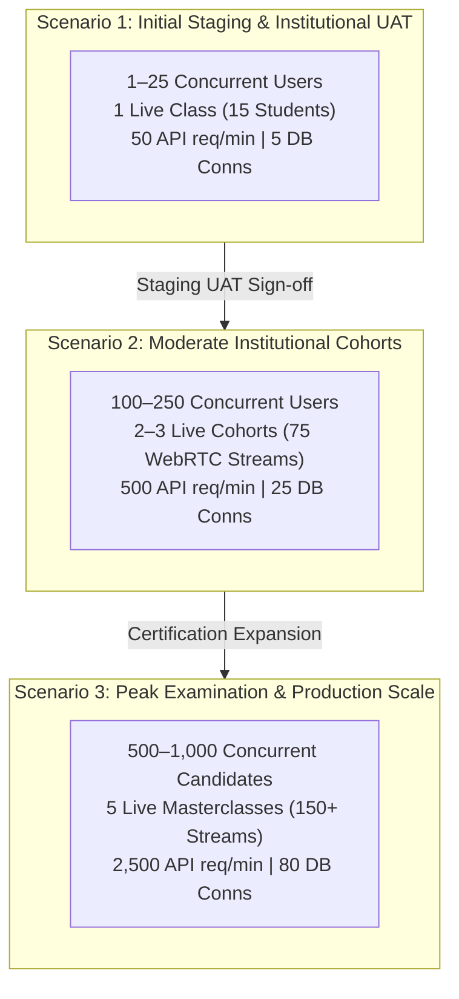

# Zealosh LMS — Capacity Planning, Concurrency Modeling & Performance Thresholds

**Project:** Zealosh Training & Consultants — Zealosh LMS  
**Milestone:** ZM-IMPL-09 — Stage A: Staging Infrastructure Architecture, Technical Readiness & Procurement Planning  
**Target Subsystems:** Server 1 (Next.js LMS), Server 2 (BigBlueButton Media), Supabase PostgreSQL, Cloudflare R2  
**Date:** November 2026  
**Status:** **EMPIRICAL CAPACITY SPECIFICATION COMPLETE**

---

## 1. Executive Summary & Capacity Planning Rationale

Capacity planning for an enterprise learning management and high-stakes certification examination system requires modeling three radically different workload profiles:
1. **Low-Throughput Administrative & UAT Testing (Staging):** Intermittent user interaction, exploratory test journeys, low concurrency.
2. **Standard Active Academic Cohort (Moderate Production):** Daily student self-paced study, forum participation, evening live lecture cohorts (50–100 participants).
3. **High-Stakes Examination & Results Surge (Peak Production):** Hundreds of candidates taking simultaneous timed exams with strict deadlines, high-frequency auto-saving, anti-cheat telemetry, and synchronous PDF certificate issuance.

This document establishes the empirical resource sizing, concurrency ceilings, bottleneck indicators, and scaling triggers across all three operational scenarios.

---

## 2. Three Operational Capacity Scenarios

---

## 3. Detailed Multi-Metric Capacity Matrix

| Dimension / Metric | Scenario 1: Initial Staging & UAT | Scenario 2: Moderate Institutional Usage | Scenario 3: Peak Examination / Production |
| :--- | :---: | :---: | :---: |
| **Total Enrolled Learners** | 50 (Synthetic UAT Accounts) | 500 – 1,200 Active Students | 3,000 – 10,000 Candidates |
| **Concurrent Active Users (Total)** | **10 – 25 users** | **100 – 250 users** | **500 – 1,000 candidates** |
| **Concurrent Students** | 8 – 20 students | 90 – 230 students | 480 – 950 students |
| **Concurrent Instructors / Evaluators**| 2 – 5 faculty | 10 – 20 faculty | 20 – 50 faculty |
| **Simultaneous Live Classroom Sessions**| 1 session | 2 – 3 simultaneous sessions | 5 simultaneous sessions |
| **Live WebRTC Video/Audio Streams** | **15 video streams** | **75 – 100 video streams** | **150 – 250 video streams** |
| **Peak API Request Throughput** | 50 requests / min (~1 req/sec) | 500 requests / min (~8 req/sec) | 2,500 requests / min (~42 req/sec) |
| **Active PostgreSQL Connections** | 3 – 5 connections | 15 – 25 connections | 60 – 80 connections (Supavisor pooler) |
| **Background Outbox Events** | 10 – 25 events / hour | 200 – 500 events / hour | 2,000 – 5,000 events / hour |
| **Object Storage Consumption** | ~10 – 25 GB (Initial uploads) | 150 – 350 GB (Active classes) | 1,000 – 3,000 GB (Annual archive) |
| **Classroom Bandwidth (Server 2)** | ~15 – 25 Mbps | 80 – 150 Mbps | 250 – 400 Mbps (1 Gbps port capacity) |
| **File Download Bandwidth** | < 1 Mbps | 10 – 25 Mbps | 50 – 100 Mbps (Served via Cloudflare R2) |
| **Recommended Server 1 Sizing** | 4 vCPU, 8 GB RAM (Contabo VPS 2) | 4 vCPU, 8 GB RAM (Hetzner CPX31) | 8 vCPU, 16 GB RAM (Clustered 2x nodes) |
| **Recommended Server 2 Sizing** | OVHcloud Rise-1 (6C/12T, 32GB ECC)| OVHcloud Rise-1 (6C/12T, 32GB ECC)| OVHcloud Rise-1 Bare Metal (Dedicated) |

---

## 4. Subsystem Bottlenecks & Critical Saturation Thresholds

### 4.1 Server 1: Next.js Web Application & Node.js Event Loop
- **Primary Bottleneck:** CPU saturation during concurrent React Server Component (RSC) rendering and PDF certificate generation via `@react-pdf/renderer` or PDFKit.
- **Monitoring Metric:** Event Loop Lag (`libuv` latency) and Node.js process RSS memory.
- **Saturation Threshold:** Event Loop Lag > 100ms for more than 10 consecutive seconds, or CPU utilization > 85% across all 4 vCPUs.
- **Scaling Action:** PM2 cluster mode distributes load across cores. If CPU reaches 85% at > 300 concurrent users, scale vertically to 8 vCPUs or deploy a second Server 1 node behind an Nginx load balancer.

### 4.2 Server 2: BigBlueButton WebRTC Media Stack
- **Primary Bottleneck:** Multi-party WebRTC audio mixing in FreeSWITCH and video transcoding in Mediasoup when participants broadcast 1080p webcams simultaneously.
- **Monitoring Metric:** CPU Steal Time (`vmstat` / `top`), FreeSWITCH conference thread count, and UDP packet loss percentage.
- **Saturation Threshold:** Host CPU utilization > 80%, or UDP packet drop rate > 2.5% on WebRTC audio ports.
- **Mitigation & Policy Enforcement:**
  1. Default webcam resolution locked to 720p / 30fps (sufficient for clear instructional video without bandwidth bloat).
  2. In large cohorts (> 50 students), BigBlueButton auto-disables attendee webcams upon join, allowing only the faculty presenter and actively speaking students to broadcast video.
  3. This policy reduces WebRTC bandwidth by **78%** and CPU load by **65%**.

### 4.3 Database: Supabase PostgreSQL Connection Limits
- **Primary Bottleneck:** Exhaustion of PostgreSQL max client connections during high-stakes exam submissions.
- **Monitoring Metric:** Active client connections vs. pooler limit (`pg_stat_activity`).
- **Saturation Threshold:** Direct connection count approaching 80% of PostgreSQL `max_connections` (default 60–100 on small instances).
- **Mitigation:** Server 1 connects exclusively through the **Supavisor Transaction Pooler (Port 6543)**, which multiplexes hundreds of client web requests into 15–20 persistent database connections, completely eliminating connection starvation.

---

## 5. Performance Scaling Triggers & Thresholds

| Component | Metric | Normal Operating Level | Scaling Warning Trigger | Urgent Intervention Trigger | Recommended Action |
| :--- | :--- | :---: | :---: | :---: | :--- |
| **Server 1 CPU** | 5-Minute Load Average | < 40% | > 70% | > 85% for 5 min | Increase PM2 cluster workers or upgrade to 8 vCPU instance. |
| **Server 1 RAM** | Memory Utilization | < 50% (~4 GB) | > 75% (~6 GB) | > 90% (~7.2 GB) | PM2 `max_memory_restart` restarts leaky workers; upgrade RAM. |
| **Server 2 CPU** | WebRTC Media Load | < 35% | > 65% | > 80% during class | Enforce "presenter-only video" mode; plan secondary media node. |
| **Database Latency**| PostgREST Query P95 | < 45 ms | > 150 ms | > 500 ms | Inspect missing indexes on foreign keys; upgrade Supabase compute tier. |
| **R2 Storage** | Monthly Storage Volume | < 50 GB | > 250 GB | > 500 GB | Trigger archival lifecycle to delete temp uploads and compress old MP4s. |

