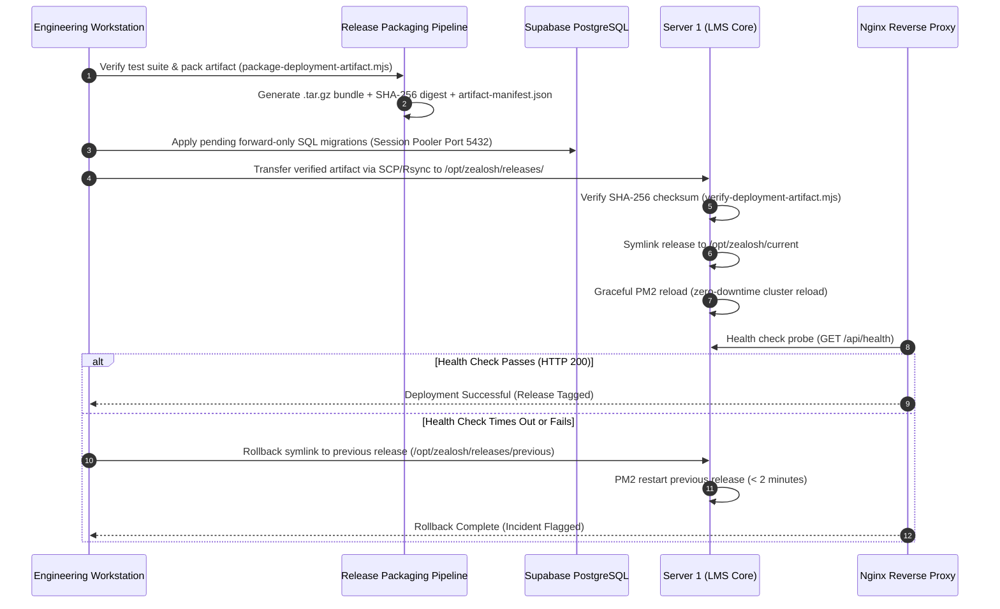

# Zealosh LMS — Staging Deployment Pipeline, Release Controls & Rollback Runbook

**Project:** Zealosh Training & Consultants — Zealosh LMS  
**Milestone:** ZM-IMPL-09 — Stage A: Staging Infrastructure Architecture, Technical Readiness & Procurement Planning  
**Execution Target:** Staging Server 1 (`app.staging.zealosh.com`) & Server 2 (`vc.staging.zealosh.com`)  
**Deployment Status:** **PROHIBITED IN STAGE A — RUNBOOK SPECIFICATION ONLY**  
**Date:** November 2026  

---

## 1. Executive Summary & Release Principles

To prevent deployment collisions, duplicate event processing, and unexpected downtime, this runbook establishes the deterministic deployment and rollback lifecycle for the **Zealosh LMS** staging platform.

### Non-Negotiable Release Invariants:
1. **Single-Worker Execution:** Only one instance of the outbox processor and email dispatcher worker may run across the cluster to eliminate duplicate transactional notifications or double enrollment triggers.
2. **Deterministic Migration Locking:** Database migrations must execute serially before application worker reloads. Concurrent DDL operations are strictly forbidden.
3. **Immutable Deployment Artifacts:** Servers never build code from source in production; they unpack pre-compiled, cryptographically verified build archives generated by `deploy/package-deployment-artifact.mjs`.
4. **Fast Rollback Guarantee:** If post-deployment smoke tests fail, the system must roll back to the previous verified release in **under 2 minutes** without database destruction.

---

## 2. Release Pipeline Overview



---

## 3. Pre-Deployment Validation & Gating (Phase 1)

Before initiating a release to Server 1:
1. **Local Test Verification:** All 106 Vitest files and 14 Playwright E2E specs must pass 100% green:
   ```bash
   npx tsc --noEmit
   npx vitest run
   npx playwright test
   ```
2. **Generate Immutable Deployment Artifact:**
   ```bash
   # Generates build/artifacts/zealosh-lms-staging-v<version>-<timestamp>.tar.gz
   node deploy/package-deployment-artifact.mjs
   ```
3. **Verify Artifact Integrity Locally:**
   ```bash
   node deploy/verify-deployment-artifact.mjs build/artifacts/zealosh-lms-staging-*.tar.gz
   # Must confirm: node_modules, .next, .env, and data/zealosh-store.json strictly excluded.
   ```

---

## 4. Controlled Deployment Procedure (Phases 2 through 6)

### Phase 2: Schema Migration Execution (Isolated Serial DDL)
Migrations are executed forward-only against the staging database before the new code is activated:
```bash
# Connect directly to Supabase Session Pooler (Port 5432)
export PGPASSWORD="<SUPABASE_STAGING_DB_PASSWORD>"
psql -h aws-0-ap-south-1.pooler.supabase.com -p 5432 -U postgres.zealosh-staging-core -d postgres \
  -f supabase/migrations/<PENDING_MIGRATION>.sql

# Verify table presence and Row-Level Security
node scripts/verify-isolated-postgresql.mjs
```

### Phase 3: Artifact Transfer & Unpacking on Server 1
```bash
# Connect as deployer user
RELEASE_DIR="/opt/zealosh/releases/release-$(date +%Y%m%d%H%M%S)"
mkdir -p "$RELEASE_DIR"

# Transfer and unpack artifact
scp build/artifacts/zealosh-lms-staging-latest.tar.gz deployer@<SERVER_1_IP>:/tmp/
ssh deployer@<SERVER_1_IP> "tar -xzf /tmp/zealosh-lms-staging-latest.tar.gz -C $RELEASE_DIR"

# Link shared persistent configuration
ssh deployer@<SERVER_1_IP> "ln -sf /opt/zealosh/shared/.env.staging $RELEASE_DIR/.env.staging"

# Install production dependencies and build optimized Next.js bundle
ssh deployer@<SERVER_1_IP> "cd $RELEASE_DIR && npm ci --omit=dev && npm run build"
```

### Phase 4: Atomic Release Switch & Graceful Process Reload
```bash
# Update current release symlink atomically
ssh deployer@<SERVER_1_IP> "ln -sfn $RELEASE_DIR /opt/zealosh/current"

# Gracefully reload PM2 cluster without dropping active HTTP connections
ssh deployer@<SERVER_1_IP> "cd /opt/zealosh/current && pm2 reload ecosystem.config.js"
```

### Phase 5: Post-Deployment Smoke Testing & Health Verification
Execute non-destructive automated health probes:
```bash
# 1. Check core health endpoint
curl -s -f https://app.staging.zealosh.com/api/health | jq .
# Must report "status": "HEALTHY" or "ok"

# 2. Check subsystem diagnostics
curl -s -f -H "x-zealosh-internal-key: <ADMIN_INTERNAL_KEY>" \
  https://app.staging.zealosh.com/api/admin/diagnostics/health | jq .
# Must report Supabase status "HEALTHY" with latency < 150ms

# 3. Verify public login page loads
curl -s -I https://app.staging.zealosh.com/login | grep "HTTP/2 200"
```

---

## 5. Rapid Rollback Runbook (< 2 Minutes)

If health probes fail, error rates spike, or unexpected regressions occur:

### Step 1: Atomic Symlink Reversion
```bash
# On Server 1:
cd /opt/zealosh
PREVIOUS_RELEASE=$(ls -dt /opt/zealosh/releases/release-* | sed -n '2p')

echo "Rolling back to: $PREVIOUS_RELEASE"
ln -sfn "$PREVIOUS_RELEASE" /opt/zealosh/current
```

### Step 2: Instant PM2 Cluster Reload
```bash
cd /opt/zealosh/current
pm2 reload ecosystem.config.js --update-env
```

### Step 3: Verify Previous Version Health
```bash
curl -s -f https://app.staging.zealosh.com/api/health | jq .
```
> **Database Rollback Note:**  
> All Zealosh migrations follow backward-compatible **expand/contract** patterns (columns are added with defaults or nullable; old columns are never dropped in the same release). Therefore, rolling back application code does not require rolling back database schema.

---

## 6. Release Governance & Concurrency Prevention

To guarantee that deployments never corrupt operational data:
1. **No Duplicate Background Workers:** The email outbox dispatcher and maintenance cron tasks are registered in PM2 as a single dedicated worker thread (`instances: 1`, `name: 'zealosh-worker'`), completely isolated from the web cluster (`instances: 2`, `name: 'zealosh-web'`).
2. **Distributed Outbox Locking:** The outbox processor uses PostgreSQL row-level locking (`SELECT ... FOR UPDATE SKIP LOCKED`) so that even if two worker threads poll simultaneously, no event is dispatched twice.
3. **Release Approval Authority:** In staging, releases are authorized by the Lead Full-Stack Engineer; in production, releases strictly require formal sign-off from the Managing Director of Zealosh Training & Consultants.

