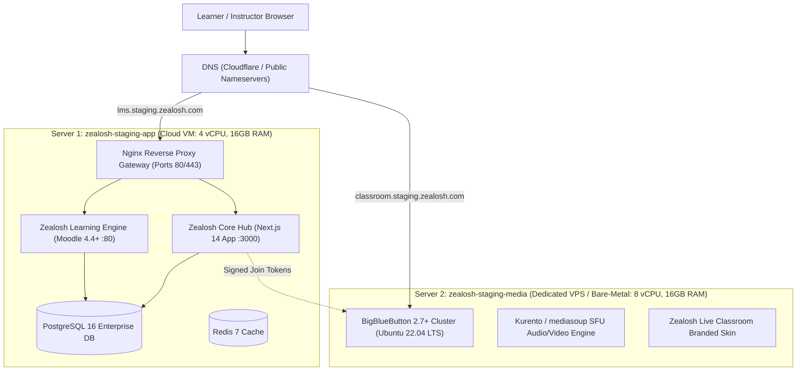

# Zealosh LMS — Staging Infrastructure Specification & Provisioning Guide

**Document Version:** 1.0.0  
**Target Milestone:** Staging Infrastructure Provisioning, Self-Hosted Moodle Activation, and BigBlueButton Media Deployment  
**Status:** **INFRASTRUCTURE ACTION SPECIFICATION**

---

## 1. Staging Target Architecture (Two-Server Topology)

To deliver a scalable, enterprise-grade deployment with full audio/video conferencing capability without overloading the web application server, Zealosh uses a **two-server physical topology**:



---

## 2. Server Specifications & Cloud Provider Sizing Matrix

### Application & LMS Container Host (`zealosh-staging-app`)
- **Role:** Hosts Docker Compose application stack (Next.js 14 Core Hub + Moodle 5.3 LTS + Redis 7 Cache + Nginx Gateway) connected to managed Supabase databases.
- **Database Architecture:** Pure Managed Supabase Cloud (Zero local database administration):
  - **Supabase Project 1:** Core Hub Application Data, Auth, and RLS (Live & Verified).
  - **Supabase Project 2:** Dedicated Moodle PostgreSQL 17 database connected via TCP Port 5432 (Session Mode Pooler with TLS).
- **Minimum Host Specs:** 2–4 vCPU, 8–16 GB RAM, 50 GB SSD, Ubuntu 22.04 LTS (or any Docker-capable host).
- **Firewall Ports Inbound:** `80` (HTTP), `443` (HTTPS), optional `22` (SSH for management).

### Dedicated Media Server (`zealosh-staging-media` — Deferred Milestone)
- **Role:** Dedicated WebRTC audio/video SFU, FreeSWITCH voice bridge, multi-user whiteboard, session recording (BigBlueButton 2.7+).
- **Minimum Specs:** 8 dedicated vCPUs, 16 GB RAM with 8GB swap, 500 GB SSD storage, dedicated public IPv4 address, 100 Mbps+ unthrottled symmetric bandwidth.
- **Firewall Ports Inbound:** `80` (HTTP), `443` (HTTPS), `16384-32768/udp` (WebRTC RTP streams).

### Cloud Sizing & Sizing Matrix:

| Hosting Option | App Host (Core Hub + Moodle + Nginx) | Database Tier | Media Server (Deferred) |
| :--- | :--- | :--- | :--- |
| **Supabase Cloud + Cloud VPS** | Cloud VPS (Hetzner CPX31 / DO Droplet / AWS) | **Supabase Managed Cloud** (Dual-Project) | Dedicated Bare-Metal / VPS |
| **Estimated Cost** | ~$15 – $40 / mo | Supabase Managed Tier | ~$40 – $80 / mo (When provisioned) |

---

## 3. Required DNS Records

Configure the following DNS `A` records with your DNS registrar (e.g. Cloudflare / Route53 / GoDaddy):

| Hostname | Type | Target Value | Purpose |
| :--- | :--- | :--- | :--- |
| `lms.staging.zealosh.com` | `A` | **App Host Public IP** | Zealosh Core Hub, Superadmin, Moodle Engine, OIDC SSO |
| `classroom.staging.zealosh.com`| `A` | **Media Host Public IP** | BigBlueButton Live WebRTC Media Server (Deferred) |

---

## 4. Automated Execution Runbook

### Step 1: Bootstrap Server 1 (Application & Moodle Engine)
> [!IMPORTANT]
> **Zero Unverified Script Execution Policy:**
> Piped execution of mutable remote scripts (`curl ... | bash`) is strictly prohibited.
> Always retrieve an approved immutable Git commit or transfer the trusted repository checkout, inspect all scripts locally, and execute from within the verified repository workspace. If the remote Git repository is private or its remote URL cannot be independently verified, transfer the existing trusted checkout directly via `rsync` or `scp` rather than inventing an unverified remote URL or exposing repository credentials.

1. Retrieve the approved repository revision into `/opt/zealosh`:
```bash
# Option A: From verified remote Git repository:
git clone <approved-repository-url> /opt/zealosh
cd /opt/zealosh
git checkout <approved-commit-sha-or-tag>

# rsync -avz \
#   --exclude='node_modules/' \
#   --exclude='.next/' \
#   --include='/.env.staging.example' \
#   --exclude='.env*' \
#   --exclude='/secrets/*.txt' \
#   ./ ubuntu@<SERVER_1_PUBLIC_IP>:/opt/zealosh/
# ssh ubuntu@<SERVER_1_PUBLIC_IP> "cd /opt/zealosh && git status"
```

2. Inspect the bootstrap script and Docker manifests prior to execution:
```bash
cd /opt/zealosh
less deploy/staging-bootstrap.sh
less docker-compose.zealosh-platform.yml
```

3. Execute the checked-out script locally on Server 1:
```bash
bash deploy/staging-bootstrap.sh
```

### Step 2: Activate Moodle Zealosh Theme & OIDC SSO
Follow the step-by-step guide in [moodle-custom/README.md](file:///C:/Users/alexc/.gemini/antigravity-ide/scratch/zealosh-lms/moodle-custom/README.md):
1. Navigate to: `https://lms.staging.zealosh.com/learn-engine/admin/`.
2. Activate **Zealosh Learning Engine Theme** (`theme_zealosh`) under **Appearance > Themes > Theme selector**.
3. Create OAuth 2 service pointing to `https://lms.staging.zealosh.com/.well-known/openid-configuration`.
4. Enable OAuth 2 authentication plugin.

### Step 3: Bootstrap Server 2 (BigBlueButton Live Classroom)
SSH into Server 2 as root and execute the automated BBB setup:
```bash
# Execute on Server 2 (Replace with your actual domain):
sudo bash deploy/bbb-staging-setup.sh classroom.staging.zealosh.com admin@zealosh.com
```

### Step 4: Link BBB Media Secret into Server 1
Copy the secret output by `bbb-conf --secret` on Server 2 into `.env.production` on Server 1:
```ini
BBB_BASE_URL=https://classroom.staging.zealosh.com/bigbluebutton/api
BBB_SECURITY_SALT=<shared-salt-from-server-2>
```
Reload Zealosh Hub container:
```bash
docker compose -f docker-compose.zealosh-platform.yml restart zealosh-hub
```

---

## 5. Verification & Acceptance Checklist

- [ ] **Next.js Hub:** `https://lms.staging.zealosh.com` loads with green palette `#4f8c4c`.
- [ ] **Moodle Engine:** `https://lms.staging.zealosh.com/learn-engine/` renders with `theme_zealosh` and persistent "Return to Zealosh Hub" link.
- [ ] **Single Sign-On (SSO):** Clicking "Log in with Zealosh Core" on Moodle signs the user in without a second password prompt.
- [ ] **Live Classroom WebRTC:** Launching `/live/[sessionId]` opens `classroom.staging.zealosh.com` with two-way audio, presenter video, and collaborative whiteboard.
