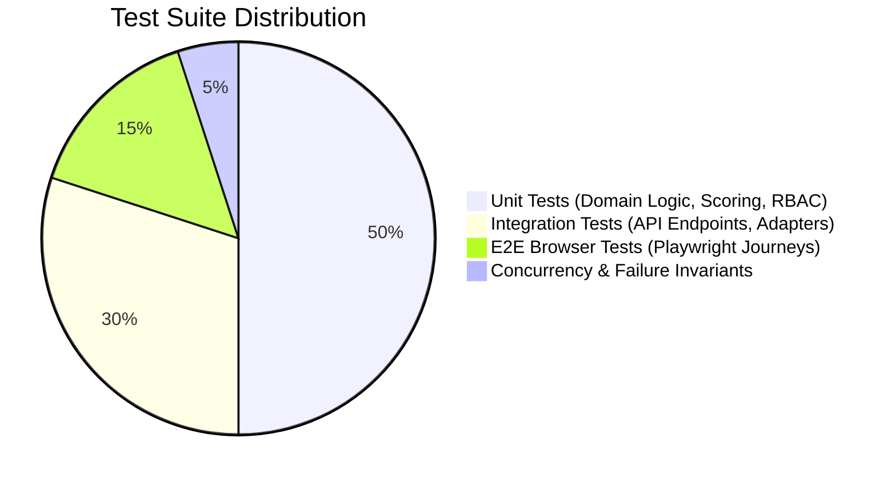

# Zealosh LMS — Automated Testing Strategy & QA Plan

**Document Version:** 1.0.0  
**Status:** Test Architecture Baseline  
**Testing Frameworks:** Vitest (Unit/Integration), Supertest (API), Playwright (E2E Browser Automation)

---

## 1. Testing Philosophy & Non-Negotiable Rules

1. **Evidence-Based Quality:** Never claim a test passes without executing the test runner and capturing verifiable console outputs and browser artifacts.
2. **Server-Enforced Integrity:** Never test solely on UI validation; all security, state transition, and scoring tests must execute direct API/database assertions.
3. **Zero Test Contamination:** Each test run must operate on isolated test data or transient in-memory databases with automatic rollback.
4. **Failure & Concurrency First:** Critical business paths (seat capacity, payment webhooks, exam deadlines) must have explicit race-condition and failure tests.

---

## 2. Test Pyramid & Coverage Matrix

| Layer | Target Areas | Tooling | Execution Command | Target Coverage |
| :--- | :--- | :--- | :--- | :--- |
| **Unit Tests** | Scoring engine, blueprint calculations, course state machine, entitlement validators, JWT tokens. | Vitest | `npm run test:unit` | $\ge 85\%$ Lines |
| **Integration Tests** | NestJS controllers, Moodle adapter, BBB adapter, payment webhooks, Prisma repositories. | Vitest / Supertest | `npm run test:integration` | $\ge 80\%$ Endpoints |
| **E2E Browser Tests** | Student, Instructor, and Super Admin end-to-end user journeys. | Playwright | `npm run test:e2e` | 100% Critical Flows |
| **Concurrency & Security** | Seat limit race conditions, double webhook posts, exam submission past deadline. | Custom Vitest suites | `npm run test:concurrency` | 100% Core Invariants |

---

## 3. End-to-End User Journeys (Playwright Automation)

### 3.1 Student Journey
1. Navigate to `/` (Zealosh Homepage).
2. Register a new student account at `/register` or login at `/login`.
3. Browse course catalog at `/courses` and filter by "ASP" certification.
4. Open course details `/courses/asp-examination-prep`.
5. Select upcoming weekend batch and complete enrollment.
6. Open Student Dashboard `/student`.
7. Enter lesson player `/learn/[courseId]` and verify video stream and watermark display.
8. Click "Join Live Session" to launch BigBlueButton classroom.
9. Navigate to `/exams`, start a timed 10-question practice mock exam.
10. Answer questions, test bookmarking, submit exam, and verify score calculation & domain breakdown.

### 3.2 Instructor Journey
1. Login with instructor credentials at `/login`.
2. Access `/instructor` dashboard.
3. Review assigned batches and student roster.
4. Schedule a new live lecture session with date/time.
5. Create a new practice assignment or assessment question.
6. Review submitted student work and enter grades with constructive feedback.

### 3.3 Administrator Journey
1. Login with super admin credentials at `/login`.
2. Access `/admin` operations console.
3. Create a new certification course (e.g., "CRSP Masterclass").
4. Assign Lead Instructor and configure batch capacity (e.g., 30 seats).
5. Transition course state from `DRAFT` to `PUBLISHED`.
6. Audit security logs and financial transaction reports.

---

## 4. Failure & Concurrency Test Specifications

1. **Duplicate Webhook Delivery:**
   - Simulate payment gateway sending identical `payment.captured` webhook 5 times simultaneously.
   - **Assertion:** Exactly 1 enrollment record is created; remaining 4 requests return HTTP 200 with `status: 'ALREADY_PROCESSED'`.
2. **Concurrent Seat Contention:**
   - Configure a batch with `capacity: 1`.
   - Dispatch 5 concurrent enrollment requests simultaneously via `Promise.all`.
   - **Assertion:** Exactly 1 enrollment succeeds; 4 receive HTTP 409 `BATCH_CAPACITY_EXCEEDED`.
3. **Late Exam Submission:**
   - Submit exam answers with client timestamp 10 minutes past the server's `scheduled_deadline`.
   - **Assertion:** Server rejects late answers with HTTP 400 `EXAM_DEADLINE_EXPIRED` and scores only answers received prior to deadline.
