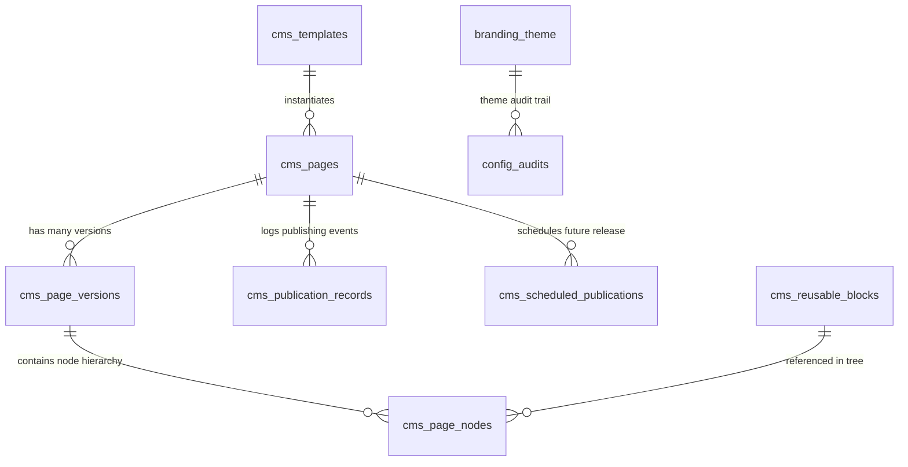
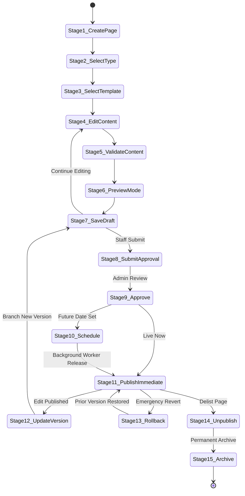
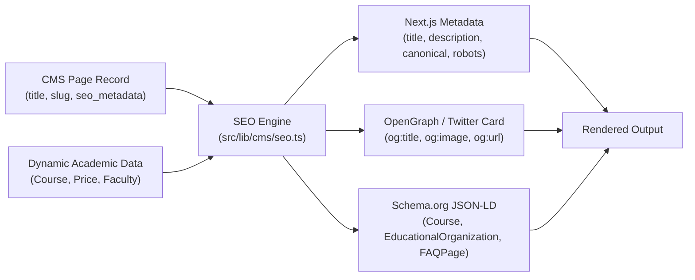

# Zealosh Website Studio — Architecture & Subsystem Integration Plan

**Project:** Zealosh Training & Consultants — Zealosh LMS  
**Subsystem:** Zealosh Website Studio  
**Architectural Lead:** Principal Software Architect & Enterprise Systems Lead  
**Date:** November 10, 2026  
**Status:** APPROVED ARCHITECTURAL SPECIFICATION  

---

## 1. Information Architecture & Navigation Structure

Zealosh Website Studio provides a unified administrative hierarchy accessible from `/admin/workspace`, organized logically by functional area:

```text
ZEALOSH WEBSITE STUDIO
├── 1. Overview & Metrics (/admin/workspace)
│   ├── Total Pages, Published vs Drafts, Scheduled Publications
│   └── Quick Actions: "Create Page", "Edit Theme", "Inspect Audit Log"
│
├── 2. Website & Pages (/admin/workspace/pages)
│   ├── All Pages (Filter by Page Type, Status, Author)
│   ├── Page Templates (17 Pre-Seeded Institutional Templates)
│   ├── Reusable Blocks Library (Hero, Accordion, CTA, Testimonial Grid)
│   └── Navigation Manager (Header, Footer, Mobile Drawer Menus)
│
├── 3. Visual Builder Workspace (/admin/workspace/builder/[id])
│   ├── Visual Canvas (Interactive Live Preview)
│   ├── Viewport Toggles (Desktop 1280px, Tablet 768px, Mobile 375px)
│   ├── Component Palette (Layout, Typography, Media, Dynamic Academic Cards)
│   ├── Component Tree & Reordering Inspector
│   └── Undo / Redo Command History
│
├── 4. Academic & Assessment Editors
│   ├── Course Curriculum Builder (/admin/curriculum)
│   ├── Rich Text Lesson Authoring Drawer
│   ├── Central Question Bank & IRT Analytics (/admin/questions)
│   ├── HSE Examination Blueprint Manager (/admin/exams)
│   └── Certificate Template Designer (/admin/certificates/templates)
│
├── 5. Design & Brand Studio (/admin/workspace/theme)
│   ├── Brand Tokens (Primary Green, Header Dark, Accents)
│   ├── Typography Hierarchy & Font Scaling
│   ├── Surface Containers, Radii & Shadows
│   └── One-Click "Reset to Zealosh Identity"
│
├── 6. Forms & Communications (/admin/workspace/forms)
│   ├── Public Enquiry & Contact Form Builder
│   └── Transactional Email Outbox Template Editor
│
├── 7. Publishing & SEO Manager (/admin/workspace/publishing)
│   ├── Pending Review & Approval Queue
│   ├── Scheduled Publications Calendar & Worker Monitor
│   ├── Version History & One-Click Rollback Desk
│   └── SEO Manager (Metadata, Canonical URLs, Schema.org JSON-LD, Sitemap)
│
└── 8. Studio Governance & Security (/admin/workspace/settings)
    ├── RBAC Permissions & Publishing Approvers
    └── Audit Trail & Revision Diffs
```

---

## 2. Database Architecture & Schema Extensions

Website Studio builds upon the seven existing relational CMS tables in `supabase/migrations/` and introduces lightweight, backward-compatible extensions without touching existing business logic:



### 2.1 Existing Tables Utilized:
1. `public.cms_pages`: Authoritative page records storing `slug`, `title`, `page_type`, `status`, `current_draft_version_id`, `published_version_id`, and `seo_metadata`.
2. `public.cms_page_versions`: Immutable version snapshots with `version_number`, `status`, `change_summary`, `created_by`, `approved_by`, `published_at`.
3. `public.cms_page_nodes`: Structured tree nodes storing `parent_node_id`, `node_type`, `component_type`, `properties` (JSONB), `styles` (JSONB), `sort_order`.
4. `public.cms_templates`: Pre-configured institutional layouts for rapid page creation.
5. `public.cms_reusable_blocks`: Global reusable component snippets (e.g. standard Zealosh CTA, accreditation badge strip).
6. `public.cms_publication_records`: Audit log of all publishing, unpublishing, and rollback events.
7. `public.cms_scheduled_publications`: Queue of future publication tasks evaluated by `scheduled-publisher-worker.ts`.

### 2.2 Backward-Compatible Schema Extensions (Planned in WS-01 & WS-07):
- **Page Type Expansion:** Expand `cms_pages.page_type` enum to encompass all 17 public marketing page types:
  ```sql
  ALTER TYPE public.cms_page_type ADD VALUE IF NOT EXISTS 'ABOUT';
  ALTER TYPE public.cms_page_type ADD VALUE IF NOT EXISTS 'FEATURES';
  ALTER TYPE public.cms_page_type ADD VALUE IF NOT EXISTS 'SOLUTIONS';
  ALTER TYPE public.cms_page_type ADD VALUE IF NOT EXISTS 'PRICING';
  ALTER TYPE public.cms_page_type ADD VALUE IF NOT EXISTS 'INSTRUCTORS';
  ALTER TYPE public.cms_page_type ADD VALUE IF NOT EXISTS 'INSTRUCTOR_PROFILE';
  ALTER TYPE public.cms_page_type ADD VALUE IF NOT EXISTS 'CONTACT';
  ALTER TYPE public.cms_page_type ADD VALUE IF NOT EXISTS 'FAQ';
  ALTER TYPE public.cms_page_type ADD VALUE IF NOT EXISTS 'BLOG';
  ALTER TYPE public.cms_page_type ADD VALUE IF NOT EXISTS 'BLOG_DETAILS';
  ALTER TYPE public.cms_page_type ADD VALUE IF NOT EXISTS 'TESTIMONIALS';
  ALTER TYPE public.cms_page_type ADD VALUE IF NOT EXISTS 'CAREERS';
  ALTER TYPE public.cms_page_type ADD VALUE IF NOT EXISTS 'PRIVACY_POLICY';
  ALTER TYPE public.cms_page_type ADD VALUE IF NOT EXISTS 'TERMS';
  ```
- **Certificate Templates (`certificate_templates`):** Store visual coordinate mappings for dynamic Ed25519 credential rendering.
- **Form Submissions (`cms_form_submissions`):** Store public contact/enquiry submissions captured via visual form blocks with automated lead generation.

---

## 3. The 15-Stage Content Publishing Lifecycle

Website Studio enforces a rigorous 15-stage publishing lifecycle to prevent content regressions, unauthorized disclosure, or broken user links:



### Lifecycle Stage Details:
1. **Stage 1 — Create Page:** User initializes new page entity with title, category, and target URL slug.
2. **Stage 2 — Select Page Type:** Choose one of 17 public marketing page types or custom landing page types.
3. **Stage 3 — Select Template:** Instantiate pre-styled container nodes from the institutional template library.
4. **Stage 4 — Edit Content:** Modify text, imagery, and component properties inside `CmsEditorWorkspace.tsx`.
5. **Stage 5 — Validate Content:** Automated validation checking for required headings, missing image `alt` tags, and invalid links.
6. **Stage 6 — Preview Mode:** Live rendering across desktop, tablet, and mobile viewports with authenticated preview token.
7. **Stage 7 — Save Draft:** Persist working tree to `cms_page_nodes` associated with `current_draft_version_id` (status `DRAFT`).
8. **Stage 8 — Submit for Approval:** Transition version status to `PENDING_REVIEW`; notify administrators via notification center.
9. **Stage 9 — Approve:** Administrator reviews visual diff; status transitions to `APPROVED`.
10. **Stage 10 — Schedule Publication:** Set future ISO 8601 release timestamp; insert task into `cms_scheduled_publications`.
11. **Stage 11 — Publish:** Atomically update `cms_pages.published_version_id`, update version status to `PUBLISHED`, purge edge CDN cache, and log event to `cms_publication_records`.
12. **Stage 12 — Update Existing Version:** Editing a live page branches a new draft version without taking down the published version.
13. **Stage 13 — Restore Prior Revision (Rollback):** Instant one-click rollback pointing `cms_pages.published_version_id` to any prior approved version.
14. **Stage 14 — Unpublish:** Set `published_version_id = NULL`; page immediately returns `404` to public visitors.
15. **Stage 15 — Archive:** Mark page status as `ARCHIVED`; exclude from all administrative listings unless explicitly filtered.

---

## 4. SEO Manager Architecture & Structured Data

The SEO Manager operates via `src/lib/cms/seo.ts` and standard Next.js App Router Metadata APIs:



### SEO Capabilities:
- **Canonical URLs:** Strict generation of absolute canonical URLs avoiding duplicate content penalties.
- **Indexing Directives:** Configurable `robots` flags (`index, follow` vs `noindex, nofollow` for private landing pages).
- **Social Sharing Previews:** Automated generation of 1200x630px OpenGraph cards featuring course badges and brand tokens.
- **Automated XML Sitemap:** Generated dynamically at `/api/cms/sitemap.xml`, crawling only actively published pages with appropriate `<lastmod>` and `<changefreq>`.
- **Schema.org Structured Data:**
  - `EducationalOrganization`: Embeds official Zealosh accreditation details on `/` and `/about`.
  - `Course`: Automatically generated on course detail pages with course code, provider, fees, and syllabus modules.
  - `FAQPage`: Automatically generated on `/p/faq` with structured Q&A pairs for search engine rich snippets.
- **Anti-Leakage Guard:** Under no circumstances does the SEO engine crawl or index private student portals, live classroom rooms, or administrative dashboards.

---

## 5. Security Architecture & Boundary Invariants

1. **XSS Defense & Sanitization:** All user-authored HTML and visual node properties are passed through `sanitizeHtml()` from `src/lib/cms/sanitizer.ts`. All disallowed tags (`<script>`, `<object>`, `<embed>`, inline event handlers `onload`, `onclick`) are stripped before writing to PostgreSQL.
2. **Safe URL Validation:** External links and media sources are verified through `sanitizeUrl()`. Protocols are strictly restricted to `http:`, `https:`, `mailto:`, and `tel:`. Any `javascript:` or `data:` URIs are rejected.
3. **Optimistic Locking:** Node mutations submit the target `version_number`. If another administrator published or updated the version in the interim, the mutation fails with `409 Conflict`, preventing accidental overwrite of concurrent edits.
4. **Draft Privacy:** Public requests to `/p/[...slug]` check if `published_version_id IS NOT NULL`. If unpublished, the request immediately terminates with `404 Not Found`. Preview tokens are time-bounded (15-minute expiry) and cryptographically signed.
