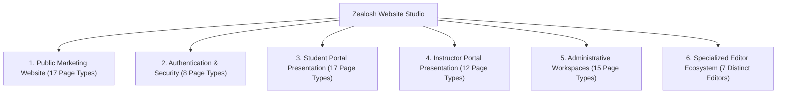
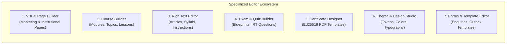

# Zealosh Website Studio — Product Requirements Document (PRD)

**Project:** Zealosh Training & Consultants — Zealosh LMS  
**Workstream:** Zealosh Website Studio (`WS-01` to `WS-09`)  
**Product Ownership:** Core Hub (Zealosh Core)  
**Academic Integration:** Learning Engine & Live Classroom  
**Target Environment:** Local Antigravity IDE (Development & Isolated Verification)  
**Date:** November 10, 2026  
**Status:** APPROVED PRODUCT SPECIFICATION  

---

## 1. Product Scope & Vision

**Zealosh Website Studio** is the dedicated, LMS-native website builder, portal management system, and unified content editing suite engineered specifically for **Zealosh Training & Consultants**.

Unlike generic, bloated third-party CMS platforms (WordPress, Webflow) or headless content silos, Zealosh Website Studio operates inside the existing Next.js App Router and PostgreSQL architecture. It seamlessly bridges marketing presentation with authoritative academic reality:
- **Presentation Layer:** Manages visual layouts, responsive page designs, typography, brand tokens, and promotional content.
- **Academic Source of Truth:** Never duplicates or overrides core academic data. Public course pages, syllabus trees, instructor rosters, batch dates, and fee schedules are dynamically bound to live PostgreSQL records.

---

## 2. Complete Page Type Inventory Across Platform Surfaces

### 2.1 Public Website Page Types (17 Authoritative Page Types)
1. **Home (`HOMEPAGE`):** Primary institutional landing page; hero banner, accreditation logos, featured courses, value propositions, and student testimonials.
2. **About Us (`ABOUT`):** Institutional mission, history, director's message, quality policy, and Kollam training facility overview.
3. **Features (`FEATURES`):** Platform capabilities; live WebRTC classrooms, AI-assisted learning, mobile PWA, and tamper-evident digital certificates.
4. **Solutions (`SOLUTIONS`):** Corporate training solutions, institutional safety audits, customized industrial HSE compliance programs.
5. **Pricing (`PRICING`):** Comprehensive course fee schedules, installment payment plans, statutory GST breakdown, and corporate group discounts.
6. **Courses (`COURSES`):** Full searchable public course directory with delivery mode filters (`LIVE`, `BLENDED`, `E-LEARNING`) and certification levels.
7. **Course Details (`COURSE_DETAILS`):** Individual course page dynamically binding to live syllabus modules, learning outcomes, batch dates, and fees.
8. **Instructors (`INSTRUCTORS`):** Faculty directory featuring certified safety professionals, industry backgrounds, and academic specializations.
9. **Instructor Profile (`INSTRUCTOR_PROFILE`):** Individual faculty biography, credentials, assigned courses, and verified student ratings.
10. **Contact (`CONTACT`):** Campus location map (Kollam, Kerala), telephone/email directory, office hours, and interactive enquiry form.
11. **FAQ (`FAQ`):** Searchable knowledge base covering admissions, exam eligibility, technical requirements, and certificate validity.
12. **Blog (`BLOG`):** HSE industry insights, regulatory safety updates, study tips, and institutional announcement articles.
13. **Blog Details (`BLOG_DETAILS`):** Full article view with sanitized rich text, author bio, social share links, and related posts.
14. **Testimonials (`TESTIMONIALS`):** Verified alumni reviews, video interview snippets, legal consent badges, and dynamic poster cards.
15. **Careers (`CAREERS`):** Employment opportunities at Zealosh Training & Consultants, faculty recruitment, and trainer application forms.
16. **Privacy Policy (`PRIVACY_POLICY`):** Comprehensive institutional data governance, student privacy standards, and cookie policy.
17. **Terms & Conditions (`TERMS`):** Course enrollment terms, examination conduct regulations, refund policies, and statutory terms of service.

### 2.2 Authentication Page Types (8 Page Types)
1. **Login (`AUTH_LOGIN`):** Supabase GoTrue email/password entry, lockout timer display, and remember-me session options.
2. **Registration (`AUTH_REGISTER`):** Student candidate registration with email verification dispatch and password strength meter.
3. **Forgot Password (`AUTH_FORGOT_PW`):** Password reset request form triggering rate-limited transactional outbox reset links.
4. **Reset Password (`AUTH_RESET_PW`):** Secure token verification and new password confirmation form.
5. **Email Verification (`AUTH_VERIFY_EMAIL`):** Link landing handler confirming candidate email address validity.
6. **OTP Verification (`AUTH_OTP_VERIFY`):** Six-digit one-time passcode confirmation for critical transactions and login fallback.
7. **Invitation Acceptance (`AUTH_INVITE_ACCEPT`):** Faculty and corporate cohort invitation onboarding flow with role pre-assignment.
8. **Two-Factor Authentication (`AUTH_MFA`):** TOTP authenticator app challenge modal with fallback recovery codes.

### 2.3 Student-Facing Portal Pages (17 Page Types)
1. **Student Dashboard (`STUDENT_DASHBOARD`):** Central learning hub; active enrollments, upcoming live sessions, pending assignments, progress bars.
2. **My Courses (`STUDENT_COURSES`):** Enrolled course roster with progression status, batch details, and completion percentages.
3. **Course Overview (`STUDENT_COURSE_VIEW`):** Enrolled course syllabus tree, instructor announcements, and classwork links.
4. **Learning Player (`STUDENT_PLAYER`):** Video lecture viewer, high-frequency beacon resume, forward-scrub restrictions, and lesson navigation.
5. **Live Classroom (`STUDENT_CLASSROOM`):** BigBlueButton WebRTC meeting client with audio/video, whiteboard, and public/private chat.
6. **Recordings Hub (`STUDENT_RECORDINGS`):** Replay archive with synchronized bookmarks, in-video doubt submission, and lecture handouts.
7. **Assignments List (`STUDENT_ASSIGNMENTS`):** Pending and submitted homework with deadlines, submission status, and rubric criteria.
8. **Assignment Submission (`STUDENT_ASSIGNMENT_SUBMIT`):** File uploader supporting PDF/DOCX, submission notes, and re-submission controls.
9. **Quizzes & Tests (`STUDENT_QUIZZES`):** Formative topic quizzes with instant feedback, attempt counts, and passing score badges.
10. **HSE Exam Portal (`STUDENT_EXAMS`):** High-stakes proctored examination lobby with countdown timer and integrity instructions.
11. **Grades & Feedback (`STUDENT_GRADES`):** Comprehensive gradebook displaying objective scores, instructor rubric evaluations, and AI notes.
12. **Certificates Hub (`STUDENT_CERTIFICATES`):** Issued credentials with Ed25519 cryptographic signatures, public verification links, and PDF download.
13. **Career Roadmap (`STUDENT_CAREER`):** Certification progression tree, milestone checkmarks, and portfolio evidence manager.
14. **Mentorship Booking (`STUDENT_MENTORSHIP`):** Faculty office hours calendar and 1-on-1 guidance appointment booking.
15. **Messages & Channels (`STUDENT_MESSAGES`):** Cohort group channels and direct messaging with instructors and peers.
16. **Account & Security (`STUDENT_SECURITY`):** Active device sessions, multi-session revocation, password change, and TOTP MFA setup.
17. **Support Helpdesk (`STUDENT_SUPPORT`):** Support ticket creation, status tracker, and threaded helpdesk communication.

### 2.4 Instructor-Facing Portal Pages (12 Page Types)
1. **Instructor Dashboard (`INSTRUCTOR_DASHBOARD`):** Assigned courses overview, upcoming lecture schedule, pending grading alert badges.
2. **Course Management (`INSTRUCTOR_COURSES`):** Curriculum tree inspection, syllabus version management, delivery mode configuration.
3. **Curriculum Builder (`INSTRUCTOR_BUILDER`):** Visual hierarchy editor for modules, topics, subtopics, and preloaded teaching materials.
4. **Live Class Studio (`INSTRUCTOR_CLASSROOM`):** WebRTC moderator launchpad with presentation preloading and participant management.
5. **Attendance Register (`INSTRUCTOR_ATTENDANCE`):** Automated session attendance records with duration percentages and export tools.
6. **Assignment Grading Queue (`INSTRUCTOR_GRADING`):** Submission evaluation desk with rubric scoring and AI-suggested feedback actions.
7. **Assessment Authoring (`INSTRUCTOR_ASSESSMENTS`):** Quiz creation and Central Question Bank item authoring with psychometric stats.
8. **Cohort Oversight (`INSTRUCTOR_COHORTS`):** Student roster, individual progress tracking, and academic intervention triggers.
9. **Office Hours Manager (`INSTRUCTOR_OFFICE_HOURS`):** Weekly availability configuration and student 1-on-1 booking confirmation.
10. **Announcements Center (`INSTRUCTOR_ANNOUNCEMENTS`):** Course broadcast creator with transactional email outbox dispatch.
11. **Learning Analytics (`INSTRUCTOR_ANALYTICS`):** Topic failure rates, exam score distribution histograms, engagement metrics.
12. **Instructor Profile (`INSTRUCTOR_PROFILE_SETTINGS`):** Professional bio, safety certifications, and office hours visibility toggles.

### 2.5 Administrator Workspace Pages (15 Page Types)
1. **Admin Console (`ADMIN_DASHBOARD`):** Executive KPI cards; active student counts, gross revenue, active WebRTC rooms, SRE alerts.
2. **Admissions Pipeline (`ADMIN_ADMISSIONS`):** 6-stage Kanban board for lead conversion, application reviews, and document verification.
3. **User Management (`ADMIN_USERS`):** User registry, role assignments, bulk CSV import, password resets, and account status toggles.
4. **Academic Governance (`ADMIN_ACADEMIC`):** Year, Department, and Programme administration, module migration, syllabus snapshot freezing.
5. **Batch Operations (`ADMIN_BATCHES`):** Cohort scheduling, capacity limit configuration, lead instructor assignments.
6. **Classroom SRE Desk (`ADMIN_CLASSROOM`):** Active BBB meeting monitors, recording ingestion status, media server health.
7. **Exam Administration (`ADMIN_EXAMS`):** HSE blueprint designer, passing grade thresholds, subjective evaluation assignment.
8. **Certificate Governance (`ADMIN_CERTIFICATES`):** Credential issuance registry, cryptographic key management, revocation audit logs.
9. **Website Studio (`ADMIN_WEBSITE_STUDIO`):** Centralized CMS page list, visual page builder, theme customizer, template library.
10. **Email & Outbox Manager (`ADMIN_EMAIL`):** Outbox queue status, failed dispatch retries, delivery latency metrics, template editor.
11. **Finance & Reconciliation (`ADMIN_FINANCE`):** Payment order audit, GST tax invoices, refund approvals, daily reconciliation runs.
12. **Support Operations (`ADMIN_SUPPORT`):** Institutional ticketing desk, SLA breach tracking, support team routing rules.
13. **Institutional Reports (`ADMIN_REPORTS`):** Multi-domain reporting hub, compliance audits, CSV/PDF executive exports.
14. **System Diagnostics & Health (`ADMIN_DIAGNOSTICS`):** Real-time service liveness/readiness, synthetic monitoring, telemetry charts.
15. **Platform Configuration (`ADMIN_CONFIG`):** Global settings, emergency maintenance mode, branding tokens, audit archive exports.

---

## 3. Specialized Editor Ecosystem (Seven Distinct Editors)

To maintain clean architectural boundaries, Website Studio provides seven specialized editors rather than a monolithic, confusing interface:

### 3.1 Visual Page Builder (`CmsEditorWorkspace.tsx`)
- **Scope:** Public marketing pages (17 types), landing pages, and promotional campaign banners.
- **Key Capabilities:** Drag-and-drop sections, containers, rows, columns; component palette (heroes, grids, feature cards, testimonial carousels, FAQ accordions); responsive desktop/tablet/mobile preview toggles; undo/redo command stack; component property inspector; fail-closed XSS sanitization.

### 3.2 Academic Course Builder (`VisualCurriculumTree.tsx`)
- **Scope:** Academic curriculum hierarchy (Programmes -> Modules -> Topics -> Subtopics -> Lessons).
- **Key Capabilities:** Visual tree reordering, delivery mode configuration (`LIVE`, `BLENDED`, `E-LEARNING`), syllabus version snapshot freezing, completion policy rules, preloaded scheduled teaching materials.

### 3.3 Rich Text Editor (Sanitized WYSIWYG Editor)
- **Scope:** Lesson descriptions, blog articles, institutional policies, knowledge-base FAQs.
- **Key Capabilities:** Semantic HTML formatting (H2-H4, paragraphs, blockquotes, unordered/ordered lists, code snippets, callout boxes); media URL embedding; zero raw `<script>` execution; automated XSS sanitization via `sanitizeHtml()`.

### 3.4 Examination & Quiz Builder (`QuestionBankWorkspace.tsx` & `/admin/exams`)
- **Scope:** Formative quizzes and high-stakes HSE certification examination blueprints.
- **Key Capabilities:** Multiple choice, multiple select, descriptive essay items; central question bank tagging and search; IRT difficulty and discrimination parameter tracking; server-enforced deadline timers; webcam proctoring hooks; rubric scoring matrix configuration.

### 3.5 Certificate Template Designer
- **Scope:** Institutional completion credentials and formal HSE professional certificates.
- **Key Capabilities:** Visual layout grid for certificate background assets; coordinate-based placement of candidate name, course title, completion date, serial number, and Ed25519 QR verification anchor; live SVG/PDF preview generation; cryptographic isolation (signing keys remain locked on server).

### 3.6 Theme & Design Studio (`ThemeDesignStudio.tsx`)
- **Scope:** Institutional visual identity and global design tokens.
- **Key Capabilities:** Color palette pickers (Primary Green `#4f8c4c`, Header Dark `#252c41`, Accent `#2ea033`, Background Surface `#ffffff`/`#f7f9fc`); typography scale configuration; component border radius and shadow sliders; live button/card/nav preview; one-click "Reset to Zealosh Official Identity".

### 3.7 Forms, Navigation & Template Editors
- **Scope:** Public enquiry forms, header/footer navigation trees, and transactional email outbox templates.
- **Key Capabilities:** Navigation tree node reordering with depth constraints; custom contact form field builder; email template editor with dynamic variable merge tags (`{{student_name}}`, `{{course_title}}`, `{{verification_link}}`).

---

## 4. Roles, Permissions & Governance Model

Access to Website Studio is governed strictly by server-enforced RBAC in `src/lib/auth/rbac.ts`:

| Permission Key | Description | Allowed Roles |
| :--- | :--- | :--- |
| `cms:view_studio` | View Website Studio dashboard and page listings | `STAFF`, `ADMIN`, `SUPERADMIN` |
| `cms:create_page` | Create new pages and select initial templates | `ADMIN`, `SUPERADMIN` |
| `cms:edit_content` | Edit node trees, copy, and layout properties in visual builder | `ADMIN`, `SUPERADMIN` |
| `cms:submit_review` | Submit draft page version for administrative review | `STAFF`, `ADMIN`, `SUPERADMIN` |
| `cms:publish` | Publish approved page version to public live website | `ADMIN`, `SUPERADMIN` |
| `cms:schedule` | Configure automated future publishing and unpublishing schedules | `ADMIN`, `SUPERADMIN` |
| `cms:rollback` | Revert published page to any prior historical version | `SUPERADMIN` |
| `cms:manage_themes` | Modify global design tokens, brand colors, and typography | `SUPERADMIN` |
| `cms:manage_seo` | Configure canonical URLs, OpenGraph metadata, and indexing | `ADMIN`, `SUPERADMIN` |
| `cms:audit_logs` | Inspect publication audit trail and version diff histories | `SUPERADMIN` |

---

## 5. Non-Functional Requirements

### 5.1 Performance & Core Web Vitals
- **Server Response Time (TTFB):** Under 200ms for public cached CMS pages.
- **Largest Contentful Paint (LCP):** Under 2.0s on standard mobile 4G connections.
- **Cumulative Layout Shift (CLS):** Under 0.05 across all responsive viewports.
- **Caching Strategy:** Public published pages served with `Cache-Control: public, s-maxage=300, stale-while-revalidate=60`.

### 5.2 Accessibility & WCAG 2.1 AA Compliance
- Strict color contrast ratios: minimum 4.5:1 for normal body text against background surfaces.
- Mandatory image `alt` attributes on all image components.
- Keyboard navigation: visible focus rings on all interactive buttons, links, and form fields.
- Valid ARIA landmark roles (`banner`, `main`, `contentinfo`, `navigation`) across all 17 page types.

### 5.3 Security & Boundary Invariants
- **XSS Prevention:** All user-supplied text and HTML rendered through `sanitizeHtml()` from `src/lib/cms/sanitizer.ts`.
- **CSRF Protection:** All CMS mutation APIs enforce SameSite cookies and verified session tokens.
- **Zero Raw Script Injection:** Prohibit `<script>`, `<iframe>` (except verified video embed allowlist), and inline `javascript:` URIs.
- **Draft Isolation:** Unpublished versions return HTTP 404 to unauthenticated visitors.
