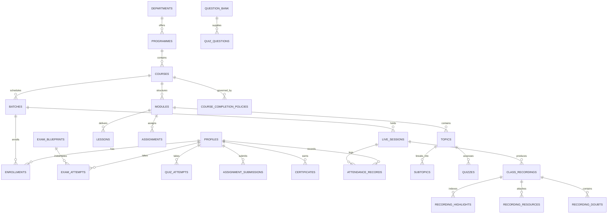

# Zealosh LMS — Authoritative Database Architecture & Schema Specification

**Document Version:** 1.0.0  
**Milestone:** ZM-01 — Master Product Blueprint  
**Status:** **AUTHORITATIVE SCHEMA & MIGRATION SPECIFICATION**  
**Target:** PostgreSQL 17 (Supabase Project 1 Core Hub DB & Project 2 Moodle DB)  
**Brand:** Zealosh Training & Consultants  
**Date:** October 30, 2026  

---

## 1. Relational Architecture & Principles

### 1.1 Single-Institution Relational Model
- **No Multi-Tenant Isolation Needed:** The database architecture serves one educational institution (**Zealosh Training & Consultants**). Tables do not require cross-institution tenant identifiers.
- **Single Source of Truth:** PostgreSQL is authoritative for Users, Profiles, Academic Structures, Courses, Batches, Enrollments, Progress, Attendance, Quizzes, Exams, Assignments, Submissions, Orders, Invoices, Certificates, and Audit Logs.
- **Sole Authoritative Database (ADR-004 & ZM-03.1.2):** Supabase PostgreSQL is the sole authoritative persistence layer. All persistent records reside exclusively in PostgreSQL across all environments. Dual writes, local JSON stores (e.g. historical data/zealosh-store.json), and silent in-memory fallbacks are strictly prohibited and eliminated.

---

## 2. Authoritative Schema Entity Relationship Model

---

## 3. Existing Migration History (Source-Derived)

All tables, indexes, constraints, and RLS policies documented below are derived directly from the canonical migration files in [`supabase/migrations/`](file:///C:/Users/alexc/.gemini/antigravity-ide/scratch/zealosh-lms/supabase/migrations):

| Migration File | Primary Responsibility | Key Tables Created / Modified |
| :--- | :--- | :--- |
| `20261023000000_zealosh_core_schema.sql` | Core Platform, Users, Catalog, Exams | `platform_settings`, `branding_theme`, `feature_flags`, `navigation_items`, `roles`, `users`, `oauth_codes`, `courses`, `batches`, `lessons`, `live_sessions`, `attendance_records`, `enrollments`, `certificates`, `exam_blueprints`, `exam_questions`, `exam_attempts`, `audit_logs`, `config_audits` |
| `20261023000001_zealosh_seed_data.sql` | Authoritative System Seeds | Seed users (superadmin, instructors, students), ASP/CSP blueprints, platform settings |
| `20261023000002_zealosh_atomic_enrollment.sql` | Concurrency Serialization | `enroll_student_atomic()` stored function with row-locking and batch capacity check |
| `20261025000003_zealosh_workflows_and_templates.sql` | Institutional Workflows | `workflows`, `workflow_definitions`, `notification_templates`, `integration_configs` |
| `20261026000004_zealosh_assignments_and_submissions.sql` | Coursework Assessment Engine | `assignments`, `assignment_submissions`, `is_course_instructor()` helper function |
| `20261026000005_zealosh_payment_orders_and_invoices.sql` | Commerce & Invoicing | `payment_orders`, `invoices`, `invoice_number_seq`, `complete_payment_order_atomic()` |
| `20261026000006_zealosh_recordings_and_doubts.sql` | Media Delivery & Doubts | `class_recordings`, `recording_batch_access`, `recording_highlights`, `recording_resources`, `recording_doubts`, `recording_doubt_answers` |
| `20261027000007_zealosh_ai_tutor_gate.sql` | AI Capability Gate | Adds `ai_tutor_enabled BOOLEAN NOT NULL DEFAULT FALSE` to `feature_flags` |
| `20261030000008_zealosh_phase1_foundations.sql` | Phase 1 Core Foundations | 14 canonical tables: `profiles`, `student_profiles`, `instructor_profiles`, `user_roles`, `academic_years`, `departments`, `programmes`, `modules`, `topics`, `subtopics`, `admission_applications`, `application_documents`, `enrollment_transfers`, `enrollment_withdrawals` |
| `20261031000009_zealosh_phase1_audit_fk_safety.sql` | Phase 1 Audit FK Safety | Enforces `ON DELETE RESTRICT` on `enrollment_transfers` and `enrollment_withdrawals` foreign keys referencing `enrollments(id)` to prevent cascading deletion of compliance audit trails |
| `20261031000010_zealosh_learning_delivery_phase2.sql` | Phase 2 Learning Delivery & Academic Experience | 9 canonical tables: `delivery_configurations`, `learning_materials`, `quizzes`, `quiz_questions`, `quiz_attempts`, `learning_progress_records`, `course_completion_policies`, `completion_evaluations`, `app_error_logs`, `student_problem_reports` with complete RLS and indexes |
| `20261031000011_zealosh_exam_and_commerce_phase3.sql` | Phase 3 High-Stakes HSE Certification Examinations, Commerce Engine & Durable Webhooks | Evolves `exam_blueprints` (versioning, sitting windows), `exam_attempts` (frozen snapshots, autosave timestamp, grace period, domain breakdowns), `payment_orders` (idempotency keys), `invoices` (CGST/SGST/IGST/Export LUT); adds `exam_manual_evaluations` (with `ON DELETE RESTRICT`), `invoice_credit_notes`, and `payment_webhook_events` tables with complete RLS policies |

---

## 4. Complete Table Dictionary & Constraint Specifications

### 4.1 Identity & Governance Tables

#### `public.users` (Current Master User Table $\rightarrow$ Target: Link to `auth.users`)
- `id`: `VARCHAR(64) PRIMARY KEY`
- `name`: `TEXT NOT NULL`
- `email`: `TEXT NOT NULL UNIQUE`
- `password_hash`: `TEXT NOT NULL` (Target: Deprecated upon Supabase Auth adoption)
- `role`: `VARCHAR(32) NOT NULL DEFAULT 'STUDENT' CHECK (role IN ('STUDENT', 'INSTRUCTOR', 'COURSE_MANAGER', 'ORG_ADMIN', 'SUPER_ADMIN', 'SUPPORT_STAFF'))`
- `avatar_url`: `TEXT`
- `organization_id`: `VARCHAR(64) NOT NULL DEFAULT 'org-zealosh-main'`
- `external_learning_id`: `VARCHAR(64)` (Moodle account ID mapping)
- `created_at`, `updated_at`: `TIMESTAMPTZ NOT NULL DEFAULT NOW()`

#### `public.profiles` (Canonical Master User Profile)
- `id`: `UUID PRIMARY KEY REFERENCES auth.users(id) ON DELETE CASCADE`
- `full_name`: `TEXT NOT NULL`
- `phone`: `TEXT`
- `avatar_url`: `TEXT`
- `status`: `VARCHAR(32) NOT NULL DEFAULT 'ACTIVE' CHECK (status IN ('ACTIVE', 'SUSPENDED', 'PENDING_VERIFICATION'))`
- `failed_login_count`: `INT NOT NULL DEFAULT 0`
- `locked_until`: `TIMESTAMPTZ`
- `mfa_enabled`: `BOOLEAN NOT NULL DEFAULT FALSE`
- `created_at`, `updated_at`: `TIMESTAMPTZ NOT NULL DEFAULT NOW()`
- **Canonical vs Alias Reconciliation:** `profiles` is the authoritative, canonical table name defined in migration `20261030000008_zealosh_phase1_foundations.sql`. Any historical design references to `user_profiles` are aliases for this canonical table.

#### `public.user_roles` (Canonical Multi-Role Governance Table)
- `id`: `UUID PRIMARY KEY DEFAULT gen_random_uuid()`
- `user_id`: `UUID NOT NULL REFERENCES public.profiles(id) ON DELETE CASCADE`
- `role`: `VARCHAR(32) NOT NULL CHECK (role IN ('SUPER_ADMIN', 'ADMIN', 'COURSE_MANAGER', 'INSTRUCTOR', 'STUDENT', 'SUPPORT_STAFF'))`
- `is_primary`: `BOOLEAN NOT NULL DEFAULT FALSE`
- `assigned_by`: `UUID REFERENCES public.profiles(id)`
- `assigned_at`: `TIMESTAMPTZ NOT NULL DEFAULT NOW()`
- **Canonical vs Alias Reconciliation:** `user_roles` is the authoritative, canonical table name defined in migration `20261030000008_zealosh_phase1_foundations.sql`. Historical references to `user_role_assignments` refer to this canonical entity.

#### `public.student_profiles`
- `user_id`: `UUID PRIMARY KEY REFERENCES public.profiles(id) ON DELETE CASCADE`
- `education_level`: `TEXT`
- `industry_experience_years`: `INT DEFAULT 0`
- `current_employer`: `TEXT`
- `current_designation`: `TEXT`
- `created_at`, `updated_at`: `TIMESTAMPTZ NOT NULL DEFAULT NOW()`

#### `public.instructor_profiles`
- `user_id`: `UUID PRIMARY KEY REFERENCES public.profiles(id) ON DELETE CASCADE`
- `biography`: `TEXT`
- `credentials`: `TEXT[] DEFAULT '{}'` (e.g. CSP, CRSP, NEBOSH)
- `expertise_areas`: `TEXT[] DEFAULT '{}'`
- `created_at`, `updated_at`: `TIMESTAMPTZ NOT NULL DEFAULT NOW()`

#### `public.academic_years`
- `id`: `UUID PRIMARY KEY DEFAULT gen_random_uuid()`
- `code`: `TEXT NOT NULL UNIQUE` (e.g. 'AY-2026-2027')
- `title`: `TEXT NOT NULL`
- `start_date`: `DATE NOT NULL`
- `end_date`: `DATE NOT NULL`
- `is_current`: `BOOLEAN NOT NULL DEFAULT FALSE`
- `created_at`, `updated_at`: `TIMESTAMPTZ NOT NULL DEFAULT NOW()`

#### `public.departments`
- `id`: `UUID PRIMARY KEY DEFAULT gen_random_uuid()`
- `code`: `TEXT NOT NULL UNIQUE` (e.g. 'DEPT-HSE')
- `name`: `TEXT NOT NULL`
- `head_user_id`: `UUID REFERENCES public.profiles(id) ON DELETE SET NULL`
- `created_at`, `updated_at`: `TIMESTAMPTZ NOT NULL DEFAULT NOW()`

#### `public.programmes`
- `id`: `UUID PRIMARY KEY DEFAULT gen_random_uuid()`
- `department_id`: `UUID NOT NULL REFERENCES public.departments(id) ON DELETE RESTRICT`
- `code`: `TEXT NOT NULL UNIQUE` (e.g. 'PROG-BCSP-ASP')
- `title`: `TEXT NOT NULL`
- `certification_track`: `TEXT NOT NULL`
- `created_at`, `updated_at`: `TIMESTAMPTZ NOT NULL DEFAULT NOW()`

#### `public.modules`
- `id`: `UUID PRIMARY KEY DEFAULT gen_random_uuid()`
- `course_id`: `VARCHAR(64) NOT NULL REFERENCES public.courses(id) ON DELETE CASCADE`
- `code`: `TEXT NOT NULL`
- `title`: `TEXT NOT NULL`
- `order_index`: `INT NOT NULL DEFAULT 0`
- `description`: `TEXT`
- `created_at`, `updated_at`: `TIMESTAMPTZ NOT NULL DEFAULT NOW()`

#### `public.topics`
- `id`: `UUID PRIMARY KEY DEFAULT gen_random_uuid()`
- `module_id`: `UUID NOT NULL REFERENCES public.modules(id) ON DELETE CASCADE`
- `title`: `TEXT NOT NULL`
- `order_index`: `INT NOT NULL DEFAULT 0`
- `description`: `TEXT`
- `created_at`, `updated_at`: `TIMESTAMPTZ NOT NULL DEFAULT NOW()`

#### `public.subtopics`
- `id`: `UUID PRIMARY KEY DEFAULT gen_random_uuid()`
- `topic_id`: `UUID NOT NULL REFERENCES public.topics(id) ON DELETE CASCADE`
- `title`: `TEXT NOT NULL`
- `order_index`: `INT NOT NULL DEFAULT 0`
- `content_type`: `VARCHAR(32) NOT NULL DEFAULT 'TEXT' CHECK (content_type IN ('TEXT', 'VIDEO', 'DOCUMENT', 'INTERACTIVE'))`
- `duration_minutes`: `INT NOT NULL DEFAULT 15 CHECK (duration_minutes >= 0)`
- `created_at`, `updated_at`: `TIMESTAMPTZ NOT NULL DEFAULT NOW()`

#### `public.admission_applications`
- `id`: `UUID PRIMARY KEY DEFAULT gen_random_uuid()`
- `application_number`: `TEXT NOT NULL UNIQUE` (Format: `APP-YYYY-XXXX`)
- `full_name`: `TEXT NOT NULL`
- `email`: `TEXT NOT NULL`
- `phone`: `TEXT`
- `course_id`: `VARCHAR(64) NOT NULL REFERENCES public.courses(id) ON DELETE RESTRICT`
- `preferred_batch_id`: `VARCHAR(64) REFERENCES public.batches(id) ON DELETE SET NULL`
- `status`: `VARCHAR(32) NOT NULL DEFAULT 'SUBMITTED' CHECK (status IN ('SUBMITTED', 'UNDER_REVIEW', 'APPROVED', 'REJECTED'))`
- `reviewer_id`: `VARCHAR(64) REFERENCES public.users(id)`
- `review_notes`: `TEXT`
- `reviewed_at`: `TIMESTAMPTZ`
- `statement_of_purpose`: `TEXT`
- `created_at`, `updated_at`: `TIMESTAMPTZ NOT NULL DEFAULT NOW()`

#### `public.application_documents`
- `id`: `UUID PRIMARY KEY DEFAULT gen_random_uuid()`
- `application_id`: `UUID NOT NULL REFERENCES public.admission_applications(id) ON DELETE CASCADE`
- `document_type`: `VARCHAR(32) NOT NULL CHECK (document_type IN ('RESUME', 'DEGREE_CERTIFICATE', 'EXPERIENCE_LETTER', 'IDENTITY_PROOF', 'OTHER'))`
- `storage_path`: `TEXT NOT NULL` (Private storage bucket)
- `file_size_bytes`: `INT NOT NULL CHECK (file_size_bytes > 0)`
- `mime_type`: `TEXT NOT NULL`
- `status`: `VARCHAR(32) NOT NULL DEFAULT 'PENDING' CHECK (status IN ('PENDING', 'VERIFIED', 'REJECTED'))`
- `created_at`, `updated_at`: `TIMESTAMPTZ NOT NULL DEFAULT NOW()`

#### `public.enrollment_transfers` (Durability: ON DELETE RESTRICT)
- `id`: `UUID PRIMARY KEY DEFAULT gen_random_uuid()`
- `enrollment_id`: `VARCHAR(64) NOT NULL REFERENCES public.enrollments(id) ON DELETE RESTRICT`
- `from_batch_id`: `VARCHAR(64) NOT NULL REFERENCES public.batches(id) ON DELETE RESTRICT`
- `to_batch_id`: `VARCHAR(64) NOT NULL REFERENCES public.batches(id) ON DELETE RESTRICT`
- `transferred_by`: `VARCHAR(64) NOT NULL REFERENCES public.users(id) ON DELETE RESTRICT`
- `reason`: `TEXT NOT NULL`
- `transferred_at`: `TIMESTAMPTZ NOT NULL DEFAULT NOW()`
- **Compliance Constraint:** `ON DELETE RESTRICT` enforced via migration `20261031000009_zealosh_phase1_audit_fk_safety.sql` to prevent cascading deletion of academic cohort audit trails.

#### `public.enrollment_withdrawals` (Durability: ON DELETE RESTRICT)
- `id`: `UUID PRIMARY KEY DEFAULT gen_random_uuid()`
- `enrollment_id`: `VARCHAR(64) NOT NULL REFERENCES public.enrollments(id) ON DELETE RESTRICT`
- `reason`: `TEXT NOT NULL`
- `refund_amount`: `NUMERIC(10, 2) DEFAULT 0 CHECK (refund_amount >= 0)`
- `approved_by`: `VARCHAR(64) NOT NULL REFERENCES public.users(id) ON DELETE RESTRICT`
- `withdrawn_at`: `TIMESTAMPTZ NOT NULL DEFAULT NOW()`
- **Compliance Constraint:** `ON DELETE RESTRICT` enforced via migration `20261031000009_zealosh_phase1_audit_fk_safety.sql` to prevent cascading deletion of academic withdrawal audit trails.

#### `public.oauth_codes` (OIDC Single-Use PKCE Codes)
- `code`: `VARCHAR(128) PRIMARY KEY`
- `user_id`: `VARCHAR(64) NOT NULL REFERENCES public.users(id) ON DELETE CASCADE`
- `client_id`: `VARCHAR(128) NOT NULL`
- `redirect_uri`: `TEXT NOT NULL`
- `scope`: `TEXT DEFAULT 'openid profile email'`
- `state`, `nonce`, `code_challenge`: `TEXT`
- `code_challenge_method`: `VARCHAR(16)` (`S256` or `plain`)
- `expires_at`: `BIGINT NOT NULL`
- `used`: `BOOLEAN NOT NULL DEFAULT FALSE`
- `created_at`: `TIMESTAMPTZ NOT NULL DEFAULT NOW()`
- **Stored Procedure:** `public.redeem_oauth_code()` enforces row-level locking (`FOR UPDATE`), atomic single-use redemption, and replay detection.

---

### 4.2 Academic Hierarchy & Curriculum Tables

#### `public.courses`
- `id`: `VARCHAR(64) PRIMARY KEY`
- `title`: `TEXT NOT NULL`
- `slug`: `TEXT NOT NULL UNIQUE`
- `certification_type`: `VARCHAR(32) NOT NULL CHECK (certification_type IN ('ASP', 'CSP', 'CRSP', 'CIT', 'NEBOSH_IDIP', 'CUSTOM'))`
- `delivery_model`: `VARCHAR(32) NOT NULL DEFAULT 'HYBRID' CHECK (delivery_model IN ('RECORDED', 'LIVE', 'HYBRID', 'MATERIALS_ONLY'))`
- `status`: `VARCHAR(32) NOT NULL DEFAULT 'DRAFT' CHECK (status IN ('DRAFT', 'REVIEW', 'PUBLISHED', 'ARCHIVED'))`
- `headline`, `description`: `TEXT NOT NULL`
- `learning_objectives`, `prerequisites`: `TEXT[] NOT NULL DEFAULT '{}'`
- `price_inr`, `price_usd`: `INT NOT NULL DEFAULT 0 CHECK (price >= 0)`
- `duration_weeks`: `INT NOT NULL DEFAULT 8`
- `cover_image`: `TEXT NOT NULL`
- `lead_instructor_id`: `VARCHAR(64) NOT NULL REFERENCES public.users(id) ON DELETE RESTRICT`
- `co_instructor_ids`: `TEXT[] DEFAULT '{}'`
- `moodle_course_id`: `INT`
- `modules_count`, `total_lessons`, `total_hours`: `INT NOT NULL DEFAULT 0`
- `created_at`, `updated_at`: `TIMESTAMPTZ NOT NULL DEFAULT NOW()`

#### `public.batches`
- `id`: `VARCHAR(64) PRIMARY KEY`
- `course_id`: `VARCHAR(64) NOT NULL REFERENCES public.courses(id) ON DELETE CASCADE`
- `name`: `TEXT NOT NULL`
- `start_date`, `end_date`: `DATE NOT NULL`
- `schedule_description`: `TEXT NOT NULL`
- `capacity`: `INT NOT NULL DEFAULT 30 CHECK (capacity > 0)`
- `enrolled_count`: `INT NOT NULL DEFAULT 0 CHECK (enrolled_count >= 0)`
- `lead_instructor_id`: `VARCHAR(64) NOT NULL REFERENCES public.users(id) ON DELETE RESTRICT`
- `status`: `VARCHAR(32) NOT NULL DEFAULT 'UPCOMING' CHECK (status IN ('UPCOMING', 'ACTIVE', 'COMPLETED', 'CANCELLED'))`
- `created_at`, `updated_at`: `TIMESTAMPTZ NOT NULL DEFAULT NOW()`
- **Constraint:** `CONSTRAINT chk_batch_capacity CHECK (enrolled_count <= capacity)`

#### `public.modules` (Target New Architecture)
- `id`: `VARCHAR(64) PRIMARY KEY`
- `course_id`: `VARCHAR(64) NOT NULL REFERENCES public.courses(id) ON DELETE CASCADE`
- `title`: `TEXT NOT NULL`
- `description`: `TEXT`
- `delivery_mode`: `VARCHAR(32) DEFAULT 'INHERITED'`
- `display_order`: `INT NOT NULL DEFAULT 0`
- `created_at`, `updated_at`: `TIMESTAMPTZ NOT NULL DEFAULT NOW()`

#### `public.topics` (Target New Architecture)
- `id`: `VARCHAR(64) PRIMARY KEY`
- `module_id`: `VARCHAR(64) NOT NULL REFERENCES public.modules(id) ON DELETE CASCADE`
- `title`: `TEXT NOT NULL`
- `description`: `TEXT`
- `display_order`: `INT NOT NULL DEFAULT 0`
- `created_at`, `updated_at`: `TIMESTAMPTZ NOT NULL DEFAULT NOW()`

#### `public.lessons`
- `id`: `VARCHAR(64) PRIMARY KEY`
- `course_id`: `VARCHAR(64) NOT NULL REFERENCES public.courses(id) ON DELETE CASCADE`
- `module_id`: `VARCHAR(64) REFERENCES public.modules(id) ON DELETE SET NULL`
- `module_title`: `TEXT NOT NULL`
- `title`: `TEXT NOT NULL`
- `duration_minutes`: `INT NOT NULL DEFAULT 45`
- `video_url`: `TEXT`
- `downloadable_materials`: `JSONB NOT NULL DEFAULT '[]'::jsonb`
- `content_html`: `TEXT`
- `is_free_preview`: `BOOLEAN NOT NULL DEFAULT FALSE`
- `display_order`: `INT NOT NULL DEFAULT 0`
- `created_at`, `updated_at`: `TIMESTAMPTZ NOT NULL DEFAULT NOW()`

---

### 4.3 Live Classroom & Media Tables

#### `public.live_sessions`
- `id`: `VARCHAR(64) PRIMARY KEY`
- `batch_id`: `VARCHAR(64) NOT NULL REFERENCES public.batches(id) ON DELETE CASCADE`
- `course_id`: `VARCHAR(64) NOT NULL REFERENCES public.courses(id) ON DELETE CASCADE`
- `title`: `TEXT NOT NULL`
- `scheduled_start_time`: `TIMESTAMPTZ NOT NULL`
- `duration_minutes`: `INT NOT NULL DEFAULT 120`
- `instructor_id`: `VARCHAR(64) NOT NULL REFERENCES public.users(id) ON DELETE RESTRICT`
- `meeting_id`: `VARCHAR(128) NOT NULL`
- `status`: `VARCHAR(32) NOT NULL DEFAULT 'SCHEDULED' CHECK (status IN ('SCHEDULED', 'LIVE', 'ENDING', 'ENDED', 'RECORDING_READY'))`
- `recording_url`: `TEXT`
- `recording_duration_minutes`: `INT`
- `created_at`, `updated_at`: `TIMESTAMPTZ NOT NULL DEFAULT NOW()`

#### `public.attendance_records`
- `id`: `VARCHAR(64) PRIMARY KEY`
- `session_id`: `VARCHAR(64) NOT NULL REFERENCES public.live_sessions(id) ON DELETE CASCADE`
- `user_id`: `VARCHAR(64) NOT NULL REFERENCES public.users(id) ON DELETE CASCADE`
- `joined_at`: `TIMESTAMPTZ NOT NULL`
- `left_at`: `TIMESTAMPTZ`
- `duration_minutes`: `INT NOT NULL DEFAULT 0`
- `attended`: `BOOLEAN NOT NULL DEFAULT TRUE`
- `created_at`: `TIMESTAMPTZ NOT NULL DEFAULT NOW()`

#### `public.class_recordings`
- `id`: `VARCHAR(64) PRIMARY KEY`
- `session_id`: `VARCHAR(64) NOT NULL REFERENCES public.live_sessions(id) ON DELETE CASCADE`
- `course_id`: `VARCHAR(64) NOT NULL REFERENCES public.courses(id) ON DELETE CASCADE`
- `batch_id`: `VARCHAR(64) NOT NULL REFERENCES public.batches(id) ON DELETE CASCADE`
- `title`: `TEXT NOT NULL`
- `description`: `TEXT`
- `storage_provider`: `VARCHAR(32) NOT NULL DEFAULT 'SUPABASE_STORAGE' CHECK (storage_provider IN ('SUPABASE_STORAGE', 'S3_COMPATIBLE', 'BIGBLUEBUTTON', 'EXTERNAL_SECURE'))`
- `storage_path`, `media_url`: `TEXT NOT NULL`
- `duration_seconds`: `INT NOT NULL DEFAULT 0 CHECK (duration_seconds >= 0)`
- `file_size_bytes`: `BIGINT NOT NULL DEFAULT 0 CHECK (file_size_bytes >= 0)`
- `status`: `VARCHAR(32) NOT NULL DEFAULT 'AVAILABLE' CHECK (status IN ('PROCESSING', 'AVAILABLE', 'ARCHIVED', 'REVOKED'))`
- `is_downloadable`: `BOOLEAN NOT NULL DEFAULT FALSE`
- `available_from`: `TIMESTAMPTZ NOT NULL DEFAULT NOW()`
- `expires_at`: `TIMESTAMPTZ`
- `created_by`: `VARCHAR(64) REFERENCES public.users(id) ON DELETE SET NULL`
- `created_at`, `updated_at`: `TIMESTAMPTZ NOT NULL DEFAULT NOW()`

---

### 4.4 Assessment & Examination Tables

#### `public.assignments`
- `id`: `VARCHAR(64) PRIMARY KEY`
- `course_id`: `VARCHAR(64) NOT NULL REFERENCES public.courses(id) ON DELETE CASCADE`
- `batch_id`: `VARCHAR(64) REFERENCES public.batches(id) ON DELETE SET NULL`
- `title`: `TEXT NOT NULL`
- `description`: `TEXT NOT NULL`
- `instructions_html`: `TEXT`
- `due_date`: `TIMESTAMPTZ NOT NULL`
- `max_score`: `NUMERIC NOT NULL DEFAULT 100`
- `rubric`: `JSONB DEFAULT '{}'::jsonb`
- `status`: `VARCHAR(32) NOT NULL DEFAULT 'PUBLISHED' CHECK (status IN ('DRAFT', 'PUBLISHED', 'ARCHIVED'))`
- `created_at`, `updated_at`: `TIMESTAMPTZ NOT NULL DEFAULT NOW()`

#### `public.assignment_submissions`
- `id`: `VARCHAR(64) PRIMARY KEY`
- `assignment_id`: `VARCHAR(64) NOT NULL REFERENCES public.assignments(id) ON DELETE CASCADE`
- `user_id`: `VARCHAR(64) NOT NULL REFERENCES public.users(id) ON DELETE CASCADE`
- `student_name`, `student_email`: `TEXT`
- `submission_text`: `TEXT`
- `attachment_url`, `attachment_filename`: `TEXT`
- `submitted_at`: `TIMESTAMPTZ NOT NULL DEFAULT NOW()`
- `status`: `VARCHAR(32) NOT NULL DEFAULT 'SUBMITTED' CHECK (status IN ('SUBMITTED', 'GRADED', 'RESUBMISSION_REQUESTED'))`
- `score`: `NUMERIC`
- `feedback`: `TEXT`
- `rubric_scores`: `JSONB DEFAULT '[]'::jsonb`
- `graded_by_user_id`: `VARCHAR(64) REFERENCES public.users(id) ON DELETE SET NULL`
- `graded_at`: `TIMESTAMPTZ`
- `created_at`, `updated_at`: `TIMESTAMPTZ NOT NULL DEFAULT NOW()`
- **Constraint:** `CONSTRAINT uq_assignment_submission_user UNIQUE (assignment_id, user_id)`

#### `public.quizzes` (Target New Architecture)
- `id`: `VARCHAR(64) PRIMARY KEY`
- `course_id`: `VARCHAR(64) NOT NULL REFERENCES public.courses(id) ON DELETE CASCADE`
- `module_id`: `VARCHAR(64) REFERENCES public.modules(id) ON DELETE CASCADE`
- `topic_id`: `VARCHAR(64) REFERENCES public.topics(id) ON DELETE CASCADE`
- `title`: `TEXT NOT NULL`
- `quiz_type`: `VARCHAR(32) NOT NULL CHECK (quiz_type IN ('PRE_LESSON', 'POST_LESSON', 'MODULE_CHECKPOINT', 'IN_CLASS'))`
- `time_limit_minutes`: `INT`
- `passing_score_percent`: `INT NOT NULL DEFAULT 70`
- `max_attempts`: `INT NOT NULL DEFAULT 3`
- `randomize_questions`: `BOOLEAN NOT NULL DEFAULT FALSE`
- `created_at`, `updated_at`: `TIMESTAMPTZ NOT NULL DEFAULT NOW()`

#### `public.exam_blueprints`
- `id`: `VARCHAR(64) PRIMARY KEY`
- `certification_type`: `VARCHAR(32) NOT NULL CHECK (certification_type IN ('ASP', 'CSP', 'CRSP', 'CIT', 'NEBOSH_IDIP', 'CUSTOM'))`
- `title`: `TEXT NOT NULL`
- `total_questions`: `INT NOT NULL DEFAULT 100`
- `duration_minutes`: `INT NOT NULL DEFAULT 180`
- `passing_score_percent`: `INT NOT NULL DEFAULT 70`
- `domains`: `JSONB NOT NULL DEFAULT '[]'::jsonb`
- `created_at`, `updated_at`: `TIMESTAMPTZ NOT NULL DEFAULT NOW()`

#### `public.exam_attempts`
- `id`: `VARCHAR(64) PRIMARY KEY`
- `user_id`: `VARCHAR(64) NOT NULL REFERENCES public.users(id) ON DELETE CASCADE`
- `blueprint_id`: `VARCHAR(64) NOT NULL REFERENCES public.exam_blueprints(id) ON DELETE CASCADE`
- `certification_type`: `VARCHAR(32) NOT NULL`
- `status`: `VARCHAR(32) NOT NULL DEFAULT 'IN_PROGRESS' CHECK (status IN ('IN_PROGRESS', 'COMPLETED', 'EXPIRED'))`
- `start_time`: `TIMESTAMPTZ NOT NULL DEFAULT NOW()`
- `deadline_time`: `TIMESTAMPTZ NOT NULL`
- `completed_time`: `TIMESTAMPTZ`
- `assigned_question_ids`: `TEXT[] NOT NULL`
- `answers`: `JSONB NOT NULL DEFAULT '{}'::jsonb`
- `bookmarked_question_ids`: `TEXT[] NOT NULL DEFAULT '{}'`
- `total_score`: `INT`
- `passing_score_percent`: `INT NOT NULL`
- `passed`: `BOOLEAN`
- `domain_breakdown`: `JSONB`
- `created_at`, `updated_at`: `TIMESTAMPTZ NOT NULL DEFAULT NOW()`

---

### 4.5 Credentials, Commerce & Auditing Tables

#### `public.certificates`
- `id`: `VARCHAR(64) PRIMARY KEY`
- `user_id`: `VARCHAR(64) NOT NULL REFERENCES public.users(id) ON DELETE CASCADE`
- `course_id`: `VARCHAR(64) NOT NULL REFERENCES public.courses(id) ON DELETE CASCADE`
- `certificate_number`: `VARCHAR(64) NOT NULL UNIQUE`
- `verification_code`: `VARCHAR(64) NOT NULL UNIQUE`
- `issue_date`: `TIMESTAMPTZ NOT NULL DEFAULT NOW()`
- `score_percent`: `INT NOT NULL`
- `status`: `VARCHAR(32) NOT NULL DEFAULT 'ISSUED' CHECK (status IN ('ISSUED', 'REVOKED'))`
- `created_at`: `TIMESTAMPTZ NOT NULL DEFAULT NOW()`

#### `public.payment_orders`
- `id`: `VARCHAR(64) PRIMARY KEY`
- `user_id`: `VARCHAR(64) NOT NULL REFERENCES public.users(id) ON DELETE RESTRICT`
- `course_id`: `VARCHAR(64) NOT NULL REFERENCES public.courses(id) ON DELETE RESTRICT`
- `batch_id`: `VARCHAR(64) NOT NULL REFERENCES public.batches(id) ON DELETE RESTRICT`
- `currency`: `VARCHAR(8) NOT NULL DEFAULT 'INR' CHECK (currency IN ('INR', 'USD'))`
- `amount`: `NUMERIC(12,2) NOT NULL CHECK (amount >= 0)`
- `status`: `VARCHAR(32) NOT NULL DEFAULT 'PENDING' CHECK (status IN ('PENDING', 'PAID', 'FAILED', 'REFUNDED', 'CANCELLED'))`
- `gateway`: `VARCHAR(32) NOT NULL DEFAULT 'RAZORPAY' CHECK (gateway IN ('RAZORPAY', 'STRIPE', 'MANUAL'))`
- `gateway_order_id`, `gateway_payment_id`, `gateway_refund_id`: `TEXT`
- `refund_reason`: `TEXT`
- `billing_address`: `JSONB DEFAULT '{}'::jsonb`
- `invoice_id`: `VARCHAR(64)`
- `enrollment_id`: `VARCHAR(64) REFERENCES public.enrollments(id) ON DELETE SET NULL`
- `created_at`: `TIMESTAMPTZ NOT NULL DEFAULT NOW()`
- `paid_at`, `refunded_at`: `TIMESTAMPTZ`
- `updated_at`: `TIMESTAMPTZ NOT NULL DEFAULT NOW()`
- **Unique Partial Index:** `CREATE UNIQUE INDEX uq_payment_orders_gateway_payment_paid ON public.payment_orders(gateway_payment_id) WHERE gateway_payment_id IS NOT NULL AND status = 'PAID'`

#### `public.invoices`
- `id`: `VARCHAR(64) PRIMARY KEY`
- `invoice_number`: `VARCHAR(64) NOT NULL UNIQUE`
- `order_id`: `VARCHAR(64) NOT NULL UNIQUE REFERENCES public.payment_orders(id) ON DELETE RESTRICT`
- `user_id`: `VARCHAR(64) NOT NULL REFERENCES public.users(id) ON DELETE RESTRICT`
- `user_name`, `user_email`: `TEXT NOT NULL`
- `billing_address`: `JSONB DEFAULT '{}'::jsonb`
- `course_id`, `course_title`, `batch_id`, `batch_name`: `TEXT NOT NULL`
- `subtotal`: `NUMERIC(12,2) NOT NULL CHECK (subtotal >= 0)`
- `tax_rate_percent`: `NUMERIC(5,2) NOT NULL DEFAULT 18.00`
- `tax_amount`: `NUMERIC(12,2) NOT NULL CHECK (tax_amount >= 0)`
- `total_amount`: `NUMERIC(12,2) NOT NULL CHECK (total_amount >= 0)`
- `currency`: `VARCHAR(8) NOT NULL DEFAULT 'INR'`
- `status`: `VARCHAR(32) NOT NULL DEFAULT 'ISSUED' CHECK (status IN ('ISSUED', 'PAID', 'VOID', 'REFUNDED'))`
- `issued_at`: `TIMESTAMPTZ NOT NULL DEFAULT NOW()`
- `paid_at`: `TIMESTAMPTZ`
- `hsn_code`: `VARCHAR(16) NOT NULL DEFAULT '999293'`
- `provider_gstin`: `VARCHAR(32) NOT NULL DEFAULT '32AABCZ1234F1Z5'`

#### `public.payment_webhook_events` (Durable Webhook Replay Log)
- `id`: `VARCHAR(64) PRIMARY KEY`
- `provider`: `VARCHAR(32) NOT NULL` (e.g. 'RAZORPAY', 'STRIPE')
- `event_id`: `VARCHAR(128) NOT NULL`
- `event_type`: `VARCHAR(64) NOT NULL`
- `order_id`: `VARCHAR(64) REFERENCES public.payment_orders(id) ON DELETE SET NULL`
- `payment_id`: `VARCHAR(128)`
- `payload_hash`: `VARCHAR(128) NOT NULL` (SHA-256 digest of raw payload)
- `received_at`: `TIMESTAMPTZ NOT NULL DEFAULT NOW()`
- `processed_at`: `TIMESTAMPTZ`
- `status`: `VARCHAR(32) NOT NULL DEFAULT 'RECEIVED' CHECK (status IN ('RECEIVED', 'PROCESSED', 'FAILED', 'DUPLICATE_IGNORED'))`
- `error_message`: `TEXT`
- `created_at`: `TIMESTAMPTZ NOT NULL DEFAULT NOW()`
- **Indexes:**
  - `CREATE UNIQUE INDEX idx_payment_webhook_events_provider_event ON public.payment_webhook_events(provider, event_id)`
  - `CREATE INDEX idx_payment_webhook_events_order ON public.payment_webhook_events(order_id)`
  - `CREATE INDEX idx_payment_webhook_events_status ON public.payment_webhook_events(status)`

#### `public.audit_logs` (Immutable Append-Only Security Log)
- `id`: `VARCHAR(64) PRIMARY KEY`
- `timestamp`: `TIMESTAMPTZ NOT NULL DEFAULT NOW()`
- `actor_user_id`: `VARCHAR(64) NOT NULL`
- `actor_email`, `actor_role`, `action`, `entity_type`, `entity_id`: `TEXT NOT NULL`
- `details`: `JSONB NOT NULL DEFAULT '{}'::jsonb`
- `ip_address`: `TEXT`
- `created_at`: `TIMESTAMPTZ NOT NULL DEFAULT NOW()`
- **Index:** `CREATE INDEX idx_audit_logs_timestamp ON public.audit_logs(timestamp DESC)`

---

## 5. Row-Level Security (RLS) Policy Specifications

| Table | Policy Name | Permitted Commands | Grantee | Target Rule / Filter |
| :--- | :--- | :--- | :--- | :--- |
| `platform_settings` | Superadmin full control | ALL | `authenticated` | `public.is_admin() = true` |
| `platform_settings` | Public read non-sensitive | SELECT | `anon`, `authenticated` | Accessible via `public.public_platform_settings` view |
| `courses` | Public read published | SELECT | `anon`, `authenticated` | `status = 'PUBLISHED'` |
| `courses` | Staff full manage | ALL | `authenticated` | `public.is_admin() = true` |
| `batches` | Public read active batches | SELECT | `anon`, `authenticated` | `status IN ('UPCOMING', 'ACTIVE')` |
| `enrollments` | Student self-read | SELECT | `authenticated` | `user_id = public.current_user_id()` |
| `enrollments` | Staff full manage | ALL | `authenticated` | `public.is_admin() = true` |
| `assignments` | Enrolled learner read | SELECT | `authenticated` | Student actively enrolled in course/batch & assignment published |
| `assignments` | Faculty manage course | ALL | `authenticated` | `public.is_course_instructor(course_id, batch_id) = true` |
| `assignment_submissions` | Student manage own | SELECT, INSERT | `authenticated` | `user_id = public.current_user_id()` and enrolled |
| `assignment_submissions` | Faculty grade assigned | SELECT, UPDATE | `authenticated` | `public.is_course_instructor(course_id, batch_id) = true` |
| `exam_questions` | Protect answer key | SELECT | `authenticated` | Strip `correct_option_ids` via `learner_exam_questions` view |
| `exam_attempts` | Learner own attempts | SELECT, INSERT, UPDATE | `authenticated` | `user_id = public.current_user_id()` |
| `certificates` | Public code verification | SELECT | `anon`, `authenticated` | Match `verification_code` (disclosing sanitized metadata only) |
| `audit_logs` | Append-only insert | INSERT | `authenticated`, `service_role` | `true` |
| `audit_logs` | Admin read-only | SELECT | `authenticated` | `public.is_admin() = true` |
| `audit_logs` | Block update/delete | UPDATE, DELETE | ALL | Strictly forbidden by zero grant policies |

