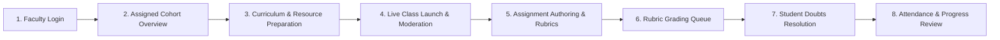
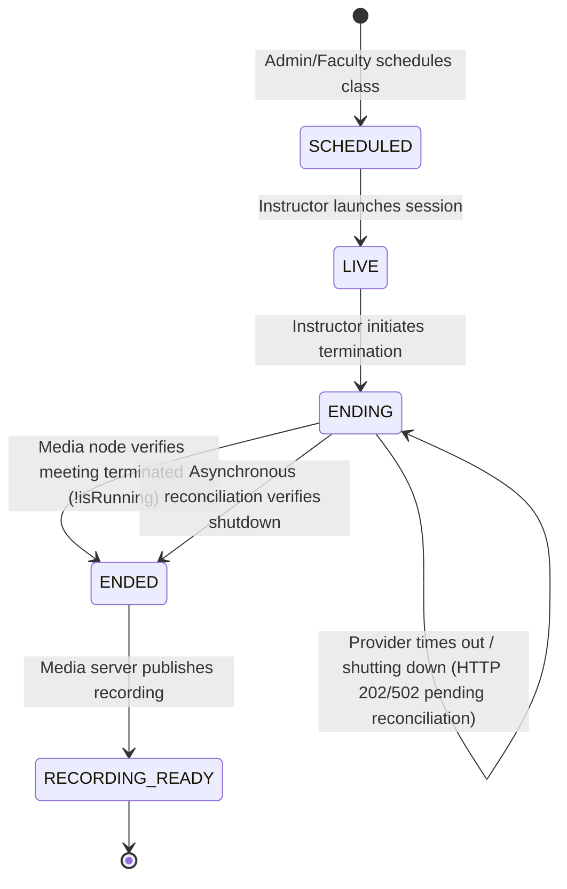
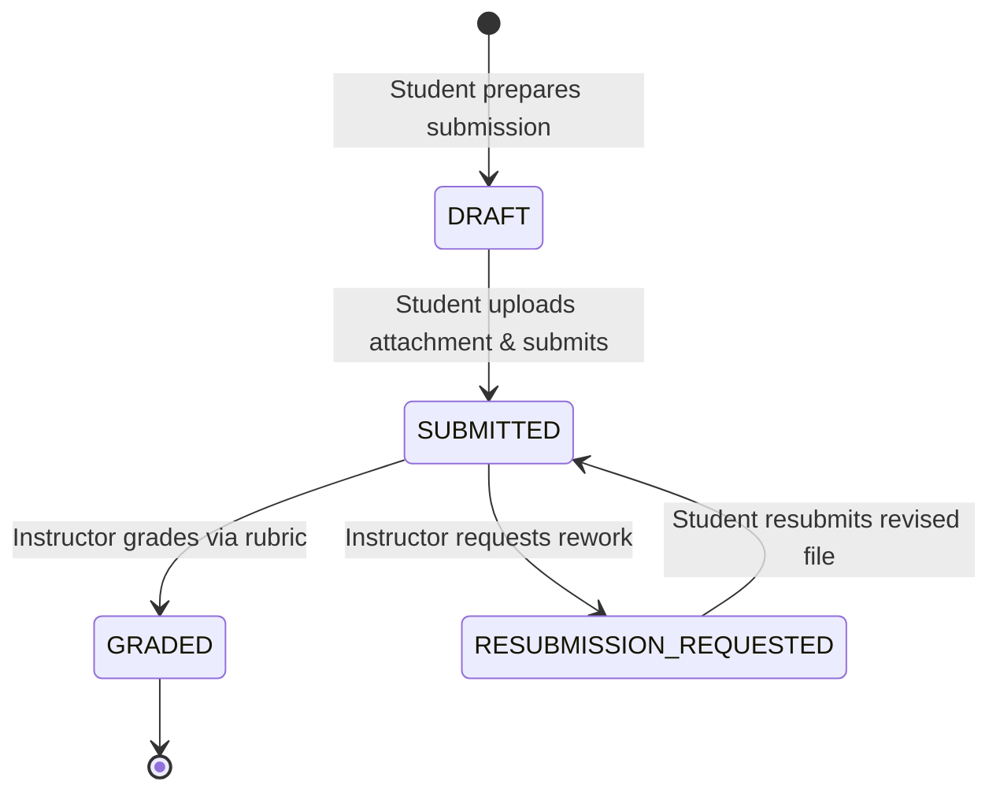
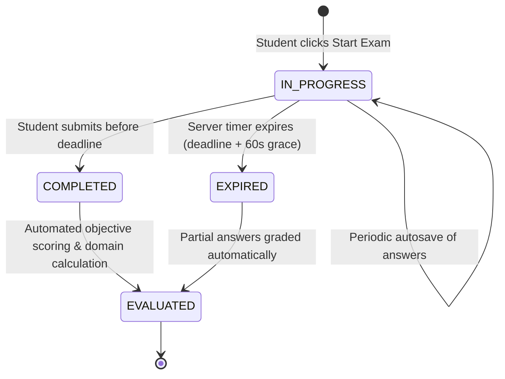
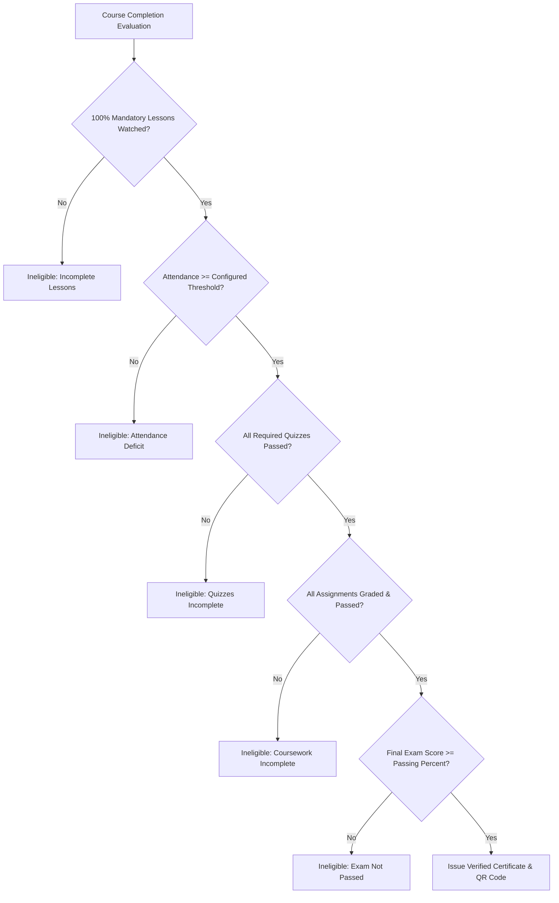
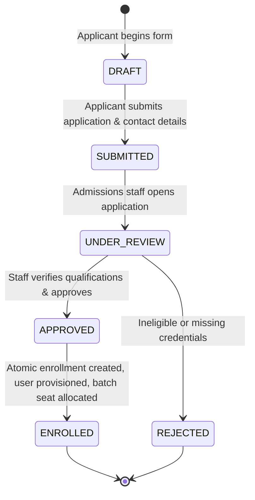
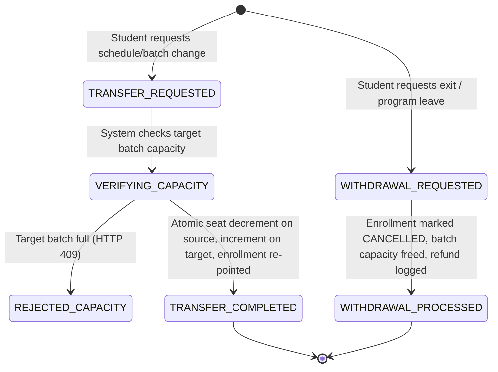

# Zealosh LMS — Master Institutional Workflow Catalog

**Document Version:** 1.1.0  
**Milestone:** ZM-01.1 — Master Blueprint Reconciliation & Phase 1 Core Foundations Implementation  
**Target:** Single Institutional Learning & Certification Platform (`https://zealosh.com`)  
**Brand:** Zealosh Training & Consultants  
**Date:** October 31, 2026  

---

## 1. Primary User Journeys

### 1.1 Student Learning & Certification Journey

```mermaid
flowchart LR
    A[1. Discovery & Application] --> B[2. Enrollment & Cohort Allocation]
    B --> C[3. Course Dashboard & Schedule]
    C --> D[4. Prerecorded & Live Learning]
    D --> E[5. Topic Quizzes & Doubts]
    E --> F[6. Coursework Assignments]
    F --> G[7. High-Stakes Certification Exam]
    G --> H[8. Diagnostic Score Breakdown]
    H --> I[9. Multi-Criteria Completion Evaluation]
    I --> J[10. Certificate Issuance & QR Verification]
```

1. **Discovery & Enrollment:** Student explores course catalog (`/courses/[slug]`), selects preferred cohort/batch, and applies/enrolls.
2. **Dashboard Navigation:** Logs into `/student`, views upcoming live classes, scheduled assignments, and lesson modules.
3. **Prerecorded Streaming:** Streams video lectures (`/learn/[courseId]`), resumes playback from exact timestamp, downloads study slides, and notes questions.
4. **Live Classroom Participation:** Launches live session (`/live/[sessionId]`) on Server 2 (BigBlueButton), interacts via WebRTC, and participates in polls.
5. **Formative Assessment:** Completes topic quizzes after each module, receiving instant automated feedback.
6. **Coursework Submission:** Submits assignment files before due date; views instructor rubric evaluation and actionable feedback.
7. **Certification Examination:** Launches server-timed mock exam simulator (`/exams/[examId]`), submits answers, and receives detailed domain diagnostic report.
8. **Credentialing:** Once all course criteria are met, receives tamper-proof certificate with unique credential ID and public QR verification link.

---

### 1.2 Instructor Academic & Teaching Journey

1. **Cohort Oversight:** Faculty logs into `/instructor`, reviewing assigned batches, enrolled student rosters, and upcoming timetable.
2. **Classroom Moderation:** Launches live classroom with moderator credentials, shares presentation slides, moderates whiteboard, and answers questions.
3. **Session Closure:** Initiates session termination; system transitions session to `ENDING` and confirms provider shutdown before marking `ENDED`.
4. **Assignment Grading:** Reviews student submission attachments in grading queue, applies criterion-by-criterion rubric scores, provides personalized feedback, and requests resubmissions if needed.
5. **Interactive Doubts:** Responds to timestamp-linked student questions on recorded classes (`/recordings/[recordingId]`).

---

### 1.3 Administrator Academic Operations Journey

```mermaid
flowchart LR
    A[1. Admin Login] --> B[2. User & Faculty Provisioning]
    B --> C[3. Academic Structure & Curriculum]
    C --> D[4. Batch Scheduling & Capacity]
    D --> E[5. Admission & Enrollment Approval]
    E --> F[6. Previous-Batch Recording Access]
    F --> G[7. Completion Policy Governance]
    G --> H[8. Institutional Reporting & Audits]
    H --> I[9. Live System Health & Diagnostics]
```

1. **User Management:** Invites new faculty, creates academic accounts, and manages role permissions.
2. **Curriculum Structuring:** Configures courses, modules, topics, delivery modes, and pricing.
3. **Cohort Planning:** Schedules batches with start/end dates, assign lead instructors, and set capacity ceilings.
4. **Cross-Batch Governance:** Authorizes access for students to view recordings from previous batches where permitted.
5. **Operational Health:** Monitors real-time application exceptions, database lock latencies, and webhook ingestion statuses.

---

## 2. Core State Machine Workflows

### 2.1 Live Session Lifecycle State Machine

- **Guardrail:** Join attempts during `ENDING` state are strictly rejected with HTTP 409 (`SESSION_TERMINATING`).

---

### 2.2 Assignment Submission & Grading Lifecycle

- **Concurrency Guard:** Optimistic locking prevents two instructors from concurrently overwriting grades for the same submission.

---

### 2.3 Examination Attempt Lifecycle

- **Server Authority:** Deadline calculation and answer submission cutoffs are enforced exclusively by the server clock. Browser timers are visual countdown aids only.

---

### 2.4 Multi-Criteria Course Completion & Certificate Lifecycle

- **Invariant:** A certificate is never issued if any single mandatory criterion remains unmet. Duplicate certificate issuance on concurrent retries is prevented via database unique constraints on `(user_id, course_id)`.

---

### 2.5 Admissions Application, Review & Atomic Enrollment Lifecycle

- **Concurrency & Capacity Guard:** Upon approval, `enroll_student_atomic` or `db.enrollStudent` locks the batch row, checks `enrolled_count < capacity`, increments the seat count, and links `admissionApplicationId` to the active enrollment.
- **Deduplication:** Applications that are already `APPROVED` or `REJECTED` reject duplicate review attempts with HTTP 409.

---

### 2.6 Student Cohort Transfer & Withdrawal Lifecycle

- **Invariants:** 
  - Transfers between identical source and target batches are rejected.
  - Decrements on source batch are safely bounded to zero.
  - Withdrawals write immutable audit logs and release cohort capacity immediately.

