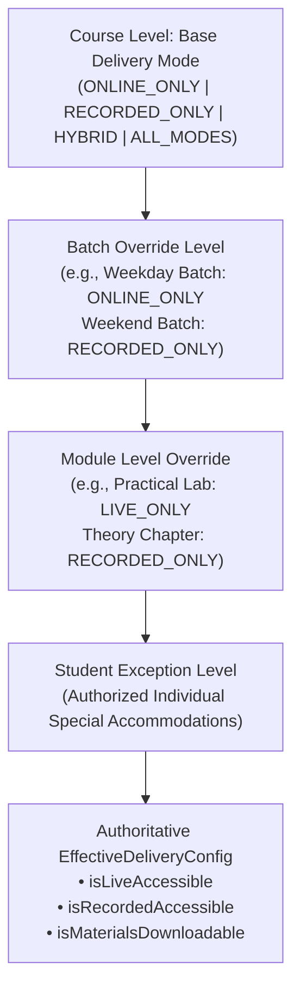

# Zealosh LMS — ZM-02 Learning Delivery Master Specification

**Platform:** Zealosh LMS & Virtual Classroom Platform  
**Institution:** Zealosh Training & Consultants (Kollam, Kerala, India)  
**Milestone Identifier:** ZM-02  
**Engineering Release Date:** October 31, 2026  
**Document Status:** CANONICAL & ARCHITECTURALLY AUTHORITATIVE  
**Target Environment:** Staging & Production (`https://zealosh.com`)

---

## 1. Executive Summary & Purpose

Milestone **ZM-02: Complete Learning Delivery, Course Management, Assessments, Assignments, Prerecorded Learning, Live Classroom Integration & Academic Completion** transforms Zealosh LMS from a foundational administrative platform into a fully connected, high-stakes academic and vocational learning hub.

Zealosh LMS supports three distinct primary instructional delivery modes:
1. **Online-Only (Live Synchronous Cohorts):** Interactive real-time lectures delivered through BigBlueButton with live attendance, pop quizzes, and doubt submission.
2. **Prerecorded-Only (Self-Paced Asynchronous Certification):** Adaptive forensic-watermarked video streaming, cross-device playback resume beacons, timestamped bookmarks, and module assessments.
3. **Hybrid (Blended Synchronous + Asynchronous Delivery):** Live interactive workshops combined with structured prerecorded foundational modules, shared recording highlights, and continuous coursework.

All academic workflows operate strictly under single-institution ownership, enforcing institutional accreditation rules, collision-free monotonic certificate numbering (`ZEI/COURSE/YYYY/XXXXXX`), granular material security (view vs download permissions), and zero leakage of internal third-party engine names.

---

## 2. Delivery Mode Architecture & Inheritance Cascade

### 2.1 The Delivery Cascade Hierarchy

Academic delivery capability is determined dynamically through a deterministic 4-tier inheritance cascade:

$$\text{Course Delivery Default} \longrightarrow \text{Cohort Batch Override} \longrightarrow \text{Module Override} \longrightarrow \text{Student Exception}$$

### 2.2 Effective Capability Rules
- When an entity sets a specific `DeliveryMode`, it selectively enables or disables capabilities:
  - `ONLINE_ONLY`: Live classroom enabled; prerecorded lessons disabled; material downloads restricted by default.
  - `RECORDED_ONLY`: Prerecorded lessons enabled; live classroom disabled; material downloads enabled by default.
  - `HYBRID`: Both live classroom and prerecorded lessons enabled; full coursework active.
  - `ALL_MODES`: Unrestricted access across all instructional vectors.
- Precedence: Any specific override at a lower level completely supersedes higher-level configurations for that scope.

---

## 3. Prerecorded Video Learning & Forensic Protection

### 3.1 Media Security & Adaptive Streaming
- Video streams are served via authenticated, session-validated endpoints (`/api/recordings/[recordingId]/stream` and `/api/courses/[slug]/progress`).
- Learners cannot inspect raw persistent storage URLs or bypass playback controls.

### 3.2 Dynamic Watermarking Engine
- A persistent, floating cryptographic watermark is overlaid dynamically on client video playback canvases (`<WatermarkOverlay />`).
- The watermark displays the authenticated student's full name, institutional email address, user ID, and an encrypted timestamp token.
- Repositioning occurs at randomized intervals to deter screencasting, unauthorized recording, and intellectual property theft.

### 3.3 Multi-Device Playback Resume Beacon
- Video playback position is periodically beaconed to `POST /api/courses/[slug]/progress` with `{ lessonId, playbackPositionSeconds, totalDurationSeconds }`.
- When students resume a lesson on any device (desktop, tablet, mobile PWA), playback automatically resumes within $\pm 2$ seconds of their previous checkpoint.
- Chapters, bookmarks (`[{ timestampSeconds, label }]`), and personal notes are synchronized with the student's central learning progress record.

---

## 4. Learning Materials Library & Granular Permission Governance

### 4.1 Granular Entitlement Matrix
Materials in the Zealosh Learning Library support fine-grained permission flags:
- `allowView`: Determines whether the learner can view the document inline via the integrated PDF/document viewer.
- `allowDownload`: Determines whether the raw binary file can be saved to the client machine.
- `allowPrint`: Controls browser print stylesheets and canvas printing capabilities.
- `watermarkEnabled`: Injects student forensic identifiers into exported document headers.

### 4.2 Batch Delivery Gating
Even if a material record has `allowDownload: true`, if the student's cohort delivery mode specifies `isMaterialsDownloadable: false` (e.g. strict `ONLINE_ONLY` live batches), downloading is server-enforced as blocked with HTTP 403 and message: `"Download disabled under current batch delivery configuration"`.

---

## 5. Unified Question Bank, Quizzes & BigBlueButton Live Sync

### 5.1 Question Bank Hierarchy
Questions belong to academic topics and subtopics, supporting:
- Single Choice, Multiple Choice, True/False, Short Answer, Numerical, and Ordering.
- Formative evaluations: Topic Quizzes, Subtopic Drills, Lesson-End Checkpoints, Practice Drills, and In-Session Live Quizzes.

### 5.2 Anti-Cheat Question Projection
- When student clients query `/api/quizzes/[quizId]`, the server strictly scrubs `correctAnswer` and `explanation` from the payload.
- Only instructors, administrators, and server-side evaluation workers have access to the master answer key.

### 5.3 In-Flight Autosave & Server-Side Scoring
- During quiz attempts, students answer questions incrementally via `PATCH /api/quizzes/[quizId]/attempt`.
- Network drops or accidental reloads preserve in-flight answers in `QuizAttempt.answers`.
- Upon submission, score calculation is performed entirely on the server against authoritative database records.

### 5.4 BigBlueButton Live Quiz Integration
- Instructors launch pre-configured live quizzes directly inside virtual classrooms (`POST /api/quizzes/[quizId]/live` with `action: 'activate'`).
- Live score dashboard (`GET /api/quizzes/[quizId]/live`): instructors inspect real-time participation counts, submitted counts, average score %, question-by-question response breakdown, and individual student rankings.

---

## 6. Coursework, Assignments & Rubric Evaluation

### 6.1 Assignment Lifecycle
1. **Creation:** Instructor publishes assignment with due date, maximum score, and weighted rubric criteria.
2. **Submission:** Student submits text, structured responses, and binary attachments before the deadline.
3. **Evaluation:** Instructor grades submission with criterion-by-criterion rubric scoring and structured feedback.
4. **Revision:** If rework is required, instructors request revisions while preserving submission history.

---

## 7. Multi-Criteria Academic Completion & Certificate Engine

### 7.1 Completion Policy Evaluation
A course completion policy (`CourseCompletionPolicy`) evaluates up to five orthogonal academic requirements:
1. `requiredLessonCompletionPercentage`: Minimum percentage of lessons completed.
2. `requiredLiveAttendancePercentage`: Minimum attendance percentage across scheduled live sessions.
3. `requireAllAssignmentsPassed`: All assigned coursework graded as passed.
4. `requireAllQuizzesPassed`: All formative topic and check quizzes passed.
5. `requireFormalExamPassed`: Passing score achieved on formal HSE certification simulation exam.

### 7.2 Monotonic Collision-Free Certificate Issuance
When all active policy criteria evaluate to `true`, the system automatically issues an official certificate:
- Format: `ZEI/COURSE/YYYY/XXXXXX` (Course Completion) or `ZEI/EXAM/YYYY/XXXXXX` (Exam Certification).
- Sequence numbers increment monotonically within the calendar year with 6-digit zero-padding.
- Operations are fully idempotent: subsequent evaluations for an already certified enrollment return the existing certificate record without duplicating IDs or codes.

### 7.3 Public Verification Gateway
- Public verification is accessible on `https://zealosh.com/verify/[code]` via `/api/certificates/verify/[code]`.
- Displays graduate name, credential title, issue date, aggregate score, and issuing authority without requiring authentication.

---

## 8. Cross-Cohort Knowledge Sharing & Interactive Doubts

### 8.1 Course-Wide Highlights
- While class recordings belong to specific cohort batches, recording highlights (key formula derivations, exam tips, case studies) are aggregated across all cohorts of a course (`db.getCourseHighlights(courseId)`).
- Weekend cohort students can study high-signal topic highlights recorded during weekday masterclasses.

### 8.2 Doubts & Anonymized Knowledge Base Promotion
- Students submit timestamped doubts during video playback or live sessions.
- Instructors provide verified answers and references.
- Instructors can promote high-value clarifications to the global course knowledge base (`promoteDoubtToKnowledgeBase`). The student's private identity is automatically sanitized to `"Verified Student Question"`.

---

## 9. Error Diagnostics & Student Problem Reporting

### 9.1 Central Application Error Logging
- All frontend error boundaries and backend exceptions report to `AppErrorLog` via `/api/diagnostics/errors`.
- Captures stack traces, route/module context, HTTP methods, client user agents, and severity (`DEBUG`, `INFO`, `WARN`, `ERROR`, `FATAL`, `CRITICAL`).
- Administrators manage the resolution lifecycle (`DETECTED` $\rightarrow$ `INVESTIGATING` $\rightarrow$ `RESOLVED` $\rightarrow$ `VERIFIED`).

### 9.2 Student Problem Tickets
- Students submit problem reports directly from the learning interface (`/api/diagnostics/report-problem`).
- The engine generates sequential, year-prefixed ticket identifiers: `REP-YYYY-XXXX` (e.g. `REP-2026-0001`).
- Instructors and administrators assign tickets, update resolution notes, and track learner satisfaction.

