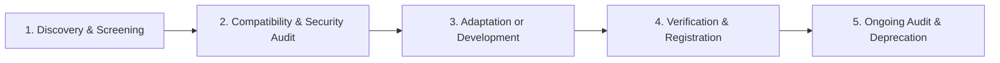

# Zealosh LMS & Antigravity Engineering Intelligence System
## Skill Ecosystem Maintenance, Evolution & Governance Guide

This document governs the operational lifecycle, update cadence, compatibility auditing, deduplication, and deprecation protocols for skills within the Antigravity Engineering Intelligence System.

---

## 1. Skill Lifecycle Management

Every skill in `.agents/skills/` or global `~/.gemini/config/skills/` traverses five formalized stages:



### 1.1 Discovery & Screening Protocol
When evaluating potential new skills (from upstream sources such as `antigravity-awesome-skills`, `gemini-skills`, `agent-skills`, or internal architecture proposals):
1. **Scope Check:** Does the skill address a genuine recurring engineering pattern or problem?
2. **Duplication Audit:** Search `.agents/skills/` and `docs/engineering-skills/inventory.md`. If $\ge 70\%$ of the capability is already covered by an existing skill (e.g., `performance-engineering`, `api-design-and-security`), **reject** or **merge** into the existing skill. Do NOT install parallel or competing skills.
3. **Safety & Security Screening:** Inspect all code samples, commands, and instructions for:
   - Hardcoded tokens or credential exposure.
   - Destructive commands (`rm -rf`, `DROP DATABASE`, `git reset --hard`).
   - Unvetted dependencies or external network fetches.

### 1.2 Compatibility & Packaging Rules
All skills must conform to Google Antigravity discovery conventions:
- **Location:** `.agents/skills/<skill-slug>/SKILL.md` (Workspace-level) or `~/.gemini/config/skills/<skill-slug>/SKILL.md` (Global).
- **Format:** Markdown file with strictly validated YAML frontmatter:
  ```yaml
  ---
  name: <skill-slug>
  description: <Concise 1-2 sentence description explaining purpose, scope, and when to activate>
  ---
  ```
- **Windows / Cross-Platform Compatibility:**
  - Filepaths must use portable forward slashes (`/`) or OS-agnostic conventions.
  - Shell commands must avoid Bash-exclusive constructs when targeting Windows PowerShell environments (e.g., avoid `export`, prefer cross-platform Node/TypeScript scripts).
  - Git executions must invoke proper mingw64 binaries when running under Windows cmd wrappers.

---

## 2. Adding a New Custom Skill

When a verified capability gap is discovered (documented in `docs/engineering-skills/capability-coverage-matrix.md`):

### Step 1: Define the Specification
Create a design outline covering:
- Skill Name (kebab-case slug).
- Primary Purpose and Explicit Scope.
- Trigger Conditions (when to activate) & Negative Triggers (when NOT to activate).
- Step-by-step Execution Protocol.
- Failure Modes & Mitigation.
- Verification Criteria.

### Step 2: Implement `SKILL.md`
Place the file in `.agents/skills/<skill-slug>/SKILL.md`. Adhere to the template:
```markdown
---
name: my-new-skill
description: Comprehensive runbook for [domain]. Use this skill when [activation trigger].
---

# Skill Name

## 1. Purpose & Scope
[Clear boundary definition]

## 2. Activation Triggers & Anti-Triggers
- Activate when: ...
- DO NOT activate when: ...

## 3. Step-by-Step Execution Workflow
[Actionable senior engineer instructions]

## 4. Safety & Verification Standards
[Validation requirements, tests to run]
```

### Step 3: Register in the Router & Documentation
1. Add entry to [`.agents/skills/engineering-skill-router/SKILL.md`](file:///c:/Users/alexc/.gemini/antigravity-ide/scratch/zealosh-lms/.agents/skills/engineering-skill-router/SKILL.md) in Section 4 (Routing Matrix) and Section 6 (Registry).
2. Update [`docs/engineering-skills/inventory.md`](file:///c:/Users/alexc/.gemini/antigravity-ide/scratch/zealosh-lms/docs/engineering-skills/inventory.md) with ID, status, and classification.
3. Update [`docs/engineering-skills/capability-coverage-matrix.md`](file:///c:/Users/alexc/.gemini/antigravity-ide/scratch/zealosh-lms/docs/engineering-skills/capability-coverage-matrix.md) mapping relevant items to the new skill.
4. Add routing test scenario in [`scripts/skill-validation/routing-scenarios.test.ts`](file:///c:/Users/alexc/.gemini/antigravity-ide/scratch/zealosh-lms/scripts/skill-validation/routing-scenarios.test.ts).

### Step 4: Verify
Run the validation suite:
```powershell
npx vitest run scripts/skill-validation/routing-scenarios.test.ts
```
Confirm all scenarios pass with 100% green exit code.

---

## 3. Updating and Versioning Existing Skills

When updating a skill:
1. **Preserve Architectural Consistency:** Do not introduce instructions that contradict the 8 Non-Negotiable Engineering Principles (Inspect before edit, Reuse before rebuild, Minimal implementation, Root-cause debugging, Database integrity, etc.).
2. **Never Weaken Security Controls:** Never remove tenant isolation guards, CSRF protections, or authorization checks to make an implementation "easier."
3. **Changelog Tracking:** For major updates, append a brief entry to the bottom of the skill's markdown file or record in the documentation package.

---

## 4. Conflict Resolution & Precedence

When two skills provide potentially conflicting advice (e.g., a rapid prototyping suggestion vs. strict database migration safety), the agent MUST apply the strict 8-level precedence order:

| Priority | Level | Description |
|:---|:---|:---|
| **P1** | Platform & System Safety | Hard OS, container, and file isolation boundaries |
| **P2** | Explicit User Instructions | Direct user constraints specified in the prompt |
| **P3** | Security & Tenant Isolation | Row-Level Security, OWASP standards, authentication contracts |
| **P4** | Data Integrity & Schema Safety | Zero data loss, non-destructive migration expand/contract patterns |
| **P5** | System Architecture & Contracts | Hexagonal boundaries, API schemas, authoritative PostgreSQL store |
| **P6** | Empirical Performance | Measured benchmarks over speculative micro-optimizations |
| **P7** | Minimal Implementation & Reuse | Anti-duplication, zero redundant dependencies, clean architecture |
| **P8** | Convenience, Formatting & Style | Aesthetic preferences, syntactical sugar |

**Rule:** A lower-priority guideline (e.g., convenience or speed) CANNOT override a higher-priority safeguard (e.g., Data Integrity or Security).

---

## 5. Deprecating & Pruning Obsolete Skills

To keep the ecosystem lean and prevent token bloat:
1. **Identification:** Run quarterly or milestone audits. Identify skills that:
   - Have zero activations across 30+ completed tasks.
   - Rely on deprecated third-party libraries or superseded runtime APIs.
   - Have had their core capabilities absorbed into a broader foundational skill.
2. **Deprecation Notice:** Mark the skill's YAML description with `[DEPRECATED: Use <target-skill> instead]`.
3. **Router Removal:** Remove routing triggers from `engineering-skill-router/SKILL.md`.
4. **Safe Archival:** Move the folder to an archive or delete after verifying no pending prompts reference it.
5. **Verification:** Re-run `npx vitest run scripts/skill-validation/routing-scenarios.test.ts`.

---

## 6. Anti-Duplication Enforcement Checklist

Before creating any file or component:
- [ ] Searched codebase with `grep_search` / ripgrep for existing keywords.
- [ ] Checked `docs/engineering-skills/inventory.md` for existing modules.
- [ ] Evaluated extending an existing utility instead of adding a new one.
- [ ] Checked if native Node.js / React / Next.js / PostgreSQL primitives solve the issue without a new package.
- [ ] Confirmed no parallel state stores or duplicate API clients will be generated.
