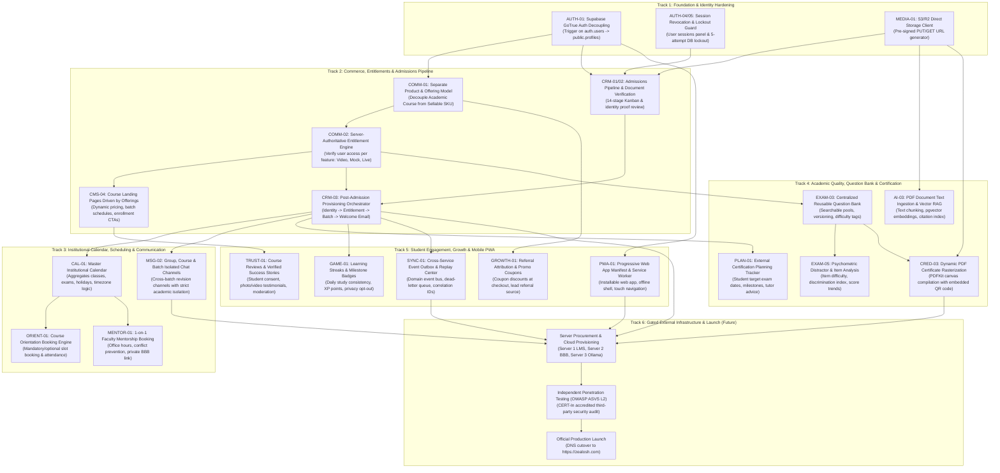

# Zealosh LMS — Master Development Dependency & Precedence Map

**Project:** Zealosh Training & Consultants — Zealosh LMS  
**Milestone:** ZM-IMPL-08A — Complete Product Scope Audit, Functional Gap Analysis & Remaining Development Roadmap  
**Scope:** Topological Ordering of Technical Dependencies Across All Remaining Product Workstreams  
**Date:** November 2026  
**Status:** APPROVED ARCHITECTURAL SPECIFICATION  

---

## 1. Principles of Dependency Ordering

In accordance with **Engineering Constitution Rule 1 (Inspect Before Implementing)** and **Rule 3 (Minimal Sufficient Implementation)**:
1. **Foundation Before Features:** Security boundaries, data models, and authoritative entities must be locked before building user interfaces or secondary automation.
2. **Entitlements Before Commerce:** The platform must define what granular access rights a product represents before selling multiple SKUs.
3. **Admissions Before Provisioning:** Admissions eligibility workflows must be complete before automating post-payment student provisioning.
4. **Calendar Before Mentorship:** A unified calendar and conflict-detection engine must exist before scheduling 1-on-1 faculty office hours or student orientations.
5. **Software Complete Before Hardware Procurement:** All 20 application domains must be locally verified and code-complete before initiating cloud server purchasing or staging deployment.

---

## 2. Global Development Dependency Graph

---

## 3. Strict Precedence Rules & Non-Negotiable Gate Constraints

1. **Rule P1: Entitlement Gate before Commerce Checkout:**
   No multi-tier pricing tables or course package checkouts may be released without `COMM-02` (Server-Authoritative Entitlement Engine) active in middleware. A student purchasing a "Video Only" SKU must be programmatically barred from live WebRTC classroom tokens and high-stakes mock exams.

2. **Rule P2: Post-Admission Provisioning Resumability:**
   Post-admission provisioning (`PROV_01`) must be implemented as an idempotent state machine with a dead-letter queue. If an email notification fails during student onboarding, retrying must NOT duplicate user profiles, batch roster seats, or financial invoices.

3. **Rule P3: Messaging Academic Isolation:**
   When cross-batch revision chat channels (`MSG_02`) are implemented, messaging channel membership must NEVER be used to determine academic course access or grade visibility.

4. **Rule P4: Complete Software Development Before Infrastructure Procurement:**
   The entire application code (Tracks 1 through 5) must pass 100% of unit, integration, and Playwright tests locally before authorizing cloud server purchasing, hosting sign-ups, or staging deployment.

