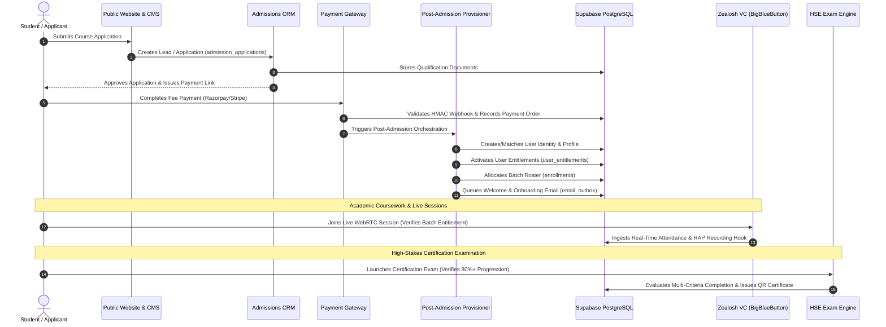

# Zealosh LMS — Master Domain Ownership & Entity Model Map

**Project:** Zealosh Training & Consultants — Zealosh LMS  
**Milestone:** ZM-IMPL-08A — Complete Product Scope Audit, Functional Gap Analysis & Remaining Development Roadmap  
**Scope:** Authoritative Entity Ownership, Data Boundaries & Single-Source-of-Truth Architecture  
**Date:** November 2026  
**Status:** APPROVED ARCHITECTURAL SPECIFICATION  

---

## 1. Single Source of Truth Invariant

In accordance with **Engineering Constitution Rule 7 (Database Integrity is Mandatory)** and **ADR-004**, **Supabase PostgreSQL** is the sole authoritative master of record for all business data belonging to **Zealosh Training & Consultants**.

- **No Split Sources of Truth:** There are no secondary shadow databases. 
- **Single-Institution Isolation:** All primary entities include `organization_id` defaulting to `'org-zealosh-main'`. Multi-tenant SaaS logic is prohibited.
- **Fail-Closed Persistence:** When `DATABASE_STORAGE="supabase"`, mutations are persisted to PostgreSQL with zero silent fallback to mock in-memory stores.

---

## 2. Master Domain Ownership Matrix

| Domain | Entity / Table Name | Master Database Table | Owning Subsystem | Authoritative Service / Adapter | Primary API Endpoints | Consumer Modules | Audit Logged? | Row-Level Security (RLS) Policy |
| :--- | :--- | :--- | :--- | :--- | :--- | :--- | :---: | :--- |
| **Identity** | User & Profile | `public.profiles`, `auth.users` | LMS Auth Service | `src/lib/auth/`, `src/lib/supabase/` | `/api/auth/*`, `/api/users/profile` | All Modules | Yes | Users read/update own; Super Admin full access |
| **Identity** | Roles & Permissions | `public.roles`, `public.user_roles` | Security RBAC | `src/lib/store/db.ts` | `/api/admin/config/roles` | Middleware, Route Guards | Yes | Read-only for authenticated; Super Admin write |
| **Academic** | Academic Hierarchy | `academic_years`, `departments`, `programmes` | Academic Core | `src/lib/store/supabase-adapter.ts` | `/api/admin/academic/*` | Course Builder, Catalog | Yes | Public read published; Staff write |
| **Academic** | Course & Syllabus | `public.courses`, `public.modules`, `topics`, `subtopics` | Course Service | `src/lib/store/supabase-adapter.ts` | `/api/courses/*`, `/api/admin/courses` | Student Hub, Public CMS, Catalog | Yes | Enrolled students read; Course Manager write |
| **Academic** | Cohort & Batch | `public.batches`, `batch_instructors` | Cohort Engine | `src/lib/store/supabase-adapter.ts` | `/api/admin/batches/*`, `/api/batches/*` | Live Classroom, Attendance | Yes | Enrolled students read; Staff write |
| **Academic** | Delivery Config | `public.delivery_configurations` | Delivery Engine | `src/lib/store/supabase-adapter.ts` | `/api/courses/[slug]/delivery` | Student Player, Classroom | Yes | Read-only for learners; Course Manager write |
| **Learning** | Prerecorded Progress | `public.learning_progress` | Progress Service | `src/lib/store/supabase-adapter.ts` | `/api/courses/[slug]/progress` | Student Dashboard, Completion | Yes | Student writes own progress via beacon; Faculty read |
| **Learning** | Teaching Materials | `public.learning_materials` | Material Hub | `src/lib/store/supabase-adapter.ts` | `/api/materials/*` | Classroom, Student Hub | Yes | Enrolled batch read upon release; Instructor write |
| **VC / Media** | Live Session | `public.live_sessions` | Virtual Classroom | `src/lib/classroom/`, `src/lib/store/` | `/api/live/*`, `/api/classroom` | Student Hub, BBB Host | Yes | Enrolled batch read; Assigned Instructor write |
| **VC / Media** | Attendance Record | `public.attendance_records` | Attendance Engine | `src/lib/store/supabase-adapter.ts` | `/api/live/[sessionId]/attendance` | Reports, Completion Engine | Yes | System webhook writes; Student reads own; Admin reads all |
| **VC / Media** | Class Recording | `public.class_recordings`, `recording_batch_access` | Recording Service | `src/lib/storage/recording-storage.ts` | `/api/recordings/*`, `/api/webhooks/bbb/recording` | Student Hub, Archive | Yes | Enrolled batch streams with signed token; Staff manage |
| **Assessment**| Exam Blueprint | `public.exam_blueprints` | Exam Engine | `src/lib/store/supabase-adapter.ts` | `/api/exams`, `/api/admin/exams` | Exam Simulator, Admissions | Yes | Super Admin / Exam Reviewer write; Student read active |
| **Assessment**| Exam Questions | `public.exam_questions` | Question Service | `src/lib/store/supabase-adapter.ts` | `/api/admin/exams/questions` | Exam Simulator, Quizzes | Yes | Answer keys hidden from students; Reviewers write |
| **Assessment**| Exam Attempt | `public.exam_attempts`, `frozen_snapshots` | Exam Proctor | `src/lib/store/supabase-adapter.ts` | `/api/exams/[id]/start`, `/submit` | Student Hub, Certificates | Yes | Student writes own; Answers frozen upon start |
| **Assessment**| Topic Quizzes | `public.quizzes`, `quiz_questions`, `quiz_attempts` | Quiz Service | `src/lib/store/supabase-adapter.ts` | `/api/quizzes/*` | Student Hub, Completion | Yes | Enrolled students attempt; Immediate auto-scoring |
| **Assessment**| Coursework Assignment| `public.assignments`, `assignment_submissions` | Grading Queue | `src/lib/store/supabase-adapter.ts` | `/api/assignments/*` | Student Hub, Instructor UI | Yes | Student submits own; Assigned Instructor grades |
| **Credential**| Course Completion | `course_completion_policies`, `completion_evaluations` | Completion Engine| `src/lib/store/supabase-adapter.ts` | `/api/student/progression/*` | Student Hub, Certificates | Yes | Server evaluates rules; Student reads own status |
| **Credential**| Certificate Record | `public.certificates` | Certificate Hub | `src/lib/store/supabase-adapter.ts` | `/api/certificates/*`, `/verify/[code]`| Student Portal, Public Verify| Yes | Public QR verification; Super Admin can revoke |
| **Commerce** | Product Offering *(New)*| `public.products`, `product_offerings` | Commerce Core | *To be implemented in 08C* | `/api/products/*`, `/api/offerings/*` | Course CMS, Checkout | Yes | Public read active; Finance/Admin write |
| **Commerce** | Entitlement *(New)* | `public.user_entitlements` | Entitlement Engine| *To be implemented in 08C* | `/api/entitlements/*` | Route Guards, Player, Exams | Yes | Server checks feature flags per user; Finance write |
| **Finance** | Payment Order | `public.payment_orders` | Payment Gateway | `src/lib/store/supabase-adapter.ts` | `/api/payments/order`, `/webhook` | Checkout, Admissions | Yes | Authenticated order creation; Webhook updates |
| **Finance** | Tax Invoice | `public.invoices`, `invoice_credit_notes` | Invoicing Service | `src/lib/store/supabase-adapter.ts` | `/api/invoices/*`, `/api/admin/refunds`| Student Hub, Accounting | Yes | Student reads own; Finance Officer manages |
| **Admissions**| Application & Leads | `admission_applications`, `application_documents` | Admissions CRM | `src/lib/store/supabase-adapter.ts` | `/api/admissions/*`, `/api/admin/admissions`| Public Website, Admin CRM | Yes | Applicant submits; Admissions Staff review |
| **Messaging** | Direct & Channels | `direct_messages`, `messaging_channels` | Messaging Hub | `src/lib/store/supabase-adapter.ts` | `/api/messages/*` | Chat Drawer, Student Hub | Yes | Members read/write; Non-members strictly denied |
| **Operations**| Support Tickets | `support_tickets`, `support_ticket_messages` | Support Desk | `src/lib/support/support-service.ts` | `/api/support/*`, `/api/admin/support/*`| Student Portal, Staff Desk | Yes | Student reads public messages; Internal notes staff-only |
| **Operations**| Email Outbox | `public.email_outbox`, `email_delivery_events` | Outbox Dispatcher| `src/lib/store/supabase-adapter.ts` | `/api/admin/email/*`, `/api/webhooks/email`| Background Worker | Yes | System worker processes; Admin inspects status |
| **CMS** | Dynamic Pages | `cms_pages`, `cms_page_versions`, `cms_page_nodes` | CMS Service | `src/lib/store/supabase-adapter.ts` | `/api/cms/*`, `/p/[...slug]` | Public Website, PageBuilder | Yes | Public reads published; CMS Editor writes |
| **AI** | Tutor Sessions | `public.ai_tutor_sessions`, `ai_tutor_messages` | Zealosh AI | `src/lib/ai/`, `src/lib/store/` | `/api/ai-tutor/*` | Student Hub, Course Page | Yes | Student reads own chat; Server 3 processes prompts |
| **Diagnostics**| Errors & Telemetry | `app_error_logs`, `diagnostic_issues`, `events` | Diagnostics Engine| `src/lib/store/supabase-adapter.ts` | `/api/diagnostics/*`, `/admin/diagnostics`| Admin Dashboard | Yes | Append-only events; Blocked UPDATE/DELETE triggers |

---

## 3. Cross-Subsystem Event Flow Architecture

